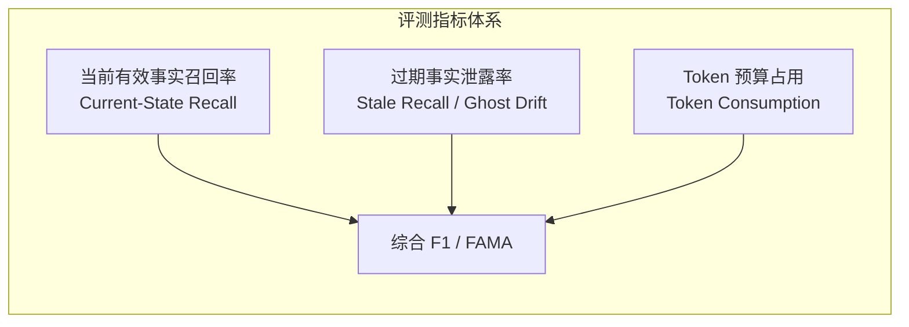

# Gated-Mem 评测基准、公开数据集与跑分成本核算指南

本文档为 [`gated_mem.md`](gated_mem.md) 落地后的**基准测试（Benchmark）、公开数据集、评测框架与成本核算**提供完整实操方案。

---

## 1. 核心评估痛点与评测维度

传统的 RAG 评测（如 MS MARCO、NQ、HotpotQA）通常测试的是“静态知识检索能力”，**完全不适合测试 Gated-Mem**。
Gated-Mem 的核心技术壁垒是：
1. **状态覆盖与过期抑制（State Superseding）**：新事实覆盖旧事实后，旧事实是否被连坐压制，还是会被余弦相似度“僵尸复活”？
2. **时间衰减与自然遗忘（Temporal Decay）**：低价值临时观察是否平滑淡出，高价值架构决策是否持续在线？
3. **深层结构残差直达（Shortcut Recall）**：第 3+ 层的细化高频规则能否在低 Token 预算下被无损带出？

因此，必须选用针对 **“长程对话状态演进（State Tracking & Temporal Memory）”** 的专用基准。

---

## 2. 推荐公开数据集与基准平台

| 基准名称 | 对应论文 / 来源 | 核心评测目标 | 样本规模 | 契合度与注意事项 |
| :--- | :--- | :--- | :--- | :--- |
| **StateMemBench** | [arXiv:2608.19652](https://arxiv.org/abs/2608.19652) | **状态更新、过期状态隔离、新旧冲突抑制** | 234 个连续状态演进场景，322 个探测探针 (Probes) | ⭐⭐⭐⭐⭐ **最高契合度**。 专门测试系统能否在注入时丢弃被覆盖的旧配置，仅保留当前最新有效事实。 |
| **Memora** | [ACL Findings / GitHub](https://github.com/geniesinc/Memora) | **记忆持久化与遗忘曲线测量（FAMA 指标）** | - Weekly: 150 题 - Quarterly: 300 题 | ⭐⭐⭐⭐⭐ **官方标准遗忘集**。 提供官方评估指标 FAMA（Fact Absence/Presence Accuracy），测试有目的遗忘与无损召回。 |
| **LoCoMo** | [ACL 2024 Long-term Conversational Memory] | **超长对话实体状态随时间变化** | 多个长会话（涵盖更新、因果、时序推断） | ⭐⭐⭐⭐ **通用对话级补充**。 测试跨越数十轮交互后，用户习惯和项目约束的状态变迁。 |
| **FreshQA / TempCompass** | 动态时效事实评测 | **时序推理与时间衰减有效性** | 600+ 动态变动问答对 | ⭐⭐⭐ **时序演进验证**。 测试对时间敏感事实的衰减和置信度调整。 |
| **SWE-bench Lite (长任务微调版)** | 实际代码工程任务 | **端到端编码 Agent 决策质量** | 300 个真实 GitHub Issue 解决任务 | ⭐⭐⭐⭐ **终极业务端验收**。 挂接 Claude Code Hooks 测试开启 Gated-Mem 后的代码通过率 (Resolve Rate)。 |

---

## 3. 评测指标设计（拒绝单一准确率）

为了证明 Gated-Mem 相比普通向量检索（Naive Vector + Top-K）的优越性，建议报告以下指标矩阵：

1. **当前状态准确率（Current-State Accuracy / Presence Score）**：
   * 在发生覆盖后，针对该主题提问，模型依据最新事实回答正确的比例（目标：相比无状态基线相对提升 $\ge 10\%$）。
2. **过期事实泄露率（Stale Recall / Superseded Leakage Rate）**：
   * 已经被置为 `superseded` 的旧配置出现在输出门或导致回答错误的比例（目标：相对下降 $\ge 30\%$，Gated-Mem 依靠连坐坍缩 $\psi=0.15$ 应接近 $0\%$）。
3. **深层规则残差召回率（Shortcut Recall）**：
   * 挂载在第 3+ 层的高频核心单测/隔离规则在同等 800 Token 预算下被正确注入的概率。
4. **Token 压缩比（Budget Efficiency）**：
   * 达到相同任务准确率时，Gated-Mem 注入上下文所消耗的平均 Token 数（应当低于全量平铺注入）。

---

## 4. 跑分成本核算清单（分档预算）

跑分过程的算力与资金开销分为两大部分：**记忆引擎自身成本** 与 **测试调用（LLM API）成本**。

### 4.1 记忆引擎运行成本（全部为 0）
* Gated-Mem 的核心（SQLite3 状态机 + 本地 Embedding 如 `bge-small`）完全在开发机 CPU 运行。
* **数据 Ingest 成本**：**$0.00**（无云端数据库，无 API 调用）。

### 4.2 跑分评测 LLM 费用（生成回答 + Judge 打分）

评测流程通常是：
1. 将数据集注入 Gated-Mem；
2. 针对 Probe 探针提问，由**生成模型（Generator）**基于注入上下文输出答案；
3. 由**评判模型（Judge）**比对标准答案并打分。

| 跑分方案 | 采用模型配置 | 适用场景 | 单次完整基准测试成本 (StateMemBench 322 题 + Memora 450 题) |
| :--- | :--- | :--- | :--- |
| **方案 A：极客纯白嫖（$0 元）** | 本地 Ollama 部署 `Qwen2.5-7B` 做生成，`Qwen2.5-14B/32B` 做 Judge | 日常单测、功能自测、逻辑消融调试 | **¥0.00 / $0.00** (仅消耗本地电费，无需联网) |
| **方案 B：高性价比主力（推荐）** | **DeepSeek-V3** (或 Qwen-Plus) 作为生成与 Judge | 阶段性里程碑汇报、参数网格调优、横向对比消融 | **约 ¥1.5 ~ ¥4.0 元 RMB** (约 **$0.2 ~ $0.6 美元**，超高精度且极便宜) |
| **方案 C：国际主流标准（小模型）** | **GPT-4o-mini** | 与海外开源基准（如 MemGPT 对比）公开对齐 | **约 $0.3 ~ $0.8 美元** |
| **方案 D：学术论文 / 商业发布级** | **Claude 3.5 Sonnet** 或 **GPT-4o** 做 Judge，DeepSeek-V3 做生成 | 最终对外发文章、技术报告、顶级基准刷榜 | **约 $3.0 ~ $8.0 美元** |

> **预算小结**：完成项目计划中的完整实验设计（包含 3 次重复试验以计算 95% 置信区间 CI），使用 **DeepSeek-V3** 方案的总预算**不超过 20 元人民币**；使用纯本地模型则为 **0 元**。

---

## 5. 建议的落地跑分流程（三步走）

1. **Step 1：本地快速流水线（Day 5 冒烟验收）**
   * 使用自定义的 `fixtures/state_conflict_cases.json`（约 50 对手写冲突与覆盖样例）。
   * 采用纯本地 Python 脚本跑规则断言（检查 SQLite 中事件表与状态表），无需调用大模型，验证核心连坐逻辑。

2. **Step 2：公开基准 StateMemBench + Memora 快速跑分（阶段 B）**
   * 下载 StateMemBench 的 322 个 Probes。
   * 配置两组对照组：
     - **Baseline**：经典 Top-K 向量检索（新近度 + 纯余弦相似度，无状态覆盖）。
     - **Gated-Mem**：双阶段裁决 + 连坐坍缩 + 结构残差。
   * 接入 DeepSeek-V3 API 计算两组的 `Current-State Accuracy` 与 `Stale Leakage Rate`。

3. **Step 3：Claude Code 真实会话插桩统计（阶段 C）**
   * 挂载在 Claude Code 上，统计一周内 30+ 真实会话的 `Explain Receipt` 拦截日志，统计真正避免的代码误写次数。
