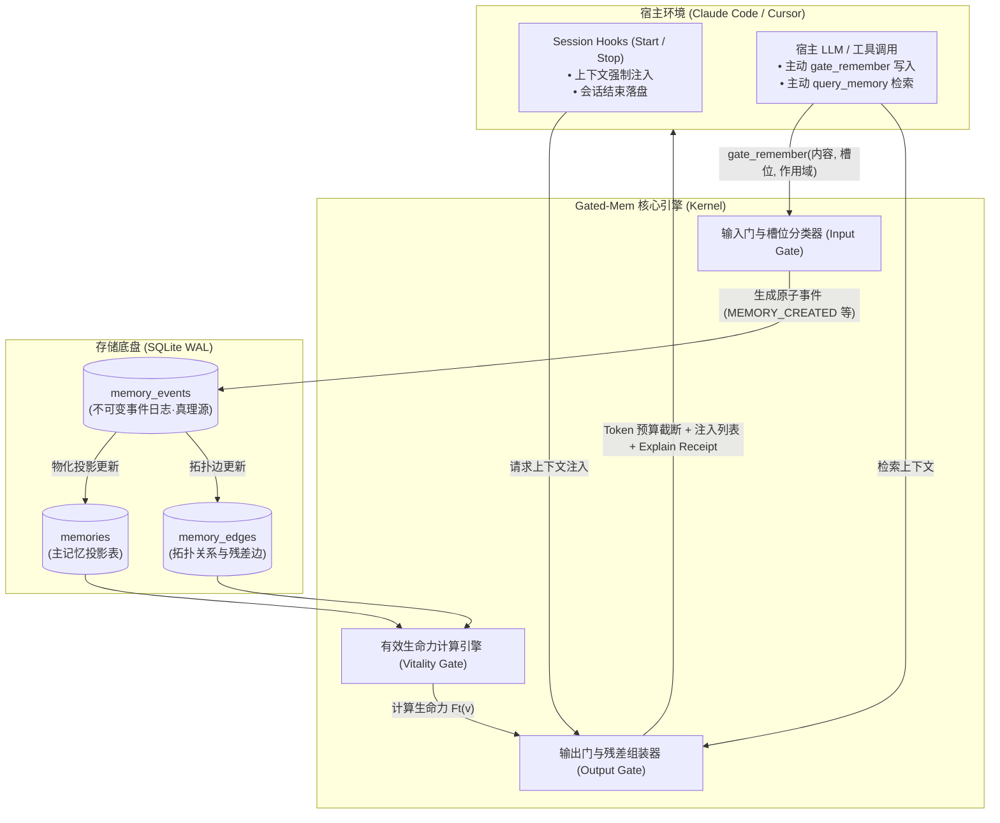
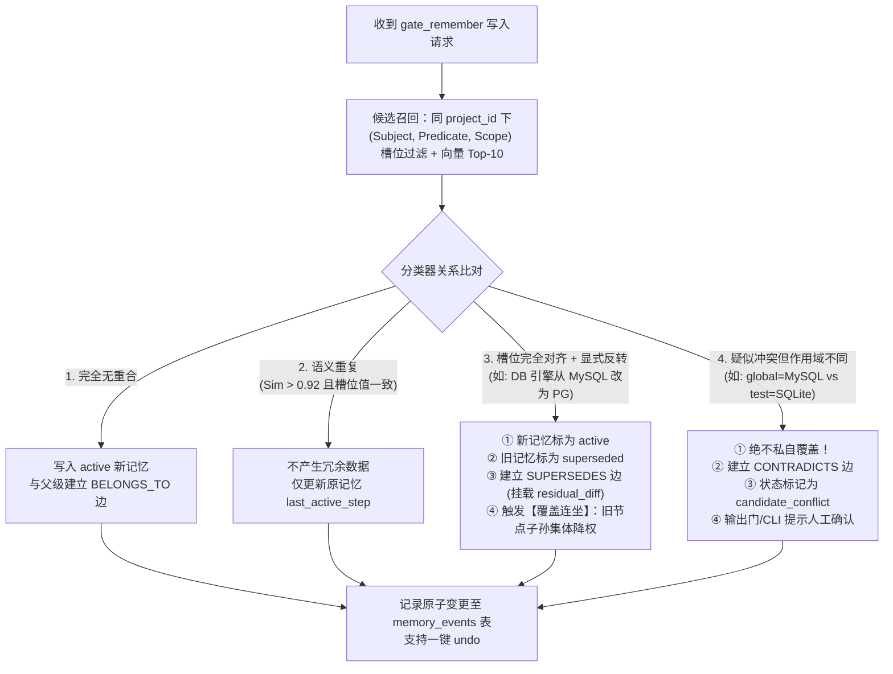
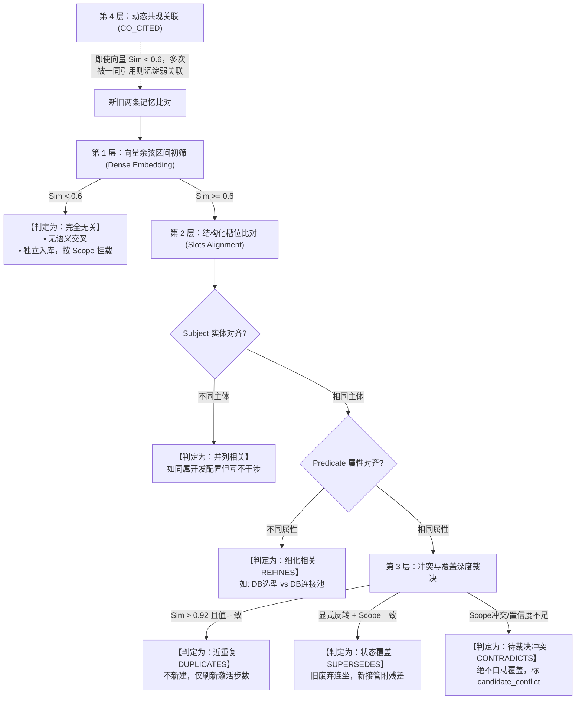
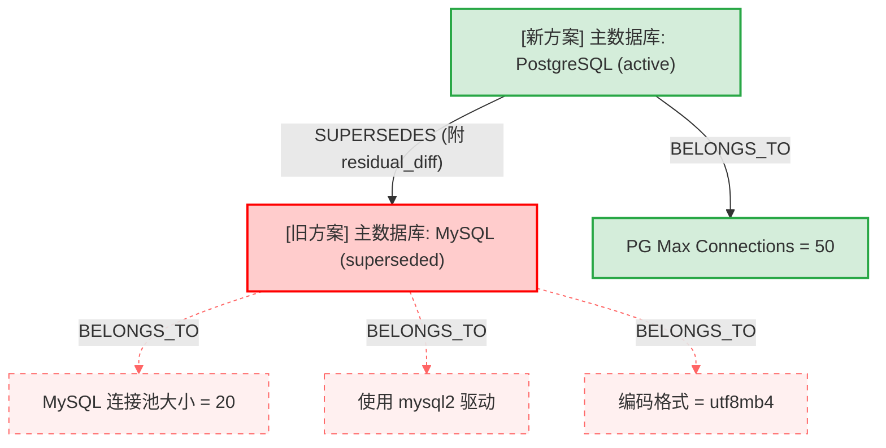
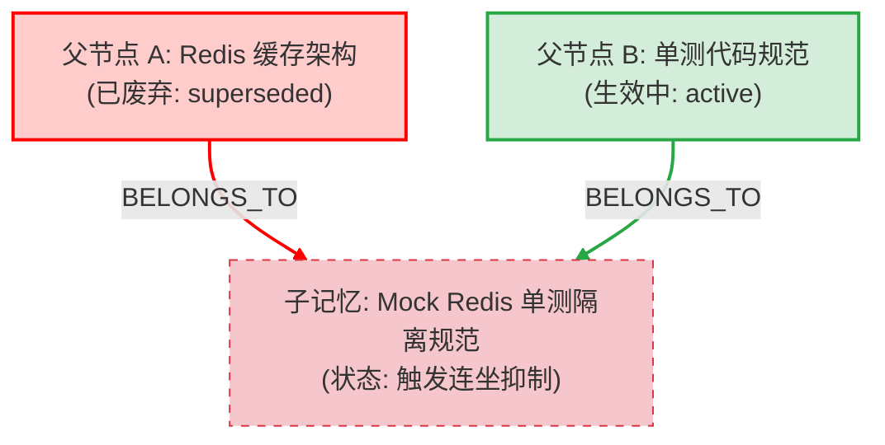
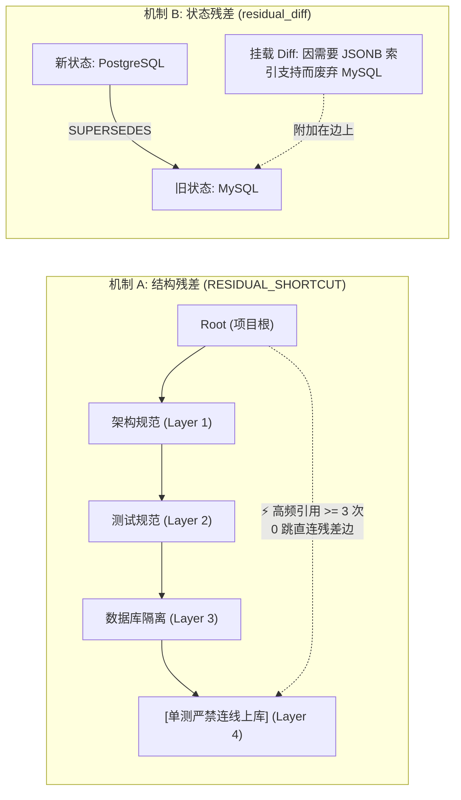
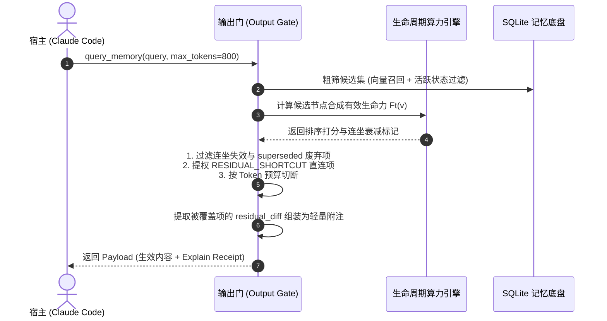
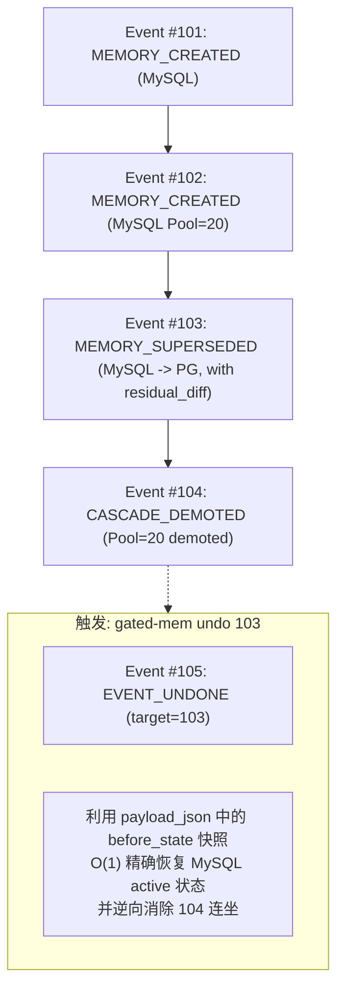

# Gated-Mem 架构与核心工作流深度全解

> 本文针对 [`gated_mem.md`](gated_mem.md) 进行系统化解构，梳理其面向 Agent（如 Claude Code / Cursor）的“事件溯源 + 门控级联 + 残差记忆图谱”设计原理与具体运转机制。

---

## 1. 为什么设计 Gated-Mem？（痛点与核心定位）

传统 Agent 记忆方案（纯向量检索 / RAG）在真实开发场景中存在三个致命短板：
1. **过期污染（Stale Contamination）**：架构或技术栈变更后（例如“从 MySQL 迁移到 PostgreSQL”），由于向量相似度极高，旧记忆（MySQL 连接池配置）依然会被误捞出来，诱导 Agent 写出冲突代码。
2. **误杀与黑盒删除（Destructive Deletions）**：盲目使用语义距离进行覆盖或删除，一旦删错不可追溯、不可回滚。
3. **深层规则断层（Hierarchical Loss）**：挂载在深层节点中的重要约束（如“测试环境严禁直连生产库”），容易在树状分级检索中因为跳数太深而被截断。

**Gated-Mem 的核心解法**：
不使用昂贵的神经网络实时推理，而是借用 **LSTM 门控机制** 的思想，结合 **事件溯源（Event Sourcing）**、**结构化槽位比对（Slot Alignment）**、**覆盖连坐（Cascade Demotion）** 与 **双重残差（Dual Residuals）**，在 `< 1ms` 纯数学与 SQLite 查询内完成高精度、可回滚、防污染的记忆管理。

---

## 2. 总体架构与数据流全景

Gated-Mem 采用 **Hooks + MCP + 单文件 SQLite (WAL 模式)** 的轻量解耦架构：



---

## 3. 工作流一：写入与两阶段冲突裁决（防误杀机制）

当宿主发起 `gate_remember(...)` 请求时，系统严格执行**两阶段决策**，彻底告别单纯依赖余弦相似度导致的“同义词误覆盖”或“不同作用域误伤”。

### 3.1 槽位四要素定义
* **Subject（实体）**：例如 `Database`、`AuthService`、`Linter`
* **Predicate（属性槽位）**：例如 `primary_engine`、`token_expiry`、`config_file`
* **Scope（作用域）**：例如 `global`、`backend`、`e2e_test`
* **Memory Type**：`decision`（架构决策）、`constraint`（硬约束）、`preference`（编码风格）、`observation`（环境观察）

### 3.2 写入判定决策树



### 3.3 记忆层级与边关系的具体判定规则

在 Gated-Mem 中，记忆的**层级（Depth）**与**关联（Edges）**完全由**结构化槽位（Slots）**与**拓扑边类型**共同决定，杜绝黑盒向量直接拍脑袋：

#### A. 层级（Depth）的判定规则
* **虚拟根节点 `ROOT`**：代表整个项目或顶级命名空间（$\text{Depth}=0$）。
* **基于 `BELONGS_TO` 边的拓扑距离**：
  节点的物理层级等于它沿 `BELONGS_TO` 边追溯到 `ROOT` 的最短有向跳数：
  * **第 1 层（顶级架构/全局规范）**：作用域为 `Scope: global` 或直接挂载在 `ROOT` 下的核心决策（如“技术栈选型”）。
  * **第 2 层（子模块/服务层级）**：例如 `Scope: backend` 或 `Scope: auth_service`。
  * **第 3+ 层（具体规则/参数叶子）**：例如 `Scope: backend.database.pool` 下的具体连接池设置、单测断言规则。
* **逻辑 0 跳穿透**：当深层节点形成 `RESIDUAL_SHORTCUT` 时，在检索算法中获得逻辑 $\text{Depth}=0$ 的直通特权，但不改变物理语义树的 `BELONGS_TO` 结构。

#### B. 六类核心关联边（Edge Types）的建立判定矩阵

| 边类型 | 建立判定标准（由什么决定） | 产生的系统级影响 |
| :--- | :--- | :--- |
| **`BELONGS_TO`**<br>(归属与层级) | **由写入时的 `Scope` 作用域路径或父节点 ID 显式决定**。<br>若无指定父级则默认归属于对应作用域或 `ROOT`。 | 构建层级树/DAG，传递正向扩散增益与逆向连坐坍缩。 |
| **`SUPERSEDES`**<br>(状态覆盖) | **三槽严格对齐 + 显式反转**：<br>1. `Subject` 相同（如 `database_primary`）<br>2. `Predicate` 相同（如 `engine_choice`）<br>3. `Scope` 完全相同（如均为 `backend`）<br>4. 传入显式覆盖声明或高置信事实反转。 | 旧记忆标为 `superseded`，旧子孙触发连坐降权，边上挂载 `residual_diff`。 |
| **`REFINES`**<br>(细化补充) | **同主题下的参数补充与递进约束**：<br>`Subject` 相同但 `Predicate` 是细化属性（例如已有“使用 PostgreSQL”，新写入“PostgreSQL 连接池上限为 50”）。 | 形成参数约束子节点，不覆盖旧决策。 |
| **`CONTRADICTS`**<br>(待裁决冲突) | **内容矛盾但槽位不明确**：<br>语义或值相斥，但 `Scope` 不一致（如 global 规定用 PG，test 模块写用 SQLite）或置信度不足以自动裁决覆盖。 | **绝不私自覆盖！** 标为 `candidate_conflict`，挂在待裁决列表，由开发者在 CLI 或回执中确认。 |
| **`RESIDUAL_SHORTCUT`**<br>(结构残差) | **拓扑深度 $\ge 3$ 且有效验证引用 $\ge 3$ 次**，且祖先无连坐。 | 建立 `ROOT -> Node` 跨层直通边，赋予 $\alpha_{\text{res}}$ 提权与 0 跳截断特权。 |
| **`CO_CITED`**<br>(共引弱关联) | **跨会话高频共用**：<br>两条并列记忆在多次任务中频繁被一同引用采纳。 | 弱关联，促进横向召回，**不传递连坐惩罚**。 |

### 3.4 记忆相关与无关的判定漏斗（语义余弦 + 槽位对齐 + 动态协同）

怎么在数学和工程上确认两条记忆是“相关”还是“无关”？Gated-Mem 采用 **四层判定漏斗**：



1. **第一层：向量余弦相似度区间（初步划定“相关 vs 无关”）**
   * **`Sim < 0.6`（完全无关区）**：认定为彼此独立的事实（例如“主库用 PostgreSQL”与“前端使用 TailwindCSS”），判定为**无关**，各自独立保存。
   * **`0.6 <= Sim <= 0.92`（冲突与关联高发区）**：认定为**语义相关候选**（例如都在讨论数据库驱动或单测规则）。**注意：系统绝对禁止仅凭余弦落在此区间就自动执行覆盖！**
   * **`Sim > 0.92`（近重复区）**：文字高度同义或表述微调，进入去重核验。

2. **第二层：结构化槽位对齐（核实具体哪里相关）**
   在确认余弦相关（$\ge 0.6$）后，比对三要素槽位：
   * **`Subject`（实体）**：实体不同，说明只是同大类下的并列项，不产生冲突；
   * **`Predicate`（属性）**：实体相同但属性不同，判定为 **补充细化（`REFINES`）**；
   * **`Scope`（作用域环境）**：实体与属性均同，但一个在 `Scope: global`，另一个在 `Scope: e2e_test`，说明属于不同环境的局部特化，不直接覆盖。

3. **第三层：三类“相关”状态的终极裁决**
   * **重复更新**：$Sim > 0.92$ 且值与槽位一致，只刷新旧记忆的活跃时间，不新增实体；
   * **覆盖替换**：$0.6 \sim 0.92$ + 槽位三元组完全吻合 + 出现技术选型反转（MySQL $\to$ PG），建立 `SUPERSEDES` 边并触发旧链连坐；
   * **待决争议**：有冲突但依据不足，建立 `CONTRADICTS` 边，进入 `candidate_conflict` 队列让人类裁决。

4. **第四层：任务协同共现（`CO_CITED`，动态衍生的语义关联）**
   * 即使两条记忆语义向量余弦很低（$< 0.6$，如一条代码格式化命令与一条 Git Commit 规范），但如果宿主大模型在完成日常任务中**频繁将它们成对引用**，系统会为它们补充建立 `CO_CITED` 关联，形成跨领域的协同网。

---

## 4. 工作流二：记忆生命力与级联门控（激活扩散与连坐坍缩）

记忆不应该是孤立的点，而必须具备图谱上下文传导能力。

### 4.1 综合生命力公式分解
对于节点 $v$，在逻辑步数距离上次激活经过 $\Delta$ 步后，其有效生命力 $F_t(v)$ 由 4 个正向与连坐因子相乘而成：

$$F_t(v) = \Big( R(v, \Delta) + \sum_{u \in \text{parent}} \gamma \cdot \mathbb{I}(u) \cdot F_t(u) + \alpha_{\text{res}} \cdot \mathbb{I}(\text{Shortcut}) \Big) \times \prod_{p \in \text{ancestor}} \psi(p)$$

| 组件 | 物理含义 | 运作逻辑 |
| :--- | :--- | :--- |
| **$R(v, \Delta)$ 基础幂律保留** | 依据半衰期规律衰减 | **按类型赋权，对深度平权**：衰减指数 $\beta_{\text{type}}$ 由记忆类型（`decision`/`constraint`/`observation`）决定，不受挂载深度影响 |
| **$\gamma \cdot F_t(u)$ 上级激活扩散** | 正向激励，非惩罚 | 若父模块（如“后端架构”）被提及，下级子配置自动获得 $+0.2 \sim 0.4$ 的活力加成；**若父级未被提及，子级仅慢衰减，绝不施加额外惩罚** |
| **$\alpha_{\text{res}}$ 结构残差直连** | 高频深层节点提权 | 若该节点已形成直接连通 Root 的残差边，直接叠加固定提权常数 |
| **$\psi(p)$ 祖先覆盖连坐乘子** | **核心防污染防线** | 若任意祖先节点被标记为 `superseded`（如旧 MySQL 被废弃），连坐乘子直接降为 **$0.15$**，依附其下的所有子参数连坐失效！ |

> [!NOTE]
> **衰减机制设计哲学：按类型赋权，深度平权**
> * **基础衰减为什么不按深度赋权？**
>   深层节点（如挂载在第 4 层的细化约束“单测严禁连线上库”）本质上具有长效业务价值。如果按深度加速衰减，会导致深层细节规则迅速被“自然遗忘”。因此基础时间衰减 $R(v, \Delta)$ 仅与类型绑定（如约束和决策均为慢衰减），在固有生命力上**各层级平权**。
> * **深度差异如何体现？**
>   深度差异体现在**拓扑传导**与**残差直连**上：深层节点间接获取的上级扩散能量经过逐层乘积自然减弱；而当某个深层规则频繁被引用时，系统通过 `RESIDUAL_SHORTCUT` 直接拉一条直通边，消除深层节点的检索截断劣势。

### 4.2 级联连坐示意场景


> [!IMPORTANT]
> **连坐机制价值**：当用户决定改用 PostgreSQL 后，原本关于 MySQL 连接池、驱动包的碎片信息**不需要逐个手动删除**，只需一条根变更，全链条子记忆的 $\psi(p)$ 骤降，在检索输出时被自动拦截，彻底杜绝 Agent 混用驱动的灾难。

### 4.3 多父节点（DAG 拓扑）关联的处理策略
在真实项目中，一条子记忆经常会同时关联两个或更多父级节点（例如：子记忆 `[Mock Redis 单元测试]` 同时归属于 `Parent A: [测试规范]` 与 `Parent B: [Redis 缓存方案]`）。系统基于底层边表 [`memory_edges`](gated_mem.md#L84-L96) 的 DAG 特性，采取以下明确规则：



1. **正向激活扩散：累加增益（OR 逻辑，多路激活）**
   * **公式逻辑**：$\sum_{u \in \mathcal{N}_{\text{parent}}(v)} \gamma \cdot \mathbb{I}(u \text{ active}) \cdot F_t(u)$ 为**求和运算**。
   * **运行表现**：
     - 若父 A 被提及、父 B 未被提及：子节点正常获得父 A 的正向权重增益（如 $+0.3 \times F_t(A)$），未被提及的父 B **不会产生任何惩罚**。
     - 若父 A 与父 B 均被激活：子节点获得两路求和的**双重增益**，体现其在跨领域交叉场景下的极高关联度。

2. **状态覆盖连坐：链式降权（AND 依赖，彻底防污染）**
   * **公式逻辑**：$\prod_{p \in \mathcal{A}(v)} \psi(p)$ 为**连乘运算**。
   * **运行表现**：
     - 只要子节点的任意一个强依赖父级 $p$ 变为 `superseded`（如 Redis 被整个缓存模块淘汰），该父节点对应的连坐因子瞬间变为 $\psi(p) = 0.15$。
     - **结果**：子节点总生命力立刻被压缩至 $15\%$ 以下，在检索输出门中被自动拦截。
     - **设计原因**：交叉衍生规则（如“Redis 单测配置”）一旦失去了核心实体（Redis），留着只会诱发 Agent 语法错误和幻觉代码。

3. **防误杀兜底与多边解耦**
   * **强从属 vs 弱关联**：只有强从属边（`BELONGS_TO`）会传导覆盖连坐；对于概念引用，使用弱关联边（`CO_CITED` 或 `REFINES`），不传递连坐乘子。
   * **人工 Pin 锁定**：若某条跨域规则是通用抽象准则、不应随单侧技术废弃而淘汰，开发者可通过 `gated-mem pin <memory_id>` 将其锁定（`pinned=1`），锁定节点生命力强制为 $1.0$，直接免疫一切连坐与时间衰减。
   * **全量可逆**：如果误触发连坐，可通过 `gated-mem undo <event_id>` 瞬间复原。

---

## 5. 工作流三：双重残差机制（Dual Residuals）

Gated-Mem 创新性地引入了两个层面的“残差”概念，分别解决“深层记忆检索截断”和“历史变更原因丢失”的问题。



1. **结构残差（Skip-Connection / 哈夫曼式动态提权）**：
   * **痛点**：传统的树形记忆检索在层级深入（如 3 层以上）时，极易因跳数过多或 Token 预算截断被遗漏。若按哈夫曼树重构拓扑，又会破坏原本的模块语义归属。
   * **具体建立标准（四项必要条件）**：
     1. **拓扑深度门槛**：节点必须挂载在第 $3+$ 层（即经由 `BELONGS_TO` 边追溯到 Root 的最短跳数 $\text{depth}(v) \ge 3$ 的深层细化规则/叶子节点）。
     2. **有效引用频次门槛**：累计被验证引用的计数达到阈值：`citation_count >= K`（工程默认取 $K=3$）。
     3. **引用可信度校验**：仅统计**已验证的引用**（包括宿主显式回传的 `self_reported` 或开发者确认的 `user_verified`）；未经验证的单纯候选召回不计入频次。
     4. **节点健康与状态约束**：
        - 节点当前状态必须为 `status == 'active'`；
        - 祖先链条无任何节点处于 `superseded` 或 `killed`（即连坐因子 $\prod \psi(p) = 1.0$）；
        - 当前尚未激活残差（`has_shortcut == 0`），保证幂等性。
   * **建立动作（原子事件与落盘）**：
     - 在 [`memory_edges`](gated_mem.md#L84-L96) 表插入一条边：`source_id = 'ROOT'`, `target_id = v.memory_id`, `edge_type = 'RESIDUAL_SHORTCUT'`。
     - 将 [`memories`](gated_mem.md#L62-L82) 表中的 `has_shortcut` 置为 `1`。
     - 向 [`memory_events`](gated_mem.md#L98-L105) 记入不可变事件：`SHORTCUT_FORMED`（记录变更前后的快照，支持 O(1) 撤销）。
   * **生效与检索收益**：
     - **活力加成**：合成生命力公式中 $\alpha_{\text{res}} \cdot \mathbb{I}(\text{Shortcut}(Root, v))$ 项被激活，享有固定的提权常数加成。
     - **0 跳直达**：在检索与 Token 预算截断时，带有 `RESIDUAL_SHORTCUT` 的深层节点无需经历逐层深度衰减，享有与项目根架构决策同等的 Top 级截断优先级。
   * **失效与连坐约束**：
     - **连坐惩罚优先**：如果该深层节点所属的祖先架构被废弃（如数据库整体迁移），祖先连坐乘子 $\psi(p) = 0.15$ 会立即对最终合成生命力施加全局降权，即使存在残差直连也不会导致过期事实泄露。
     - **支持 Undo**：可通过 `gated-mem undo <event_id>` 撤销 `SHORTCUT_FORMED` 事件，无损拆除跳跃边并将 `has_shortcut` 复位为 0。

2. **状态残差（Delta Memory）**：
   * **痛点**：覆盖旧记忆后，模型容易忘记“为什么不这么做”，导致开发者在后续多轮对话中反复提问“为什么我们不用 MySQL”。
   * **解法**：建立 `SUPERSEDES` 边时，把变更动因（`residual_diff`）写在边属性上。
   * **收益**：日常写代码时屏蔽旧记忆；当检测到询问“为什么不选某技术”时，顺着边直接提取历史残差作答。

---

## 6. 工作流四：检索、输出门与可解释性回执

检索过程受到严格的 Token 预算控制（如 800 tokens），输出时通过**可解释性回执（Explain Receipt）**向上层透传决策逻辑。



### 6.1 解释回执（Explain Receipt）的输出结构
向模型与开发者同时注入明确的解释回执：
```markdown
[Gated-Mem 注入上下文 | Token: 412/800]
✅ 生效记忆:
  1. [backend.primary_db] 改用 PostgreSQL (active)
     └─ [演进说明: 于 Step 42 替代了 MySQL，原因: 需要 JSONB 索引]
  2. [test.db_rule] ⚡ 单测严禁连接线上库 (active, 0-hop shortcut)

🛡️ 拦截/连坐隔离日志 (已拦截 3 条过期污染):
  - [已拦截] MySQL 连接池参数: 因其上级 [MySQL] 被覆盖，触发覆盖连坐(ψ=0.15)自动休眠
  - [已拦截] 旧主数据库配置 MySQL: 状态处于 superseded
```

### 6.2 注入遍历策略：按深度优先（DFS）还是广度优先（BFS）？

系统**既不是纯粹的 DFS，也不是盲目的 BFS**，而是采用 **“分层生命力驱动 + 结构残差直通” 的优先队列贪心截断策略（Priority-Ranked Greedy Budget Packing）**：

| 策略类型 | 算法逻辑与表现 | 为什么被淘汰 / 如何采纳 |
| :--- | :--- | :--- |
| **纯深度优先 (DFS)** | 顺着某一个局部细化分支（Root $\to$ 架构 $\to$ 数据库 $\to$ 连接池 $\to$ 编码）一直往深层递归放入 | ❌ **坚决淘汰**：容易过早耗尽有限的 Token 预算（800 tokens），导致其他顶级核心模块（如“鉴权方案”、“测试规范”）根本没有机会被注入，出现“一叶障目”。 |
| **纯广度优先 (BFS)** | 严格按层级先铺满 Layer 1，再铺满 Layer 2，最后才考虑深层细节 | ❌ **不直接采用**：深层的高频核心规则（如 Layer 4 的“单测禁用线上库”）永远排在最后，必然被 Token 预算截断遗漏。 |
| **Gated-Mem 方案** | **优先队列（带权分层广度 + 结构残差直达）** | ✅ **核心标准**：<br/>1. **0 跳特权组**：顶层根决策（Layer 1）与**结构残差直连规则（`RESIDUAL_SHORTCUT`）**享有最高同等特权，优先保证全局架构与深层高频硬约束同时入选；<br/>2. **常规扩散组**：未直连的深层节点受级联扩散乘子 $\gamma^{k}$ 衰减，自然遵循“浅层广度优先于深层细节”的递减顺序；<br/>3. **贪心装箱**：按合成打分降序贪心填满 Token 预算，既能全局掌控，又能穿透深层。 |

---

## 7. 工作流五：事件溯源与无损时光机（Undoable Machine）

所有对状态的修改（新增、更新、连坐、提权、删除）**绝不执行原地 UPDATE / DELETE 覆写**，而是全部遵循不可变事件流（Event Sourcing）。



* **安全底线**：即使自动化判定偶尔出现误判，开发者只需在终端敲入 `gated-mem undo <event_id>`，系统即可根据事件载荷里的 `before_state` 快照，瞬间无损回滚整个图谱拓扑。

---

## 8. 总结：Gated-Mem 架构精髓速查口诀

```text
1. 向量只找候选，槽位决定覆盖；拿不准就挂起（candidate_conflict），绝不静默删改。
2. 上级激活向下传（正向扩散），上级作废全家瘫（覆盖连坐），平时没用只慢衰（无反向连坐惩罚）。
3. 高频叶子拉残差（Shortcut 直连根节点），状态覆盖留残差（residual_diff 记变更原因）。
4. 一切变更皆事件（memory_events），任何错误可一键 undo。
```

---

## 9. 附录：本地 Embedding 资源开销与选型评估

在很多开发者的印象中，“跑模型”往往与动辄几 GB 显存的大模型混为一谈。事实上，**小型本地 Embedding 模型的开销极度轻量，几乎可以忽略不计**。

### 9.1 核心硬件消耗实测指标（以经典轻量模型为例）

| 资源维度 | 工业级轻量模型（如 `bge-small-zh` / `MiniLM-L6` / `fastembed`） | 对开发机的影响评估 |
| :--- | :--- | :--- |
| **磁盘占用** | **~50MB - 120MB**（INT8 量化后仅 ~30MB） | 仅相当于一个小型 npm 包或几张高清截图 |
| **内存常驻 (RAM)** | **~100MB - 180MB** | 远低于一个普通 Chrome 标签页（~300MB+）或 VSCode 插件进程 |
| **GPU 显存需求** | **0 MB（完全无需 GPU）** | 纯 CPU（利用 AVX2/NEON 指令集）运行即可 |
| **单条推理延迟** | **5ms ~ 15ms / 句**（20~50 tokens 短文本） | 相当于本地读写一次小文件的耗时，体感完全无感知 |
| **向量检索计算** | **< 1ms**（1000 条记忆的 NumPy 矩阵点乘） | 纯内存矩阵运算，甚至不需要外部向量数据库服务 |

### 9.2 为什么在 Agent 工作流中消耗微乎其微？

1. **调用频次极度稀疏**：
   * **只在写入新记忆时算 1 次**：Agent 记录一条技术决策时，仅对这几十个字符推理一次，向量落库 SQLite，后续无需重复计算。
   * **只在发起检索时算 1 次**：对当前提问 Prompt 提取一次向量，直接与库中已有浮点数组点乘。
2. **文本极短**：
   * 状态记忆不同于长文档 RAG，每条记忆本质上是 1~2 句话（例如 `Subject: database, Predicate: engine, Value: PostgreSQL`），计算量仅为标准文档切片的几十分之一。
3. **断网零费用**：
   * 模型一次性随环境打包或本地缓存，无需调用 OpenAI 或外部 Embedding API，零网络延迟、零调用资费、支持完全离线运行。
4. **无缝降级保底**：
   * 若用户处于无法加载 C++ 向量扩展的极端受限环境，系统可无缝回退至纯 NumPy 矩阵运算或 BM25 词频统计，保证 100% 可用性。
