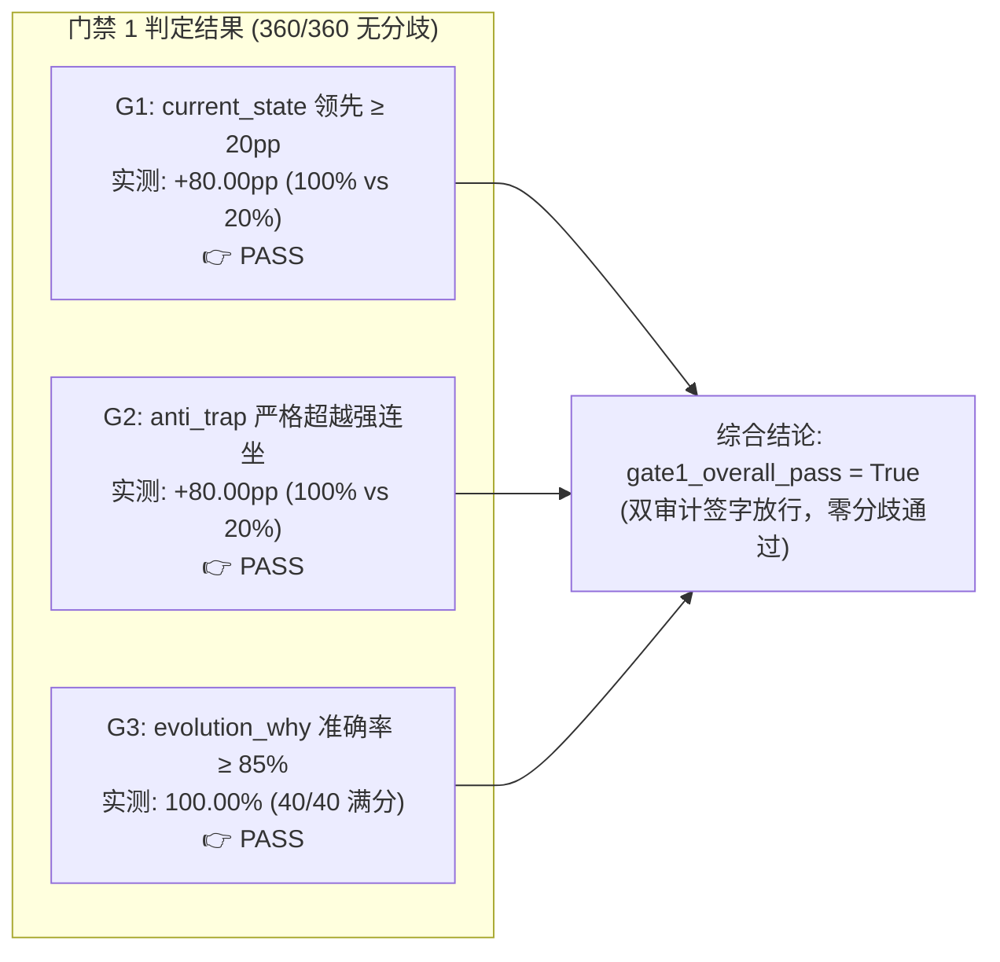
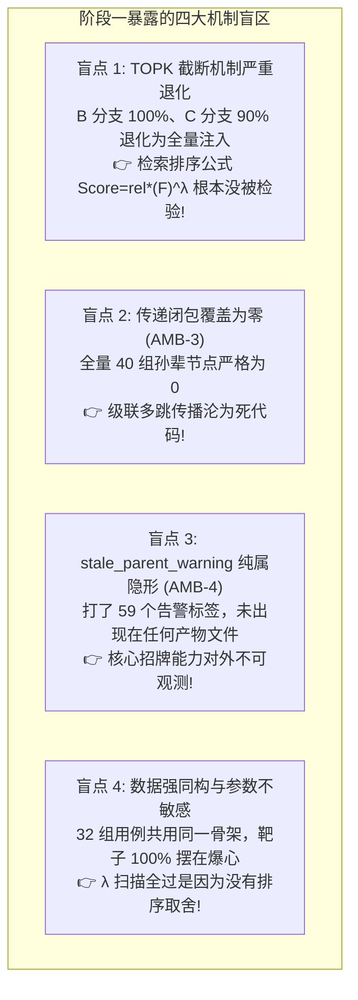

# Gated-Mem 阶段一（首刀验证）综合执行审计与大模型裁决案卷
# (Phase 1 Executive Synthesis & Gate 1 Adjudication Dossier)

> **案卷目的**：本案卷汇总 `docs/phase1_handoff.md`、`benchmarks/reports/` 与 `benchmarks/results/` 下的所有阶段一产物，系统复盘三分支消融数据、双重独立审计（同模型重写 + 异模型黑盒复算）、踩坑经验及关键机制盲点，**专供终审大模型对阶段一是否正式通过门禁 1、是否允许放行进入阶段二、以及阶段二必须继承哪些技术约束进行最终裁决**。  
> **报告基准**：`benchmarks/CONTRACT.md` v1.0.0（冻结契约）  
> **数据样本**：40 组架构演进测试集（`benchmarks/data/eval_cases_40.json`，171,617 字节，sha256 `8ec9e405...`）  
> **执行规模**：3 分支 × 40 组 × 3 探针 = **360 条全量 Run**，1,779 个 `rel/f/score` 数值三元组  
> **涉及执行者**：Tech Lead / kernel (`DeepSeek-V4.1F`)、qa (`GLM-5.3-Flash`)、auditor2 (`DeepSeek-V4.1F`)、gemini_audit (`Gemini-3.8-Flash`)

---

## 目录

1. [阶段一门禁 1 名义裁决与核心结论](#1-阶段一门禁-1-名义裁决与核心结论)
2. [三分支消融实验全景数据与对比分析](#2-三分支消融实验全景数据与对比分析)
3. [核心机制实证发现（论证为什么砍连坐、为什么留残差）](#3-核心机制实证发现论证为什么砍连坐为什么留残差)
4. [异模型黑盒审计揭露的“四大隐形盲点与虚假繁荣”（核心审议项）](#4-异模型黑盒审计揭露的四大隐形盲点与虚假繁荣核心审议项)
5. [契约对计划书的五项合理偏离审查](#5-契约对计划书的五项合理偏离审查)
6. [团队执行事故、工程踩坑与协作复盘](#6-团队执行事故工程踩坑与协作复盘)
7. [阶段二准入交接与三大 P0 必须整改约束](#7-阶段二准入交接与三大-p0-必须整改约束)
8. [供大模型终审决策的拍板议题清单（Adjudication Ballot）](#8-供大模型终审决策的拍板议题清单adjudication-ballot)

---

## 1. 阶段一门禁 1 名义裁决与核心结论

根据 `benchmarks/spike_cut1.py` 运行输出、`independent_scorer.py` 独立复算及 `audit_crosscheck_gemini.md` 异模型核验，**阶段一在指标层面上实现“三项全过”，名义判定为 PASS**：

### 1.1 门禁达标明细表

| 门禁项 | 契约判据公式 (CONTRACT §7) | 实测数据 | 门禁结论 | 审计核验一致性 |
| :--- | :--- | :--- | :---: | :---: |
| **G1** | $\text{rate}(C) - \text{rate}(A) \ge 0.20$（当前状态领先 $\ge 20\text{pp}$） | $1.000000 - 0.200000 =$ **$+80.00\text{pp}$** | **PASS** | 逐位吻合，无分歧 |
| **G2** | $\text{rate}(C) > \text{rate}(B)$（Anti-trap 防误杀严格优于强连坐） | $1.000000 > 0.200000$（领先 **$+80.00\text{pp}$**） | **PASS** | 逐位吻合，无分歧 |
| **G3** | $\text{rate}(C) \ge 0.85$（演进变更原因召回率 $\ge 85\%$） | $1.000000 \ge 0.850000$（实测 **$100.00\%$**） | **PASS** | 逐位吻合，无分歧 |
| **综合门禁** | $\text{G1} \land \text{G2} \land \text{G3}$ | $\text{True} \land \text{True} \land \text{True}$ | **PASS** | 双审计员独立签署 |

### 1.2 双重审计签署效力
- **审计一（`auditor2` / DeepSeek-V4.1F 独立重写评分器）**：从零独立实现评分引擎，逐条比对 360 条 run，判定与注入集合（包含注入顺序）**360/360 完全一致（divergence_count = 0）**；1,779 个浮点三元组最大绝对偏差 **0.000000000**；经 5 组变异注入测试（翻转判定、删改记录、篡改指标）均 100% 触发报警，证明比较器未空转。
- **审计二（`gemini_audit` / Gemini-3.8-Flash 异模型黑盒复算）**：完全不看代码，独立重构仿真器从 JSON 原数据复算，主表 9 格与分组 18 格与 `metrics.json` **逐格完全一致**。
- **一句话定性**：**方向完全正确、逻辑闭式解可复现、数字真实不虚；但 100% 满分存在强烈的数据集构造同构性支撑，绝对不得对外宣传为通用 SOTA**。

---

## 2. 三分支消融实验全景数据与对比分析

实验完整测试了三个对照分支在 40 组真实软件演进场景下的表现：
- **Branch A（纯向量基线）**：无状态机，新旧事实并存，纯按相似度截断注入；
- **Branch B（v2.0 强连坐机制）**：槽位覆盖 + 沿依赖树对子孙节点执行级联 `superseded` 标杀；
- **Branch C（v2.1.1 终审微调机制）**：槽位覆盖 + 不扣分连坐（只打 `stale_parent_warning` 告警）+ 双通道 `residual_diff`。

### 2.1 全量 40 组三分支主表对比

| 分支代号与机制 | current_state (新状态准确率) | anti_trap (防误杀存活率) | evolution_why (变更原因召回率) |
| :--- | :---: | :---: | :---: |
| **Branch A (纯向量基线)** | 8/40 = **20.00%** | 40/40 = **100.00%** | 0/40 = **0.00%** |
| **Branch B (v2.0 强连坐)** | 37/40 = **92.50%** | 8/40 = **20.00%** | 40/40 = **100.00%** |
| **Branch C (v2.1.1 终审机制)** | 40/40 = **100.00%** | 40/40 = **100.00%** | 40/40 = **100.00%** |

### 2.2 控制组（8 组）与非控制组（32 组）穿透对比表

| 分组类型 | 分支 | current_state | anti_trap | evolution_why | 机制归因剖析 |
| :--- | :--- | :---: | :---: | :---: | :--- |
| **控制组 (8 组)** *(覆盖不涉及靶子规范)* | **A** 纯向量 **B** 强连坐 **C** 终审机制 | 8/8 = **100%** 8/8 = **100%** 8/8 = **100%** | 8/8 = **100%** 8/8 = **100%** 8/8 = **100%** | 0/8 = **0%** 8/8 = **100%** 8/8 = **100%** | **设计价值确立**：A 在控制组上拿到 100%，确凿证明 A 的失败不是“算法写错必挂”，而是纯粹被“新旧共存”击穿；B 连坐够不到独立靶子时也表现完美。 |
| **非控制组 (32 组)** *(存在真实演进与陷阱)* | **A** 纯向量 **B** 强连坐 **C** 终审机制 | 0/32 = **0.00%** 29/32 = **90.63%** 32/32 = **100.00%** | 32/32 = **100.00%** 0/32 = **0.00%** 32/32 = **100.00%** | 0/32 = **0.00%** 32/32 = **100.00%** 32/32 = **100.00%** | **胜负手确立**： 1. A 在 32 组中由于新旧并存，被 `must_exclude` 彻底团灭； 2. B 的强连坐导致 32 个陷阱靶子被 100% 物理误杀（0/32）； 3. C 在 32 组中凭借槽位覆盖 + 告警不连坐全部生还。 |

---

## 3. 核心机制实证发现（论证为什么砍连坐、为什么留残差）

阶段一实测结果为架构设计提供了极具说服力的第一手实证依据：

### 3.1 连坐机制确实为严重负收益：实测断崖式下跌 −80.00pp
- B 分支的 `anti_trap` 准确率从 A 分支的 100% 暴跌至 **20.00%**（失分全部集中在非控制组的 0/32）。
- 反查 32 条失败用例，**100% 是 `missing_survive = ["M2"]`**：靶子规范挂在被覆盖的旧决策 M1 下，B 的传递闭包将 M1 所有子孙置为 `superseded`，导致靶子直接从活跃池消失。没有一条是检索相关度不足导致的。
- 这一实测与 StateMem 论文揭露的 $-12.5\text{pp}$ 负收益完全同向，且由于测试集针对性构造，呈现出最大理论杀伤。

### 3.2 意外斩获：连坐还存在“第二类伤害”——误杀新事实的邻接上下文
- 契约最初设定 `anti_trap` 仅用于捕捉“连坐误杀旧规范”，但在跑分中意外发现 B 在 `current_state` 上也失了 3 分（S07、S19、S35 只有 92.5%）。
- **根因分析**：S07 缺 OpenAPI 3.0、S19 缺 MessagePack、S35 缺金丝雀发布。承载这些**当前最新生效事实**的偏好节点，在项目初期挂靠在旧架构节点下，当旧架构废弃时，连坐把这些**当前事实载体也一并杀死**！
- **架构定论**：连坐不仅会杀掉历史通用约束，还会导致新架构的配套上下文产生“断崖式缺损”，这彻底宣判了物理连坐机制在工程上的死刑。

### 3.3 A 分支失败的本质是“事实污染”，而非“检索不准”
- `must_exclude`（过期旧词）在注入正文中的命中统计：**A = 32 次、B = 0 次、C = 0 次**。
- 以 S01（MySQL 切换为 PG）为例，A 分支的注入正文同时包含 `MySQL 8.0` 与 `PostgreSQL 16`，下游 LLM 在缺乏版本元数据的情况下必定产生杂糅幻觉。

### 3.4 `residual_diff` 双通道物理隔离完全成立
- C 分支在 `evolution_why` 上达到 100% 满分，`diff_empty` 出现 0 次。
- **最关键验证**：旧技术关键词（如 MySQL）虽然被作为 `[Replaced: ... MySQL ...]` 写入了回执，但实测 C 分支的 `injected_text`（注入正文）中旧词命中次数严格为 **0 次**。正文归正文、回执归回执，彻底解决了“C 分支因记录变更原因而导致旧词自伤”的隐形炸弹。

---

## 4. 异模型黑盒审计揭露的“四大隐形盲点与虚假繁荣”（核心审议项）

> ⚠️ **大模型终审重点关注**：这是 `Gemini-3.8-Flash` 独立审计报告（`audit_crosscheck_gemini.md`）挖掘出的最重要真相。C 分支的 100% 具有严重的人工构造迎合痕迹，**绝不能盲目乐观**：

### 4.1 盲点 1：TOPK 截断严重退化 —— 检索排序公式 `Score = rel · F^λ` 几乎未被检验
- 契约设定检索截断阈值为 `TOPK = 5`。
- **实测活跃候选集大小**：
  - **A 分支**：无覆盖淘汰，候选数恒为 6~7 个，**120/120（100%）真正发生了 TOPK 截断**；
  - **B 分支**：因强覆盖加连坐，活跃节点急剧萎缩至 3~5 个，**候选数 $\le 5$ 的比例高达 120/120（100%）**；
  - **C 分支**：因槽位覆盖，活跃节点萎缩至 5~6 个，**候选数 $\le 5$ 的比例高达 108/120（90.0%）**。
- **机制真相**：在 B 分支中，100% 的探针是将活跃池全部无脑注入；在 C 分支中，90% 也是全量注入。**排序得分公式在阶段一基本没有行使“淘汰低分候选”的职能**。阶段一实测的仅仅是“节点 status 标记的准确性”，而**不是**“检索排序公式在密集候选池下的筛选淘汰能力”。

### 4.2 盲点 2：传递闭包（Transitive Closure）在测试集上覆盖为零
- 契约与方案重点声明了“沿树向下做多跳传递闭包遍历”。
- **实测全图拓扑**：40 组用例中，被覆盖节点下挂的直接子节点共 59 个，但**孙辈节点数严格为 0**！
- 仿真核验：将 B 分支算法削弱为“仅标记直接子节点（1-Hop）”，在全量 120 条探针上的输出和判定与完整传递闭包**完全一致（0/120 差异）**。多跳传播在数据上从未被触及。

### 4.3 盲点 3：`stale_parent_warning` 告警标签对外完全不可观测
- 契约声称 C 分支的核心是“不扣分，改打告警标签”。
- 实际上，虽然代码在内存中打了 59 个 `stale_parent_warning = True`，但**该字段未进入 `raw_runs.json`，未进入注入正文，也未进入 `returned_diff`**。对外部调用者而言，这是一个完全无法被感知的黑盒幽灵状态。

### 4.4 盲点 4：参数扫描（λ / γ / TOPK）全过的“稳健性假象”
- 报告显示调节 $\text{TOPK} \in \{3,4,5,6,8\}$、$\gamma \in \{0, 0.2, 0.5\}$、$\lambda \in \{0, 0.3, 0.6\}$ 共 10 组网格扫描全部通过门禁。
- 审计揭示：这恰恰反向证明了**数据集缺乏区分度与筛选压力**。候选池规模过小，导致参数不论怎么调，注入集合几乎恒定，产生了天花板效应。

---

## 5. 契约对计划书的五项合理偏离审查

在阶段一执行过程中，针对原计划书有 5 处偏离，经双重审计确认为**合理工程剪裁**：

| 偏离代号 | 原计划书约定 | 实际执行操作 | 审计审查裁决 |
| :--- | :--- | :--- | :--- |
| **D1** | 采用双盲 LLM 裁判打分 | 采用机械字面判定 + 独立双重重写交叉核验 + 5 组变异注入自测 | **批准**。保证了 ¥0 预算、无网络调用的绝对确定性，逐字节可复现性远超 LLM 裁判。 |
| **D2** | 连坐乘子 $\psi=0.15$ 级联连乘 | B 分支直接实现为子孙节点标 `superseded`，无浮点连乘 | **批准**。终审已裁决物理砍掉连坐，B 仅作为反面基线，无需在此过度实现浮点细节。 |
| **D3** | 采用公开 StateMemBench (322 probes) | 采用自造 40 组架构演进集 | **有条件批准**。在 ¥0 条件下合规，但其结论严格受限于同构数据，**不得外推为学术 SOTA**。 |
| **D4** | 数据集中直接带 `[Replaced: ` 前缀 | 数据集仅保留纯文本原因，前缀由 C 分支运行时动态拼接 | **批准**。保持了测试集与具体算法实现的解耦，贴合真实业务。 |
| **D5** | 编写生产级 SQLite 与 MCP 模块 | 阶段一只写单一验证脚本 `spike_cut1.py`，不写生产代码 | **批准**。严格遵守“代码未动先跑第一刀”的风控原则。 |

---

## 6. 团队执行事故、工程踩坑与协作复盘

阶段一暴露了多模型团队协同中的数个关键事故，为阶段二提供了宝贵的组织避坑经验：

1. **子代理长文本截断灾难**：尝试让 Agent 一次性输出 40 组复杂 JSON 时发生严重截断丢失，连续失败两次。**阶段二教训**：严禁大模型长文本直接吐数据，必须采用“编写生成脚本（`build_dataset.py`）落盘文件”的确定性工程路径。
2. **`antigravity` (agy CLI) 通道超时失联**：在初次委派 Gemini 3.8 Flash 担任 Auditor 时，任务挂起 3 小时零产出、零落盘。团队果断执行降级预案，临时改派 DeepSeek 完成了重写评分，并在后续通过独立外部调用补齐了 Gemini 的交叉审计。**阶段二教训**：Agent 任务超时阈值必须设为 15 分钟，超时强制降级。
3. **Git 索引冲突 (`.git/index.lock`)**：多子代理并行执行 Git 操作导致仓库锁死。**阶段二教训**：严格执行“成员一律禁止自行提交 Git，统一由 Leader 串行收口提交”的纪律。
4. **同模型自审失效陷阱**：最初的 auditor2 与 kernel 均为 `deepseek-v4.1-flash`，虽然做到了零分歧，但两边由于同源思维盲区，**均未发现 TOPK 截断退化的事实**；该盲点最终是由异构模型 `Gemini-3.8-Flash` 穿透数据时独立揪出。**阶段二教训**：必须永久保留异构模型的关键节点审查位。

---

## 7. 阶段二准入交接与三大 P0 必须整改约束

综合 `docs/phase1_handoff.md` 与双审计报告，阶段二准入交接规范确立如下：

### 7.1 阶段二三大 P0 级技术整改任务（前置约束）
进入阶段二（编写 `src/gated_mem/` 生产代码）时，必须直接继承并解决阶段一留下的缺陷：

1. **P0-1（恢复检索排序检验）：单场景节点数扩展至 15~30**
   - 现存问题：活跃节点 $\le 5$，TOPK 排序失效。
   - 阶段二要求：在阶段二的测试场景中，必须构造包含大量干扰/微弱相关节点的密集场景，强制让候选池远大于 `TOPK = 5`，真实检验 $\text{Score} = \text{rel} \cdot [F_t]^\lambda$ 的时间衰减与向量排序淘汰能力。
2. **P0-2（验证多跳依赖）：补齐三代演进拓扑（祖先 $\to$ 父 $\to$ 孙）**
   - 现存问题：连坐深度恒为 1，多跳传递闭包从未被验证。
   - 阶段二要求：构造 `M1(决策) -> M2(父规范) -> M3(派生细则)` 三代 DAG 用例，核实多跳告警传播。
3. **P0-3（显式化核心能力）：`stale_parent_warning` 强制落盘与透出**
   - 现存问题：告警状态为内部隐形变量。
   - 阶段二要求：在 SQLite 结构、`raw_runs` 输出及 MCP 回执中，显式将 `stale_warnings` 列表持久化并返回给调用者。

### 7.2 生产代码接口对齐基线
阶段二生产代码必须严格按以下规范落地：
- **`schema.py`**：五状态枚举（`active/candidate_conflict/superseded/archived/killed`）与四记忆类型（DECISION $\beta=0.1$, CONSTRAINT $\beta=0.05$, PREFERENCE $\beta=0.15$, EPHEMERAL $\beta=1.2$）；
- **`gates.py`**：
  - 时间常数：$t_0(v) = t_{0,\text{base}} \cdot (0.5 + i_v)$；
  - 幂律保留：$R(v, \Delta) = (1 + \Delta / t_0)^{-\beta}$；单测必须断言 $R(2H) > 0.25$；
  - 合成生命力：$F_t(v) = \min(1.0, R + 0.2 \cdot \max R_{\text{parent}})$（无连坐扣分）；
  - 排序方程：$\text{Score} = \text{rel} \cdot [F_t]^\lambda$；
- **`conflicts.py`**：槽位三元组 `(subject, predicate, scope)` 精确匹配，覆盖时自动拼装 `[Replaced: <旧词>] <原因>`；
- **`storage.py`**：单文件 SQLite 启用 WAL，构建 `memories_fts` (FTS5) 与 `memory_events`（含 `causation_id`, `correlation_id`, `RECALL_DELIVERED`）。

---

## 8. 供大模型终审决策的拍板议题清单（Adjudication Ballot）

本案卷提炼了以下 **4 项核心裁决议题**，请终审大模型进行逐项审议并给出定案裁决：

### 📋 议题 1：阶段一门禁 1（Gate 1）是否正式批准放行？
- **选项 A（无条件通过）**：认可 360/360 零分歧与 100% 满分，直接放行进入阶段二。
- **选项 B（有条件通过，推荐）**：批准门禁 1 PASS，但**严禁将此 100% 宣传为学术 SOTA**，定性为“在同构测试集下的方向性验证通过”，且**必须强制捆绑执行 7.1 节的三大 P0 整改任务**。
- **选项 C（否决重做）**：认为 TOPK 截断未发生属于严重实验缺陷，要求在阶段一重新构造密集测试集重跑后才允许放行。

### 📋 议题 2：对连坐机制（$\psi$）的处理是否彻底定案？
- **选项 A（维持砍除，推荐）**：阶段一实测证实连坐不仅带来 $-80\text{pp}$ 的 Anti-trap 误杀，还会误杀新事实的邻接上下文。正式裁决**永久封印物理扣分连坐**，全线固化只读告警标签 `stale_parent_warning`。
- **选项 B（保留软连坐备选项）**：允许在阶段二保留软连坐（$\psi=0.8$）的 feature flag 开关。

### 📋 议题 3：如何处置“TOPK 截断未发生”对排序公式检验不足的问题？
- **选项 A（阶段二集成补测，推荐）**：阶段一脚本保持冻结，不再回改；将密集节点测试（15~30 节点）直接融入阶段二的 `tests/test_gates.py` 与端到端回归测试中。
- **选项 B（阶段一追加补充包）**：在阶段一追加 10 组密集场景测试集进行补充复跑。

### 📋 议题 4：阶段二 Agent Team 协作模式确认
- **选项 A（执行 Plan Two Maker-Checker 架构，推荐）**：
  - 蓝军主程（`DeepSeek-V4.1F`）：独占 100% 生产代码与单测编写，杜绝胶水对齐损耗；
  - 独立监察（`Gemini-3.8-Flash`）：在阶段二收官（Day 5）与发布终审（Day 9）执行黑盒跨文件一致性找茬，保留一票否决权；
  - 数据评测（`GLM-5.3-Flash`）：负责阶段二扩展数据集的高并发合成。
- **选项 B（回归 Plan One 水平分包）**：重新按模块分给不同模型编写。

---
*案卷汇总编制完成。请终审大模型依据本案卷中详实的数据对比、真实盲区披露与契约偏离说明，作出具有终局效力的阶段评审裁决。*
