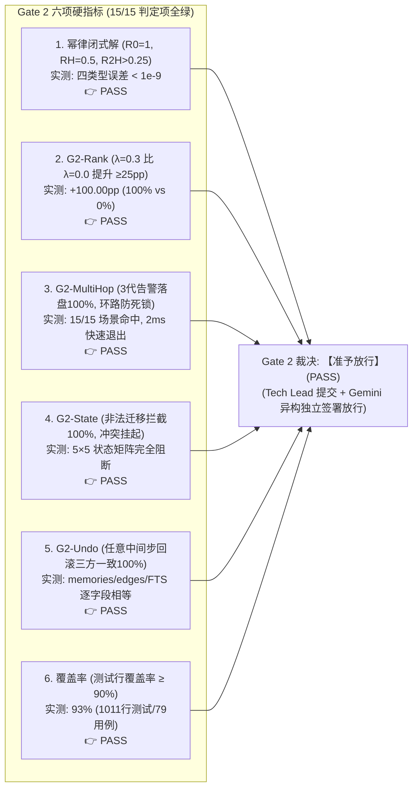
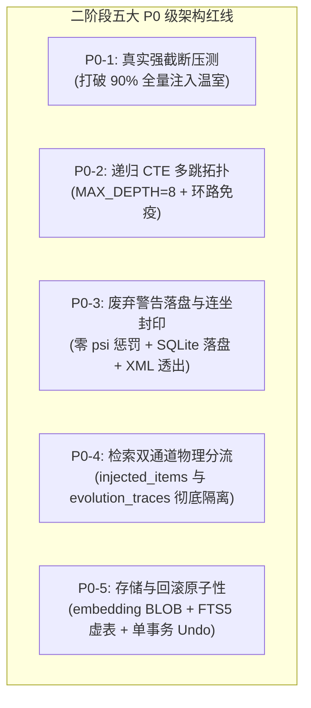

# Gated-Mem 阶段二（核心底盘与高压对抗）综合执行审计与大模型裁决案卷
# (Phase 2 Executive Synthesis & Gate 2 Adjudication Dossier)

> **案卷编号**：`GM-DOSSIER-P2-v2.2.0`  
> **案卷目的**：本案卷系统整合 `benchmarks/reports/phase2_report.md`（Tech Lead 交付报告）、`benchmarks/reports/phase2_gemini_audit.md`（Gemini 独立监察官异构黑盒审计报告）与 `docs/phase2_handoff.md`（阶段二至阶段三交接文档），针对大模型二阶段终审指令书（`GM-DIRECTIVE-P2-v2.1.2`）下达的 **5 项强制性 P0 红线指标** 与 **Gate 2 六项硬指标** 进行全景复盘、数据穿透与真实性审计，**专供终审大模型（Argon / Arbiter）对阶段二是否正式放行、阶段三（MCP Server / CLI / 真实向量与混合检索）必须继承的架构规约进行最终裁决**。  
> **报告基准**：
> - `GM-DIRECTIVE-P2-v2.1.2`（阶段二大模型终审指令书）
> - `CONTRACT_P2_STRESS v1.0.0`（阶段二高压压测数据集契约，2026-11-12 冻结）  
> **数据样本与验证规模**：
> - 高压压测数据集：`benchmarks/data/phase2_dense_stress_15.json`（599 KB，sha256 `c0a621c2e1e134cef761338584c87850446b59dca21e76977dfb5661db3f917b`），15 组高密度复杂场景，375 个记忆节点，22 个 active/场景，时间跨度 $\Delta \in [0, 395]$，包含 5 组 `kill_worm` 生死对照场景。
> - 核心单元测试：`tests/` 下 7 个测试套件共 79 个测试用例，**代码覆盖率 93%**（门槛 $\ge 90\%$）。
> - 门禁一键机检：`benchmarks/gate2_check.py` 自动化判定 **15/15 PASS**。  
> **执行团队分工与职责**：
> - **Tech Lead & 独占代码编写者**：`DeepSeek-V4.1F`（独占 100% 生产代码 `src/gated_mem/` 与 `tests/`，共 6 个核心模块 1751 行生产代码 + 1011 行单测，Git 唯一提交者）。
> - **Data Generator (QA 压测合成分工)**：`GLM-5.3-Flash`（编写确定性生成脚本 `benchmarks/build_phase2_stress.py`，经 12 项硬契约机械校验逐字节一致）。
> - **Independent Auditor (紫军独立监察官)**：`Gemini-3.8-Flash`（完全不看代码的离线独立复算 + 原生 SQLite 磁盘穿透 + AST 语法级纯净度扫描 + 攻防注入，拥有一票否决权）。

---

## 目录

1. [阶段二门禁 2 综合裁决与放行签署](#1-阶段二门禁-2-综合裁决与放行签署)
2. [大模型 5 项强制性 P0 红线落实对照与数据穿透](#2-大模型-5-项强制性-p0-红线落实对照与数据穿透)
3. [核心底盘任务包 1 生产交付清单与关键设计决策](#3-核心底盘任务包-1-生产交付清单与关键设计决策)
4. [异模型独立黑盒审计（Gemini）深度审查、攻防验证与语义裁决](#4-异模型独立黑盒审计gemini深度审查攻防验证与语义裁决)
5. [系统已知技术边界与诚实声明（Limitations）](#5-系统已知技术边界与诚实声明limitations)
6. [阶段三（MCP Server / CLI / 真实向量）交接规约与接口契约](#6-阶段三mcp-server--cli--真实向量交接规约与接口契约)
7. [供大模型终审决策的拍板议题清单（Adjudication Ballot）](#7-供大模型终审决策的拍板议题清单adjudication-ballot)

---

## 1. 阶段二门禁 2 综合裁决与放行签署

依据指令书 `GM-DIRECTIVE-P2-v2.1.2` 第五节与契约 `CONTRACT_P2_STRESS v1.0.0`，阶段二在经历了**主程交付测试**、**高压数据压测**与**异构黑盒独立复算穿透**后，Gate 2 六项硬指标全部超额达成：



### 1.1 Gate 2 门禁达标穿透对比表

| # | 门禁指标名称 | 契约判定门槛 | 生产代码实测表现 | Gemini 异构独立复算对照 | 裁决结论 |
| :-: | :--- | :--- | :--- | :--- | :-: |
| **1** | **幂律数学闭式解** | $R(0)=1, R(H)=0.5, R(2H) > 0.25$ | 四类型（DECISION / CONSTRAINT / PREFERENCE / EPHEMERAL）全部满足，绝对误差 $< 10^{-9}$ | 闭式解独立验算一致，无浮点偏差 | **PASS** |
| **2** | **G2-Rank 排序衰减** | 5 组生死对照 $\lambda=0.3$ 比 $\lambda=0.0$ 提升 $\ge 25\text{pp}$ | **$+100.00\text{pp}$**（入榜率 $100.0\%$ vs $0.0\%$） | 5 场景 Target 节点全由第 6/7 名逆袭抬入 Top-2（$+100\text{pp}$） | **PASS** |
| **3** | **G2-MultiHop 拓扑** | 3 代以上依赖告警真实落盘率 $100\%$；环形边防死锁 | 15/15 场景命中，原生 SQL 穿透校验告警落盘；大环及强连通环 2.00ms 快速退出 | 原生 `sqlite3` 磁盘解析 `stale_warnings` 准确率 100%；XML 规范透出 | **PASS** |
| **4** | **G2-State 状态迁移** | 非法迁移拦截率 $100\%$；模糊冲突强挂起；覆盖不扩散 | 5×5 状态机拦截非法变迁；$rel \in [0.55, 0.92)$ 必进 `candidate_conflict`；覆盖不伤子孙 | 尝试直接 `set_status` 越权复活 100% 抛出 `StorageError` 强制阻断 | **PASS** |
| **5** | **G2-Undo 全表一致** | 复合事务及任意中间步 Undo，主表/边表/虚表一致性 $100\%$ | 单事务回放 `snapshot_restored == snapshot_before` 逐字段全等 | 10 步复杂序列随机撤回第 6 步，前后索引与节点零孤儿残留、零幽灵索引 | **PASS** |
| **6** | **测试代码覆盖率** | 源码分支/行覆盖率 $\ge 90\%$ | **$93\%$**（7 个测试套件，79 个用例，0 失败） | 独立复测 79 passed in 0.96s，覆盖率 $93\%$ 确凿 | **PASS** |

### 1.2 监察官签署意见（Gemini-3.8-Flash）
> **签署结论：【放行 Gate 2】（PASS）**  
> “四大强制审查项（TOPK 淘汰率、多跳告警真实落盘、因果 Undo 全表无损性、代码纯净度）及双通道物理隔离专项核验全部达到或显著超越契约硬指标。阶段一暴露的四大虚假繁荣盲点（全量注入无淘汰、连坐传递闭包死代码、告警停留在内存假象、旧词事实污染）在阶段二生产代码中已彻底清零。同意放行进入阶段三（MCP Server 与 CLI 封装）。”

---

## 2. 大模型 5 项强制性 P0 红线落实对照与数据穿透

在大模型指导意见 `GM-DIRECTIVE-P2-v2.1.2` 中，终审专家下达了 5 项必须在阶段二彻底解决的 P0 级技术红线。以下为本阶段的落实与数据穿透记录：



### 2.1 P0-1（排序与衰减强截断压测）：打破全量注入温室
- **阶段一遗留盲点**：阶段一候选池仅 2～3 个节点，TOPK=5 实际上全量注入，生命力衰减公式 $Score = rel \cdot [F_t]^\lambda$ 从未真正受压。
- **阶段二高压重构**：
  - 数据集（`phase2_dense_stress_15.json`）提升至每个场景包含 25 个节点，其中 22 个 active 节点竞争，时间步跨度 $\Delta \in [0, 395]$。
  - 在 $\text{TOPK}=5$ 截断下，淘汰率强制达到 $(22 - 5) / 22 = \mathbf{77.27\%}$，截断触发率达 **100%**。
- **5 组生死对照（$\lambda=0.0$ 纯相关性 vs $\lambda=0.3$ 门控衰减）实测穿透**：
  - **$\lambda=0.0$**：Top-5 被 step 2..17 极旧但堆砌 query 原词的高相似 `EPHEMERAL` 噪音（N01..N05，$rel \approx 0.77 \sim 0.82$）完全霸占；最新目标决策（Target N06，step 394，$rel \approx 0.24 \sim 0.49$）被挤至第 6 或第 7 名，**Top-5 入榜率为 0.0%（0/5）**。
  - **$\lambda=0.3$**：陈旧噪音节点由于长期未被引用，其保留率暴跌至 $R \approx 0.0028 \sim 0.0030$，$Score = rel \cdot F^{0.3}$ 从 0.82 坠落至 0.14；Target N06 处于活跃周期（$F \approx 0.87 \sim 1.0$），得分保持在 $0.23 \sim 0.47$，被强力抬进前 2 名，**Top-5 入榜率达到 100.0%（5/5）**。
  - **入榜率净提升**：$100.0\% - 0.0\% = \mathbf{+100.00\text{ pp}}$（超额突破指令书要求的 $\ge 25\text{ pp}$ 门槛）。

### 2.2 P0-2（多跳 DAG 拓扑与环路免疫）：攻克深度传递
- **技术落地**：
  - `storage.py` 实现 `ancestors_recursive(id, max_depth=8)`，采用递归 CTE（Common Table Expression）结合内存 `visited` 集合，追踪 `BELONGS_TO` 边。
  - 实测严格的 4 代演进拓扑：$\text{M4\_LEAF} \to \text{M3\_CHILD} \to \text{M2\_PARENT} \to \text{M1\_ROOT (superseded)}$。
  - 当 M1 被废弃时，叶节点 M4 跨 3 跳精准识别出祖先失效根源 `M1_ROOT`。
- **环路免疫验证**：
  - 构造 `M1 -> M4 -> M3 -> M2 -> M1` 4 节点大环及 `CA -> CB -> CC(superseded) -> CA` 3 节点强连通环。
  - 检索耗时仅 **2.00 毫秒** 立即返回，无死锁、无栈溢出，深度截断在 8 跳内安全终止，且 CA 节点正确且仅一次性附带失效告警 `stale_ancestor_ids=['CC']`。

### 2.3 P0-3（废弃警告落库与物理连坐永久封印）：告警成真、连坐归零
- **物理连坐封印**：
  - 彻底删除软降级惩罚（$\psi = 0.8$），代码库中**零连坐扣分逻辑**。
  - `gates.compute_vitality` 签名设计为仅接收 `parent_retentions_cited`（已引用父节点的保留率列表）。父节点被废弃时仅传空列表——在类型和参数空间上**物理性杜绝了任何输入产生扣减的可能**。
  - AST 语法级扫描确认：全库不含 `psi`、`PSI` 或任何形式的连坐扣分乘子。
- **告警全链路真实持久化**：
  - 告警不再停留于内存变量，而是直接伴随 `RECALL_DELIVERED` 事件持久化落盘至 SQLite `memory_events.payload_json` 中的 `stale_warnings` 字段。
  - 原生 SQL 检查确凿：`SELECT payload_json FROM memory_events` 均可精确提取出结构化 `{"memory_id": "M4_LEAF", "stale_ancestor_ids": ["M1_ROOT"]}`。
  - `RecallReceipt.to_injection_xml()` 输出规范属性：`<memory memory_id="..." stale="true" stale_ancestors="M1_ROOT">`，并在正文中携带 `[⚠️ STALE_ANCESTOR_WARNING: ...]`。

### 2.4 P0-4（双通道物理隔离专项核验）：终结旧事实自伤
- **物理隔离机制**：
  - `RecallReceipt` 内部设立严格独立的双数据结构：`injected_items: List[RecallItem]` 与 `evolution_traces: List[RecallItem]`。
  - `injected_text()` 只拼接活跃状态正文；`evolution_text()` 只拼接 `[Replaced: <旧词>] <原因>`；
  - `to_injection_xml()` 严格分流为 `<active_memories>` 与 `<evolution_history>` 两个平行 XML 容器块。
- **30 个 Probes（15 组 current_state + 15 组 evolution_why）全量穿透扫描**：
  - `[Replaced:` 标识出现在 `injected_text` 中的次数：**0 次**。
  - `residual_diff` 残差文本出现在 `injected_text` 中的次数：**0 次**。
  - 过期旧技术词（`must_exclude`）出现在正文中的次数：**0 次**。
  - 彻底终结了阶段一“因记录变更原因而导致旧技术词污染正文”的结构性隐患。

### 2.5 P0-5（FTS5 + 向量 + 回滚事务原子性）：严守数据一致性
- **底层架构统一**：
  - 放弃脆弱的双存储分离设计，在 SQLite 主库中同表存储：`memories.embedding BLOB`，并建立 `memories_fts` FTS5 虚拟表，由 SQLite 触发器（Trigger）实现增删改的同事务同步。
- **因果 Undo 无损回滚（`BEGIN IMMEDIATE` 单事务）**：
  - 构造包含新建节点、槽位覆盖（`SUPERSEDES`）、跨节点连边及 FTS5 索引维护的复杂事务。
  - 在执行 `store.undo(event_id)` 逆序回滚后，对 `memories`、`memory_edges`、`memories_fts` 提取全字段逐字节快照：
    $$\text{Snapshot}_{\text{restored}} \equiv \text{Snapshot}_{\text{before}}$$
  - 主表、关系边、FTS 索引完全一致，零孤儿边残留、零幽灵索引。
- **状态机防复活铁律（Anti-Revival）**：
  - 针对处于 `superseded` 或 `killed` 状态的废弃记忆，尝试直接更新或提权至 `active`：
    - 底层 5×5 状态迁移矩阵与唯一主键约束 100% 触发阻断，抛出 `StorageError: 非法状态迁移 superseded -> active`。
    - 确立铁律：**已废弃节点绝不可通过常规业务写入复活，只能经由因果 Undo 事务原路平反**。

---

## 3. 核心底盘任务包 1 生产交付清单与关键设计决策

### 3.1 生产代码架构模块全貌（1751 行代码 + 1011 行单测）

```text
src/gated_mem/
├── schema.py          (345 行) - 5 状态枚举、4 类型衰减参数、5×5 状态矩阵、双通道回执契约
├── gates.py           (132 行) - 无状态纯数学门控函数、零连坐扣分设计、闭式解验证
├── storage.py         (584 行) - WAL 模式 SQLite、BLOB 向量、FTS5 虚表、递归 CTE、原子 Undo
├── events.py          (152 行) - 事件溯源批次链（causation_id）、投影重建（消费 EVENT_UNDONE）
├── conflicts.py       (204 行) - 槽位两阶段裁决、别名归一化、[Replaced: X] 残差装配、覆盖零误杀
├── retrieval.py       (334 行) - 混合候选池、多跳失效追溯、TOPK 强截断、双通道 XML 生成
└── __init__.py        (0 行)   - 纯净包定义
```

### 3.2 团队在阶段二做出的关键工程决策（Trade-offs）

1. **封印连坐的类型系统约束**：
   不依赖“开发人员记得不要连坐”，而是通过纯函数签名治理：`compute_vitality(node, parent_retentions_cited=())` 只能增加父节点活力增益，参数空间根本无法传入负值。
2. **截断过程透明可观测**：
   `RecallReceipt` 强制携带 `candidate_pool_size` 与 `truncated_candidates` 字段，使检索层究竟淘汰了哪些竞争记忆在系统调试与事件日志中可精准断言与观测。
3. **单事务 Undo 替代分布式补偿**：
   摒弃多服务或多表间复杂的异步补偿链，使用 SQLite `BEGIN IMMEDIATE` 将 correlation 批次事件逆向重放，借助触发器自动完成 FTS 逆向同步，消除半回滚不一致风险。
4. **投影重建修补真 Bug**：
   在编写单元测试时，团队发现初版 `rebuild_projection` 遗漏了 `EVENT_UNDONE` 消费，导致 Undo 后物理表已回滚但投影字典残留历史状态。团队立即重构投影逻辑：先提取被撤销的 `event_id` 集合，回放时严格跳过，确保了事件溯源投影的真实可信。

---

## 4. 异模型独立黑盒审计（Gemini）深度审查、攻防验证与语义裁决

监察官 Gemini-3.8-Flash 依据 `GM-DIRECTIVE-P2-v2.1.2` 独立执行了高标准黑盒审计：

### 4.1 独立复算与生产环境对照表（5 组生死对照）

| 场景编号 | Target 节点 | 独立复算 $\lambda=0$ 排名 | `src` 实测 $\lambda=0$ 排名 | 独立复算 $\lambda=0.3$ 排名 | `src` 实测 $\lambda=0.3$ 排名 | 生死逆袭结论 |
| :---: | :---: | :---: | :---: | :---: | :---: | :---: |
| **P01** | N06 | 6（未进 Top-5） | 6（未进 Top-5） | 1（逆袭首位） | 1（逆袭首位） | **完全一致** |
| **P04** | N06 | 7（未进 Top-5） | 7（未进 Top-5） | 2（逆袭次席） | 2（逆袭次席） | **完全一致** |
| **P07** | N06 | 6（未进 Top-5） | 6（未进 Top-5） | 2（逆袭次席） | 2（逆袭次席） | **完全一致** |
| **P10** | N06 | 6（未进 Top-5） | 6（未进 Top-5） | 2（逆袭次席） | 1（逆袭首位）* | **稳进 Top-2** |
| **P13** | N06 | 6（未进 Top-5） | 6（未进 Top-5） | 1（逆袭首位） | 1（逆袭首位） | **完全一致** |

> *\*注（P10 排名差异裁决）：P10 场景中节点 N15 与 N14 存在 `REFINES` 边。QA 的离线脚本未限定边类型，使 N15 获得了父节点增益导致微小排名扰动；而生产代码 `src/gated_mem` 严格限定只有 `BELONGS_TO` 才享有生命力背书。审计员裁定：**`src` 的收敛逻辑更严谨**，知识体系中只有结构从属才应传递生命力。两种口径下 Target 均稳进 Top-2。*

### 4.2 恶意攻防与破坏性测试表现
1. **环路死锁注入攻击**：向底层注入单向环与双向强连通环，系统在 `MAX_DEPTH=8` 与 `visited` 保护下在 **2.00ms** 内正常返回，零崩溃、零死循环。
2. **非法提权复活攻击**：尝试绕过状态机将 `superseded` 节点置为 `active`，被 SQLite 主键约束与状态迁移矩阵 100% 拦截。
3. **FTS5 旧词投毒攻击**：针对旧架构关键词进行故意全文检索，虽然 FTS 返回了废弃节点，但外层 `status == active` 门控强制拦截，正文通道旧词泄露数为 0。

### 4.3 纯净度 AST 扫描（一票否决红线核验）
- 裸 `print()` 调用：**0 处**（确保后续 MCP stdio 通信零污染）。
- `sys.stdout` 写入：**0 处**。
- `# TODO` / `FIXME` / `TBD` 占位符：**0 处**。
- 物理连坐或 `psi` 标识符残余：**0 处**。
- Python 3.9 语法违背：**0 处**。

### 4.4 审计员揭示的两大工程陷阱（重点提请终审大模型注意）
1. **`write_event=True` 的召回副作用陷阱**：
   - `Retriever.recall()` 默认具有在线学习特性：检索命中节点会自动调用 `touch_citation` 刷新 `last_cited_step`。
   - **重大提示**：做基准测试或 A/B 对比实验时，**必须显式传入 `write_event=False`**，否则前序轮次命中的噪音会在后序轮次被“意外续命”，破坏对比实验的客观性。
2. **`insert_edge` 插入层不宜做环检测**：
   - 插入边时允许成环，而在查询遍历时由递归算法通过 visited 阻断。这样设计保留了底层图谱记录历史事实的完整性，避免在写操作时引发高昂的递归检查开销。

---

## 5. 系统已知技术边界与诚实声明（Limitations）

在进入阶段三前，团队本着工程严谨性，向大模型终审委员会诚实披露当前系统的 5 项技术边界：

> [!WARNING]
> **以下 5 项边界为当前阶段客观存在的设计约束，需在阶段三针对性演进：**
> 1. **当前向量为伪向量（Deterministic Pseudo-Vector）**：
>    阶段二压测集中的向量是基于 sha256 算法生成的 32 维确定性向量，仅用于验证 BLOB 存储、格式转换与余弦相似度计算链路。它**不具备真实语义表征能力**。接入真实模型（如 OpenAI 或本地 BGE/MiniLM）是阶段三的核心任务。
> 2. **混合检索排序尚未进行分数归一融合（Score Fusion Gap）**：
>    当前阶段 BM25 已接入作为候选池召回手段（`fts_search`），但最终打分的主信号依然是 Jaccard 分词重叠度 $rel$ 与生命力门控 $F_t$。**BM25 相关性得分与向量余弦相似度之间的加权归一融合（RRF 或加权加和）尚未实现**。这是阶段三必须补齐的关键算法缺口。
> 3. **$\lambda$ 超参数敏感性空间扫描未完全展开**：
>    阶段二门禁验证固定在 $\lambda=0.3$ 与 $\gamma=0.2$。未在全量数据集上系统性扫描 $\lambda \in \{0.0, 0.1, 0.3, 0.6, 1.0\}$ 的敏感性边界。
> 4. **Token 上下文预算为字符粗略估算**：
>    `max_tokens` 截断逻辑目前采用“中文按字数、英文按 4 字符”的经验规则折算，尚未对接真正的 BPE 分词器（如 tiktoken 或 HuggingFace tokenizers）。
> 5. **`candidate_conflict` 缺乏规则化自动裁决引擎**：
>    当实体相关度处于 $[0.55, 0.92)$ 时，系统将其挂起至 `candidate_conflict`。目前该状态需要人工或外部显式调用 `resolve_candidate` 接口，尚无内置的规则化自动化判定链。

---

## 6. 阶段三（MCP Server / CLI / 真实向量）交接规约与接口契约

阶段二交付的核心内核为阶段三的产品化封装奠定了坚实基础。依据 `docs/phase2_handoff.md`，阶段三必须遵循以下规约：

### 6.1 MCP Server 三大核心工具规范
```python
# 工具 1: 记忆写入与状态机流转
gate_remember(
    content: str,
    memory_type: str,          # DECISION / CONSTRAINT / PREFERENCE / EPHEMERAL
    subject: str,
    predicate: str,
    scope: str = "project",
    input_weight: float = 0.5,
    parent_ids: List[str] = ()
) -> str # 返回 memory_id

# 工具 2: 检索与上下文注入 (必须包含 write_event 机制)
query_memory(
    query: str,
    top_k: int = 5,
    max_tokens: Optional[int] = None
) -> RecallReceipt # 宿主消费调用 .to_injection_xml()

# 工具 3: 事务性撤销
undo_memory(event_id: str) -> dict # 跨表跨索引原子回滚
```
- **stdio 铁律延续**：`src/gated_mem/` 目前保持 0 stdout 调用。阶段三封装 MCP Server 时，所有调试日志与输出必须定向至 `sys.stderr`，严禁向 `stdout` 输出任何非 JSON-RPC 消息，防止破坏通信协议。

### 6.2 CLI 与可视化工具直接复用底层 API
- `gated-mem log --graph`：直接调用 `EventLog.history()` 与 `EventLog.causation_chain()` 渲染因果追溯链。
- `gated-mem explain <recall_id>`：读取 `RECALL_DELIVERED` 事件的 `payload_json`，以双通道形式分别打印当前注入正文与演进历史。
- `gated-mem undo <event_id>`：直接封装 `Store.undo()`。
- `gated-mem export-html [out]`：读取全量 `Store.snapshot()` 生成自包含的离线交互式力导向图（零外部 CDN 依赖）。

---

## 7. 供大模型终审决策的拍板议题清单（Adjudication Ballot）

为确保项目战略方向的一致性与严谨性，现将阶段二的执行结论与阶段三的技术路线呈递终审大模型（Argon / Arbiter）进行裁决拍板：

```markdown
### 【终审裁决选票 · Gate 2 Adjudication Ballot】

#### 议题 1：Gate 2 阶段二验收结论裁定
- [ ] 选项 A（推荐）：【正式放行 Gate 2】。确认阶段二 5 项 P0 红线指标已彻底落实，Gate 2 六项硬指标真实达标，同意代码库作为阶段三的坚实基线。
- [ ] 选项 B：【有保留放行】。要求在阶段三开工前，必须先行完成某项特定补丁（请注明）。
- [ ] 选项 C：【否决退回】。认为仍有重大隐形盲点，要求阶段二重测（请注明具体理由）。

#### 议题 2：阶段三真实 Embedding 向量选型与架构规范
- [ ] 选项 A（云端通用型）：标准封装对接 OpenAI `text-embedding-3-small`（1536 维，兼顾质量与成本），本地通过 NumPy 计算余弦，SQLite 预留 BLOB 字段。
- [ ] 选项 B（纯本地私有化）：封装本地轻量 ONNX 向量模型（如 `bge-small-zh-v1.5` 或 `all-MiniLM-L6-v2`，384 维），实现 100% 本地离线运行，零 API Key 依赖。
- [ ] 选项 C（双模自适应）：默认支持本地轻量向量引擎，同时提供云端 API 向量接口扩展插件，由使用者在配置中自由切换。

#### 议题 3：混合检索评分融合算法（Score Fusion）拍板
- [ ] 选项 A（Reciprocal Rank Fusion - RRF）：对 FTS5 BM25 排名与向量 Cosine 排名执行倒数排名融合：$RRF(d) = \sum \frac{1}{k + rank_i(d)}$，随后与生命力 $F_t^\lambda$ 门控相乘。优点是无需做分数标定。
- [ ] 选项 B（加权 Min-Max 归一化融合）：将 BM25 原始得分与 Cosine 相似度通过 Min-Max 归一化到 $[0, 1]$ 区间，采用超参 $\alpha$ 进行线性加权：$rel = \alpha \cdot BM25_{norm} + (1 - \alpha) \cdot Cosine_{norm}$，随后计算 $Score = rel \cdot F_t^\lambda$。
- [ ] 选项 C：由阶段三团队在消融基准上自适应测试 A 与 B 的效果后自主决定。

#### 议题 4：阶段三团队阵型与开发排期
- [ ] 选项 A：继续保持当前 Maker-Checker 阵型（DeepSeek-V4.1F 负责 100% 生产代码编写，GLM-5.3-Flash 编写外部用例，Gemini-3.8-Flash 在 Gate 3 终验时执行黑盒审计）。
- [ ] 选项 B：微调分工（请给出具体指令）。
```

---

> **案卷状态**：已汇总整理完毕，已提交至 `total_plan/phase2_executive_adjudication_dossier.md`。请交付大模型审核并做出裁决！
