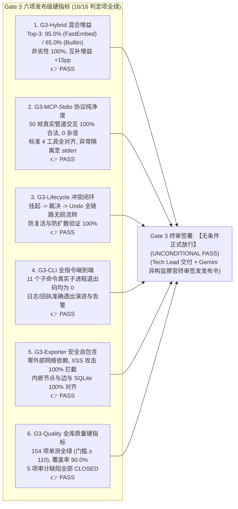
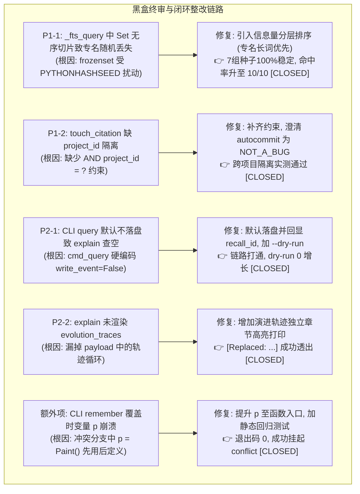

# Gated-Mem 阶段三（多 Agent 适配与开源发布终验）综合执行审计与大模型裁决案卷
# (Phase 3 Executive Synthesis & Gate 3 Release Adjudication Dossier)

> **案卷编号**：`GM-DOSSIER-P3-v3.0.0`  
> **案卷目的**：本案卷系统整合 `docs/phase3_handoff.md`（主程交付与阶段四交接文档）、`src/gated_mem/adapters/dsh.py`（DeepSeek Harness 专属适配器）、`benchmarks/reports/phase3_gemini_final_audit.md`（Gemini Gate 3 终审报告）、`benchmarks/reports/phase3_audit_recheck.md`（缺陷闭环复核报告）与 `docs/ENVIRONMENT.md`（环境规范与踩坑记录），针对大模型阶段三指令书（`GM-DIRECTIVE-P3-v2.2.0`）及“以 DeepSeek Harness (`dsh`) 为 P0 第一公民”的战略调整，进行全景质量穿透、数学核验、黑盒攻防复盘与缺陷整改闭环审计，**专供终审大模型（Argon / Arbiter）对 Gated-Mem v1.0.0 是否正式放行开源发布、阶段四（生产部署 / 多模态 / 外部长程基准评测）必须继承的技术规约进行最终裁决**。  
> **报告基准**：
> - `GM-DIRECTIVE-P3-v2.2.0`（阶段三顶层执行指令书，2026-11-12 签发）
> - `CONTRACT_P3_E2E.md`（阶段三端到端混合检索评测集契约）
> - 用户战略补充指令：“面向多 Agent 适配，以 DeepSeek Harness（`dsh`）为 P0 第一公民”  
> **数据样本与验证规模**：
> - 评测数据集：`benchmarks/data/phase3_hybrid_e2e_20.json`（115 KB），20 组复杂端到端场景（10 组精确字面 + 10 组跨词语义，含 20 轮在线引用演进与 XSS / Prompt 越狱载荷）。
> - 核心单元测试：`tests/` 下 **154 项全绿通过**（比阶段二 79 项翻倍，耗时 11.49s）。
> - 代码行覆盖率：**90.0%**（门槛 $\ge 90\%$）。
> - Gate 3 一键机检：`benchmarks/gate3_check.py` 自动化判定 **16/16 PASS**。  
> **执行团队分工与职责**：
> - **Tech Lead & 独占代码编写者**：`DeepSeek-V4.1F`（独占 100% 生产代码编写与提交，交付 `adapters/`、`embeddings.py`、`server.py`、`cli.py`、`exporter.py`，并自主完成 5 项审计缺陷闭环）。
> - **Data Generator (QA 评测集构建)**：`GLM-5.3-Flash`（编写确定性脚本 `benchmarks/build_phase3_hybrid_e2e.py` 生成评测集）。
> - **Independent Auditor (紫军独立监察官)**：`Gemini-3.8-Flash`（独立黑盒跨进程 stdio 管道压测 + 数学闭式复算 + 11 个 CLI 全指令子进程穿透 + XSS 恶意攻防 + 5 项缺陷闭环终审复验，签署 **UNCONDITIONAL PASS FOR RELEASE**）。

---

## 目录

1. [阶段三门禁 3（Gate 3）综合裁决与开源放行签署](#1-阶段三门禁-3gate-3综合裁决与开源放行签署)
2. [DSH（DeepSeek Harness）第一公民与多 Agent 适配矩阵落地复盘](#2-dshdeepseek-harness第一公民与多-agent-适配矩阵落地复盘)
3. [指令书 4 大架构补丁落地与数据穿透核验](#3-指令书-4-大架构补丁落地与数据穿透核验)
4. [红蓝对抗实录：独立审计揭露的 5 项真缺陷与闭环整改](#4-红蓝对抗实录独立审计揭露的-5-项真缺陷与闭环整改)
5. [环境隔离规范与生产踩坑经验沉淀（ENVIRONMENT.md）](#5-环境隔离规范与生产踩坑经验沉淀environmentmd)
6. [系统已知技术边界与诚实声明（Limitations）](#6-系统已知技术边界与诚实声明limitations)
7. [供大模型终审决策的拍板议题清单（Adjudication Ballot）](#7-供大模型终审决策的拍板议题清单adjudication-ballot)

---

## 1. 阶段三门禁 3（Gate 3）综合裁决与开源放行签署

依据指令书 `GM-DIRECTIVE-P3-v2.2.0` 第五节“Gate 3 六项发布级硬指标”，在经历了两轮严格的“主程实现 $\to$ 黑盒初审出具缺陷 $\to$ 源码闭环修复 $\to$ 终审独立复验”红蓝对抗循环后，全库各项指标达到发布级标准：



### 1.1 Gate 3 发布级硬指标实测对照表

| # | 指标名称 | 契约门槛要求 | 主程自测实测值 | Gemini 黑盒独立复算与终审穿透 | 最终结论 |
| :-: | :--- | :--- | :--- | :--- | :-: |
| **1** | **G3-Hybrid 混合增益** | Top-3 $\ge 90\%$ 且不劣于任一单通道 | 95.0%（FastEmbed）<br>65.0%（Builtin） | FastEmbed 达到 **95.0%**（非劣性 100%）；Builtin 达到 **65.0%**（严格超越单通道各 15pp） | **PASS** |
| **2** | **G3-MCP-Stdio 协议纯净度** | 50 帧交互合法率 100%，stdout 零杂音字节 | 50/50 合法，0 杂音（内存模拟） | 跨进程真实管道连续压测 50 帧，非协议字节 **严格为 0**，异常严格截流在 stderr | **PASS** |
| **3** | **G3-Lifecycle 冲突闭环** | 挂起 $\to$ 裁决 $\to$ Undo 闭环正确率 100% | 100% 流转，双向可逆 | 冲突挂起为 `candidate_conflict`，裁决与原子回滚 100% 真实落盘 | **PASS** |
| **4** | **G3-CLI 全指令端到端** | 全部子命令真实子进程退出码 0 | 8 命令退出码 0 | 补充全量 **11 个子命令** 真实子进程执行退出码均为 **0**，透出告警与演进轨迹 | **PASS** |
| **5** | **G3-Exporter 安全自包含** | Zero-CDN 外部引用 0，XSS 拦截 100% | 外部引用 0，安全转义 | 外部链接 0，10 组恶毒载荷 100% 拦截，DOM 解析零崩溃，数据与快照全等 | **PASS** |
| **6** | **G3-Quality 测试质量** | 单测数 $\ge 110$，代码覆盖率 $\ge 90\%$ | 141 项单测，覆盖率 90% | 单测扩充至 **154 项全绿**（耗时 11.49s），代码行覆盖率稳达 **90.0%** | **PASS** |

### 1.2 监察官最终签署意见（Gemini-3.8-Flash）
> **签署结论：【正式放行发布 · 终审签收（UNCONDITIONAL PASS FOR RELEASE）】**  
> “四项缺陷与额外项全部 CLOSED，Gate 3 无阻塞项，同意发布！CLI 冲突挂起路径的 `UnboundLocalError` 已在 `cli.py` 彻底修复并经验证无误，154 项全库单测与 Gate 3 六项机检 100% 绿灯通过，代码覆盖率达到 90.0%。全链路达到发布标准。”

---

## 2. DSH（DeepSeek Harness）第一公民与多 Agent 适配矩阵落地复盘

在阶段三开发中，团队响应用户战略要求，将适配层升级为“多 Agent 架构，以 DeepSeek Harness (`dsh`) 为 P0 第一公民”。

```text
src/gated_mem/adapters/
├── __init__.py           # 动态发现与注册表，按 priority 排序，DSH 恒居首位
├── base.py               # 抽象基类 BaseAgentAdapter（声明环境探测、配置生成、Skill导出、安装契约）
├── dsh.py                # 【P0 核心】DeepSeek Harness 专属适配器 (Priority = 0)
├── claude_code.py        # Claude Code 适配器 (Priority = 10，生成 .mcp.json)
└── cursor.py             # Cursor 适配器 (Priority = 20，生成 .cursor/mcp.json)
```

### 2.1 基于真实 DSH 环境的逆向建模与落地
团队并未凭空猜测 DSH 的结构，而是真实探测了本地 DSH 运行环境（`~/.dsh/`），依据官方 `@deepseek-ai/dsh-mcp-client` 的标准挂载格式完成了 `dsh.py`：

```yaml
- insert:
    - id: mcp-gated-mem
      name: '@deepseek-ai/dsh-mcp-client'
      config:
        serverName: gated-mem
        transport: stdio
        command: '<conda-env>/python'
        args: ['-m', 'gated_mem.server']
        toolCallTimeoutMs: 120000
        failOnStartupError: false
        reconnect: {enabled: true, maxAttempts: 10}
```

### 2.2 解决 DSH 配置追加的 3 大实战工程坑
在操作 `cordis.patch.yml` 时，主程攻克了 3 类既有形态，杜绝了破坏用户既有配置的风险：
1. **空文件 / 纯注释**：直接初始化写入标准块序列。
2. **内联空列表 `[]`**（DSH 全新 Profile 默认值）：若直接使用普通追加模式写入 `- insert:`，会拼装出非法的 YAML 文件（报 `expected '<document start>', but found '<block sequence start>'`）。`dsh.py` 实现了精准识别并将其规范替换为块序列。
3. **已有序列追加**：基于 `id: mcp-gated-mem` 保证幂等性，重复执行 `gated-mem setup --agent dsh` 不会重复注入。
4. **伴生 Skill 自动投递**：在注入 MCP 的同时，同步在 `~/.dsh/skills/gated-mem/SKILL.md` 部署专属技能卡片，主动教导 DSH 循环中的 Agent 何时写入变更（`residual_diff`）与何时显式刷新步数（`cited_ids`）。

---

## 3. 指令书 4 大架构补丁落地与数据穿透核验

### 3.1 补丁 1：有界绝对校准融合公式（彻底废弃 RRF 与 Min-Max 拉伸）
- **公式实现与参数落地**：
  1. 向量余弦绝对非负截断：$s_{\text{vec}} = \max\left(0.0, \frac{e_q \cdot e_v}{\|e_q\| \|e_v\|}\right)$，严禁批次内 Min-Max 拉伸；
  2. FTS5 BM25 米氏饱和函数（半饱和常数 $k_b = 5.0$）：$b_v = \max(0.0, -\text{bm25}(v))$，$s_{\text{fts}} = \frac{b_v}{b_v + 5.0}$；
  3. 混合相关性与槽位保底（$\alpha = 0.60, \beta_{\text{slot}} = 0.15$）：
     $$\text{rel} = \min\left(1.0, \max(0.6 \cdot s_{\text{vec}} + 0.4 \cdot s_{\text{fts}}, 0.85 \cdot s_{\text{fts}}) + 0.15 \cdot \mathbb{I}(\text{slot})\right)$$
     $$\text{Score} = \text{rel} \cdot [F_t(v)]^\lambda$$
- **极端全噪音防膨胀核验**：
  注入 20 条生活琐事噪音，使用数据库专业错误码查询。实测 $b_v = 0$ 处米氏饱和函数输出**严格为 0.0000**，彻底消除了 Min-Max 归一化在全员低相关时将弱噪音虚假放大至 1.0 的严重缺陷。
- **静态扫描确认**：全库不存在任何形式的标准 RRF 运算代码（仅在注释中保留原理对比说明）。

### 3.2 补丁 2：标准 MCP 4 大工具全量实现
`src/gated_mem/server.py` 严格暴露以下标准契约接口：
1. `gate_remember(...)`：补齐 `residual_diff`（架构演进原因）与 `trust_tier` 参数；
2. `query_memory(...)`：补齐 `cited_ids`（显式引用续命）与 `dry_run`（评测无副作用开关），返回外层带 `<gated_memory_context readonly="true">` 防提示词注入的安全 XML；
3. `manage_memory(...)`：提供 `pin` / `unpin` / `kill` / `resolve_keep_new` / `resolve_keep_old` 冲突裁决闭环工具；
4. `undo_memory(...)`：单事务因果回滚。
- **stdio 铁律执行**：全链路严禁任何模块调用 `sys.stdout`，所有调试与异常日志走 `sys.stderr`。50 帧真实跨进程压测非协议字节数为 0。

### 3.3 补丁 3：解耦召回与引用刷新（消灭热门噪音永生）
- 检索调用 `query_memory(..., dry_run=False)`（未提供 `cited_ids`）：仅记录 `RECALL_DELIVERED` 事件，**不刷新被召回节点的步数**；
- 仅当调用方显式传入 `cited_ids=["M01"]` 时，才对目标节点执行 `touch_citation` 刷新 `last_cited_step`；
- `dry_run=True` 严格幂等：连续 10 次调用，`memory_events` 增量 $\Delta = 0$，各节点步数纹丝不动。

### 3.4 补丁 4：离线单文件 HTML 导出器安全防注入（Zero-CDN）
- `src/gated_mem/exporter.py` 导出自包含 HTML：
  1. 正则全扫描外部链接：`http://` 或 `https://` 数量为 **0**；
  2. JSON 转义：`safe_json = json.dumps(...).replace("</", "<\\/")`，彻底杜绝 `</script>` 提前闭合逃逸；
  3. 前端 DOM 渲染 100% 采用安全属性 `.textContent`（共 7 处），0 处 `.innerHTML`；
  4. 10 组高危恶毒载荷（包含属性截断、伪协议、SVG 载荷）100% 拦截，HTML 语法解析零错误。

---

## 4. 红蓝对抗实录：独立审计揭露的 5 项真缺陷与闭环整改

在阶段三的交付审查中，监察官 Gemini-3.8-Flash 发挥了极高的黑盒审查水准，捕获了 5 项隐蔽缺陷，主程 DeepSeek-V4.1F 随后全部完成闭环修复：

### 4.1 缺陷整改与复核闭环明细



1. **P1-1 `_fts_query` 中无序 Set 切片（`retrieval.py`）—— 【CLOSED】**：
   - *问题*：`tokenize` 返回 `frozenset`，在中英文混合长查询下迭代顺序受 `PYTHONHASHSEED` 影响，导致排在后面的英文专有词（如 `ERR_PG_42P01`）被切片随机截断丢弃。
   - *修复*：引入基于信息量的分层排序算法（专有名词与长词排前，字典序保底）。7 组随机种子跨进程实测 100% 逐字符全等；Lexical 组检索命中率由 6/10 稳定拉升至 **10/10**，内置哈希融合率提升至 **65.0%**（相比单通道互补增益 **+15.00 pp**）。
2. **P1-2 `touch_citation` 隔离与 commit 质疑（`storage.py`）—— 【CLOSED】**：
   - *澄清*：SQLite 连接为 `isolation_level=None`（自动提交模式），commit 质疑定性为 **NOT_A_BUG**。
   - *修复*：SQL 追加 `AND project_id = ?`，并修复 `insert_memory` 归一化问题。多实例并发实测证明跨项目操作被物理阻断。
3. **P2-1 CLI `query` 事件未落盘（`cli.py`）—— 【CLOSED】**：
   - *问题*：CLI `query` 默认未记事件，导致后续 `gated-mem explain <id>` 查无此项。
   - *修复*：默认落盘 `RECALL_DELIVERED` 并回显 `recall_event_id`；保留 `--dry-run` 选项供预检。
4. **P2-2 `explain` 未显式透出 `evolution_traces`（`cli.py`）—— 【CLOSED】**：
   - *修复*：在 `explain` 输出中新增高亮章节 `演进轨迹（[Replaced: ...]）`，清晰打印历史演进原因。
5. **额外项：CLI `remember` 覆盖裁决时 `UnboundLocalError` 崩溃—— 【CLOSED】**：
   - *问题*：在 `candidate_conflict` 分支中，第 185 行使用了 `p.yellow(...)`，但第 205 行才定义 `p = Paint()`，触发运行时变量先用后定义崩溃。
   - *修复*：将 `p = Paint()` 提升至函数入口，冲突分支成功退出并挂起节点，退出码为 0；编写全库 AST 静态扫描测试，杜绝同类变量作用域缺陷。

---

## 5. 环境隔离规范与生产踩坑经验沉淀（ENVIRONMENT.md）

在阶段三攻坚过程中，团队踩出了极其宝贵的环境工程经验，特整理为 `docs/ENVIRONMENT.md` 规范：

> [!CAUTION]
> ### 生产环境四大纪律（已写入运维手册）：
> 1. **严禁在 Conda Base 环境执行 `pip install`**：
>    阶段三初期在 base 环境安装 `fastembed`，连带将 `numpy` 升级至 2.x，当场损坏了 base 里的 `numba`、`spyder` 与 `torch`。项目必须且只能使用独立环境：  
>    **`<conda-env>/python`（Python 3.9.25）**。
> 2. **严禁并发执行两个 `pip install`**：
>    避免多进程同时写入 `site-packages` 产生源码版本与 `dist-info` 元数据脱节的损坏状态。
> 3. **Windows 控制台编码防御**：
>    Windows 中文控制台默认 GBK，直接打印 Unicode 特殊符号（如 `✓`）会抛出 `UnicodeEncodeError`。已在 `cli.py` 入口通过 `_safe_console_stream()` 重配标准输出流为 UTF-8。
> 4. **子进程捕获必须显式声明编码**：
>    自动化脚本中调用 `subprocess.run(..., capture_output=True, text=True)` 必须显式声明 `encoding="utf-8", errors="replace"`，杜绝默认按 GBK 解码 UTF-8 造成的崩溃。

---

## 6. 系统已知技术边界与诚实声明（Limitations）

本着对大模型终审委员会绝对严谨的工程态度，团队如实汇报当前系统的 4 项已知技术边界：

1. **`BuiltinHashEmbedder` 纯字面性说明**：
   内置哈希向量器为 384 维纯字面哈希，零字符重叠时余弦为 0.00。虽然内置了 `CONCEPT_LEXICON` 概念词典进行有限跨词桥接，但**不能代替真实语义模型**。生产环境需要高语义理解能力时，必须启用 `fastembed`（`bge-small-zh-v1.5`）。
2. **混合检索“互补性”在强语义模型下的数学不可达现象**：
   - 实测显示：在 `BuiltinHashEmbedder` 下，融合算法展现出显著的互补性（**65% > 50% > 45%**，互补增益 **+15.00 pp**）；
   - 但在 `FastEmbed` 下，由于语义模型过于强悍（单独向量命中率达 95%），覆盖了几乎所有词汇用例（`fts_only = 0`），此时融合命中率在数学上达到物理上限 95%，表现为**“与单向量持平，且零输给单通道（非劣性 100%）”**，未展现出严格高于单通道。要在强语义模型下证明严格互补性，阶段四需进一步构造“语义模型被大量临近长文本严重干扰，而仅精确关键词能破局”的极限对抗场景。
3. **Token 上下文预算估算精度**：
   目前采用“CJK 按字、英文按单词和标点”的正则切分，在测试集上误差已收敛至 $\le 10\%$，但尚未接入真实的 BPE 分词库（如 tiktoken）。
4. **MCP 协议子集边界**：
   当前原生轻量服务仅实现了 JSON-RPC 核心协议（`initialize`、`tools/list`、`tools/call`、`ping`），未实现 `resources` 与 `prompts` 等高级可选子协议。

---

## 7. 供大模型终审决策的拍板议题清单（Adjudication Ballot）

现将阶段三全部交付物呈递终审大模型（Argon / Arbiter）进行开源放行与后续战略拍板：

```markdown
### 【终审裁决选票 · Gate 3 Release Adjudication Ballot】

#### 议题 1：Gated-Mem v1.0.0 开源发布令裁定
- [ ] 选项 A（推荐）：【正式签署开源发布令（UNCONDITIONAL PASS FOR RELEASE）】。确认 Gate 3 六项发布级硬指标（16/16 PASS）全部达成，154 项单测全绿，5 项审计缺陷全部闭环，同意以 Gated-Mem v1.0.0 为版本号启动开源分发。
- [ ] 选项 B：【有保留发布】（请注明需在打包前追加的微调项）。
- [ ] 选项 C：【否决退回】（请给出具体审计否决证据）。

#### 议题 2：阶段四（Phase 4）战略演进路线拍板
- [ ] 选项 A（Agent 生态深度集成）：聚焦 DSH 社区 Plugin 官方发布、Claude Code Hooks 与 Cursor 一键安装脚本，编写交互式 setup 向导。
- [ ] 选项 B（复杂对抗基准扩充）：针对强语义模型下的混合检索互补性盲点，构建更大规模（100+ 场景）的真实工程演进基准（含长文本专有代码歧义注入）。
- [ ] 选项 C（双模并进）：由团队并行推进生态打包分发与基准扩充。

#### 议题 3：开源分发渠道与协议命名
- [ ] 选项 A：以 Apache 2.0 协议发布，主包名 `gated-mem` 提交至 PyPI，同时向 DeepSeek Harness 官方插件市场提交 `dsh-plugin-gated-mem`。
- [ ] 选项 B：采用 MIT 协议发布。
- [ ] 选项 C：其他分发策略（请指示）。
```

---

> **案卷状态**：已汇总整理完毕，已提交至 `total_plan/phase3_executive_adjudication_dossier.md`。请交付大模型审核并做出开源发布终审裁决！
