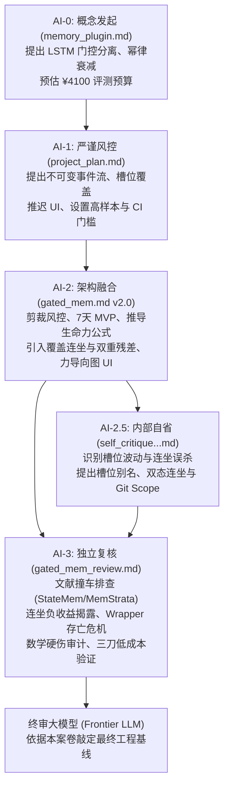
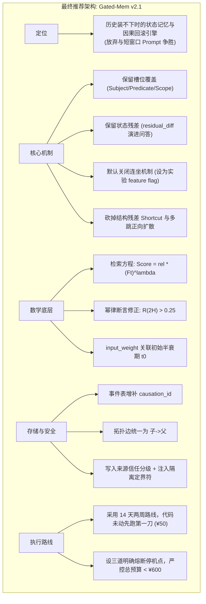

# Gated-Mem 方案综合归纳与大模型终审拍板案卷
# (Gated-Mem Comprehensive Synthesis & Adjudication Dossier)

> **案卷目的**：本案卷全面归纳工作区内关于 `gated_mem.md` 的所有方案文档、支撑材料、自省增强报告与独立复核意见，系统梳理多方 AI 的核心观点、技术分歧与底层证据，专供**高阶大参数前沿模型（Frontier LLM）**进行顶层技术路线裁决与方案终审拍板。  
> **归纳基准文件**：`gated_mem.md`（总体方案 v2.0）  
> **多方输入源**：
> - **AI-0（基础调研与范式提出者）**：`memory_plugin.md`（LSTM 门控语义、幂律衰减与初步基准调研）
> - **AI-1（工业/学术风控规划者）**：`project_plan.md`（严谨分期、统计功效门槛、SQLite WAL 并发与防御性规格）
> - **AI-2（方案主推与架构融合者）**：`gated_mem.md`、`artifacts/gated_mem_workflow_guide.md`、`artifacts/competitive_landscape_analysis.md`、`gated_mem_visualizer.html`（7天 MVP、数学闭式解、覆盖连坐、双重残差、力导向图 UI）
> - **AI-2.5（方案自省与微调增强者）**：`artifacts/self_critique_and_landscape_enhancement.md`（槽位别名、双态连坐、Git 分支感知 Scope、动态交互加权）
> - **AI-3（外部独立实证复核者）**：`review/gated_mem_review.md`（基于已发表 SOTA 实测的证伪分析、数学与 Schema 漏洞审计、三刀渐进式验证与关停/转向预案）

---

## 目录

1. [方案演进与各方 AI 角色画像](#1-方案演进与各方-ai-角色画像)
2. [总体方案 `gated_mem.md` 核心架构与主张提炼](#2-总体方案-gated_memmd-核心架构与主张提炼)
3. [多方 AI 的共识与底层分歧矩阵](#3-多方-ai-的共识与底层分歧矩阵)
4. [核心争议深度解构与实证证据链](#4-核心争议深度解构与实证证据链)
   - [争议一：持久化存储的存亡危机（StateMem Table 6 "Wrapper 效应"）](#争议一持久化存储的存亡危机statemem-table-6-wrapper-效应)
   - [争议二：“头号护城河”覆盖连坐的负收益证据与过杀风险](#争议二头号护城河覆盖连坐的负收益证据与过杀风险)
   - [争议三：零经费 7 天 MVP vs 严格风控瀑布流的执行路线冲突](#争议三零经费-7-天-mvp-vs-严格风控瀑布流的执行路线冲突)
   - [争议四：底层数学、数据 Schema 与状态机缺陷](#争议四底层数学数据-schema-与状态机缺陷)
   - [争议五：评测指标、统计功效与基准预算的真实账目](#争议五评测指标统计功效与基准预算的真实账目)
5. [大模型拍板决策清单（Adjudication Ballot）](#5-大模型拍板决策清单adjudication-ballot)
   - [决策项 1：项目终极定位与产品形态](#决策项-1项目终极定位与产品形态)
   - [决策项 2：核心机制去留与参数降级（砍/留/改）](#决策项-2核心机制去留与参数降级砍留改)
   - [决策项 3：检索排序方程与数学公式修正](#决策项-3检索排序方程与数学公式修正)
   - [决策项 4：数据 Schema、因果撤销与状态机补丁](#决策项-4数据-schema因果撤销与状态机补丁)
   - [决策项 5：评测验证策略与三刀验证流水线](#决策项-5评测验证策略与三刀验证流水线)
   - [决策项 6：执行周期与阶段性关停/转向条件](#决策项-6执行周期与阶段性关停转向条件)
6. [推荐裁决组合方案（Reference Verdict）](#6-推荐裁决组合方案reference-verdict)

---

## 1. 方案演进与各方 AI 角色画像



### 1.1 各方 AI 的立场与思考特征

| 角色编号 | 代表文档 | 核心关注点 | 核心倾向与风格 | 潜在盲区与偏颇 |
| :--- | :--- | :--- | :--- | :--- |
| **AI-0 (探索者)** | `memory_plugin.md` | 理论范式类比、参数更新、初步选型 | 试图将 xLSTM 等前沿门控理念映射到 Agent 记忆，主张输入/遗忘分离、幂律衰减。 | 引证一手文献不够严谨（如将 FadeMem 的 Weibull 误当幂律）；基准题量与成本预估粗糙。 |
| **AI-1 (风控者)** | `project_plan.md` | 工业落地风控、统计严谨性、数据防损 | 极度保守。要求 200 对标注才开自动覆盖、严密并发与事件安全、推迟所有演示性 UI。 | 过于学院派和瀑布流，将 MVP 工期拉长至 4–6 周；评测门槛在数学上自相矛盾（见争议五）。 |
| **AI-2 (攻坚者)** | `gated_mem.md`<br>`workflow_guide.md`<br>`competitive_landscape.md` | 独立开源交付、黑客直觉、差异化卖点 | 极致务实与黑客精神。提出 7 天 MVP、纯数学闭式解、覆盖连坐、双重残差、将可视化作为核心交互。 | 乐观盲目。忽视竞品已发表成果，缺乏严密数学推演（漏检索方程、写错单元测试），轻视安全。 |
| **AI-2.5 (修补者)** | `self_critique...md` | 边缘 Case 捕捉、前沿框架经验吸收 | 敏锐察觉到自然语言槽位易漂移、连坐易杀无辜规则、分支切换污染等工程硬伤，提出补丁。 | 治标不治本，打补丁增加系统复杂度，未直面“连坐机制本身是否有正增量”的根本问题。 |
| **AI-3 (审计者)** | `gated_mem_review.md` | 论文一手证据、统计功效、逻辑闭环 | 严厉求真、冷酷客观。直击项目存在前提（Table 6），指出连坐负收益，精准重构成本模型与单测。 | 倾向于推翻重来或转向 prompt/skill，对独立开源产品的“叙事价值”和开发者交互体验略显冷感。 |

---

## 2. 总体方案 `gated_mem.md` 核心架构与主张提炼

`gated_mem.md`（v2.0）由 AI-2 在吸收 AI-1 骨架的基础上裁剪形成，其对外宣称的核心体系如下：

### 2.1 四大工程铁律
1. **不可变事件日志（Event Sourcing）**：当前状态为 `memory_events` 投影，支持 `gated-mem undo <event_id>` $O(1)$ 逆向回滚。
2. **两阶段槽位对齐覆盖**：弃用纯余弦阈值，强制比对 `(Subject, Predicate, Scope)` 槽位；拿不准的归为 `candidate_conflict` 挂起待确认。
3. **废除 `IGNORED` 降权惩罚**：宿主 LLM 未回传引用不代表未使用，严防误杀否定式硬约束。
4. **Hooks 与 MCP 职责解耦**：MCP 提供工具接口，Hooks 负责会话级确定性注入与快照。

### 2.2 核心理论与计算公式
1. **基础幂律保留率**：
   $$R(v, \Delta) = \left(1 + \frac{\Delta}{t_0}\right)^{-\beta_{\text{type}}}, \qquad H_v = t_0 \left(2^{1/\beta_{\text{type}}} - 1\right)$$
2. **合成有效生命力公式**：
   $$F_t(v) = \Big( R(v, \Delta) + \sum_{u \in \mathcal{N}_{\text{parent}}(v)} \gamma \cdot \mathbb{I}(u \text{ active}) \cdot F_t(u) + \alpha_{\text{res}} \cdot \mathbb{I}(\text{Shortcut}(Root, v)) \Big) \times \prod_{p \in \mathcal{A}(v)} \psi(p)$$
   - $\gamma \in (0.2, 0.4)$：正向激活扩散系数；
   - $\psi(p) = 0.15$：祖先废弃连坐乘子（当祖先变为 `superseded`/`killed` 时触发）；
   - $\alpha_{\text{res}}$：结构残差加成。
3. **双重残差设计**：
   - **结构残差 (`RESIDUAL_SHORTCUT`)**：深层节点引用 $K \ge 3$ 次后直连 Root，实现 0 跳防截断；
   - **状态残差 (`residual_diff`)**：覆盖边上挂载轻量字符串，记录“为什么变”。

### 2.3 交付计划与评测设想
- **7 天 MVP 瀑布路线**：D1 核心数学与事件 -> D2 存储与冲突 -> D3 MCP/Hooks -> D4 CLI -> D5 力导向图 UI -> D6 50 组黄金集评测 -> D7 吃狗粮与开源发布。
- **评测指标**：有效状态命中率、过期状态泄露率（宣称基线 $>40\% \to$ 本方案 $<2\%$）、深层规则召回率。

---

## 3. 多方 AI 的共识与底层分歧矩阵

### 3.1 达成高度一致的共识点（无需争论，直接固化）

1. **事件溯源（Event Sourcing）作为架构底盘**：放弃在业务表中物理硬删除/修改数据，一切状态变更（创建、覆盖、连坐、撤销）均由不可变追加日志投影产生。
2. **拒绝纯余弦相似度覆盖判定**：MemStrata 与 AI 各方实测均证明，语义冲突/反转文本的余弦相似度往往高于近义改写（AUROC 仅 0.59）。必须采用结构化槽位比对，拿不准必须人工或交互挂起（`candidate_conflict`）。
3. **否定式与防御性约束必须特殊保护**：宿主模型不回传 `cited_ids` 是常态，绝对不能将“单轮未被命中”作为负反馈惩罚，否则“禁止使用 Redis”等高价值安全规则会在几轮内被过早遗忘。
4. **单文件 SQLite WAL 纯本地形态**：拒绝外部重型向量数据库（Milvus、Qdrant）或图数据库（Neo4j），所有状态与计算必须在开发者本地单机内闭环，零云端 API 依赖。
5. **记忆演进解释权（Explain Receipt）**：系统在向 LLM 注入记忆时，必须同时生成结构化回执，说明本次为什么注入 A、为什么拦截了高相似的 B，具备完全的黑盒透明性。

### 3.2 存在尖锐冲突的核心分歧矩阵

| 争议维度 | AI-1 (风控规划) | AI-2 (方案主推) | AI-2.5 (自省增强) | AI-3 (独立复核) | 争议本质 |
| :--- | :--- | :--- | :--- | :--- | :--- |
| **首发定位** | 纯 CLI 验证核心价值，无 UI，防误杀为主 | 具备完整图谱 UI 的端到端开源产品 | 增加别名与 Git 上下文的增强引擎 | 定位在“历史装不下上下文时的记忆”或回滚工具 | 是做“轻量插件产品”还是做“学术/Prompt 方案”？ |
| **覆盖连坐 ($\psi$)** | 默认禁止自动覆盖，需人工审核 | 核心护城河，$\psi=0.15$ 级联连乘清空子树 | 提出补丁：区分强依赖与弱环境（双态连坐） | **负收益机制**（实测 -12.5pp），建议默认关闭降级为实验项 | 连坐是防污染神技，还是杀敌八百自损一千的毒药？ |
| **持久化存储** | 假设持久化能带来长期跨会话收益 | 假设 SQLite 持久化是战胜无状态 RAG 的根本 | 默认接受持久化，增加 SQLite 别名表 | **提出存亡质疑**：短历史下持久化完败于纯 Prompt Wrapper | 持久化存储在当前大模型超长上下文时代是否多此一举？ |
| **双重残差** | 未作深入展开，强调简单基线 | 核心创新：结构 0 跳直达 + 状态 diff 留存 | 沿用并肯定残差机制 | 结构残差无必要（排序方程已解决）；状态残差保留且应放大 | 结构 Shortcut 是否是画蛇添足？ |
| **UI 优先级** | 极低，推迟到阶段 D（几周后） | 极高，Day 5 核心交付物，交互看板 | 沿用 Day 5 看板设想 | 极低，力导向图对价值验证无用，仅保留 CLI explain | 图谱可视化是核心生产力工具还是演示花架子？ |
| **验证与成本** | 需 200+ 样本、CI 显著检验，估算需大预算 | 零经费，手写 50 组 Golden Fixtures 验证 | 沿用 50 组样例自测 | 预算模型重算为三刀（<¥600），必须设 5 臂对照与桥接实验 | 50 组自制测试集是否自欺欺人？LLM 评测究竟贵不贵？ |
| **工期与节奏** | 5 天 Spike + 2~3 周核心 + 1~2 周试点 | 7 天极限 MVP 开源发布 | 7 天内合入 4 个增强补丁 | 严禁直接写代码，先花 ¥50 跑第一刀验证，设三道停机点 | 究竟是“边写边测”还是“先证伪假设再动工”？ |

---

## 4. 核心争议深度解构与实证证据链

### 争议一：持久化存储的存亡危机（StateMem Table 6 "Wrapper 效应"）

这是 AI-3 对总体方案发起的**最致命质询**，直接动摇了 Gated-Mem 作为持久化存储插件的存在合理性。

#### 1. 核心实证证据（arXiv:2608.19652 §6.4 Table 6）
StateMem 论文在 StateMemBench（n=60 配对子集，相同 chunk，相同 Judge）上对比了**完整持久化存储系统**与**纯 Prompt 改写 Wrapper（零持久化存储，仅在提问时通过 Prompt 进行状态溯源链还原与优先级裁决）**的表现：

| 条件 / 后端架构 | Qwen-3.5-9B | DeepSeek-V4-Flash |
| :--- | :---: | :---: |
| **完整 StateMem 系统（含完整持久化状态存储）** | **23.3** | **36.3** |
| Mem0 单独 | 25.0 | 28.3 |
| **Mem0 + 纯 Prompt Wrapper（无存储）** | **56.7** | **71.7** |
| **A-Mem + 纯 Prompt Wrapper（无存储）** | **56.7** | **75.0** |
| **Dense + 纯 Prompt Wrapper（无存储）** | **56.7** | **70.0** |

#### 2. 深度分析与各方辩论
- **AI-3 的观点**：在上下文窗口能够容纳对话历史的范围内（StateMemBench 为 165~600 轮，约 3k~15k tokens），**在回答时依靠 Prompt 现场解析状态，其准确率（56.7~75.0）是复杂持久化系统（23.3~36.3）的 2 倍以上**。如果 Gated-Mem 耗费巨大精力打造 SQLite 事件溯源、衰减公式与图谱，却在一个 Prompt 模板就能解决的问题域里竞争，本质上是在用极其昂贵且低效的架构去跑一个错误的问题。
- **AI-2 的潜在抗辩与破局点**：StateMemBench 的测试集历史较短（<15k tokens）。但在真实大型工程演进中，一个开发数周的项目历史上下文超过数十万甚至上百万 tokens，**根本不可能每次全量塞入上下文做 Prompt Wrapper**。持久化存储的核心价值不在于“短历史下的状态裁决”，而在于**“历史超长装不下时的跨周期状态投影”**。
- **裁决影响**：Gated-Mem 必须**彻底放弃在短历史对话基准上宣称超越 Prompt 类方案**。必须重新锚定核心价值：**“超长工程生命周期下，上下文溢出时的确定性状态防线”**。

---

### 争议二：“头号护城河”覆盖连坐的负收益证据与过杀风险

AI-2 将“祖先覆盖连坐坍缩（$\psi=0.15$）”列为四大护城河之一，而 AI-3 与学术界实测显示其极度危险。

#### 1. 核心实证证据（arXiv:2608.19652 §6.2 消融实验）
StateMem 论文对其依赖传播机制（Rechecker 遍历 DAG 标记 `needs_recheck`，等价于 Gated-Mem 的连坐）进行了严密消融：
> *"dependency propagation helps its target modes but **over-propagates on Set B anti-traps (−12.5 pp)**, and **removing it leaves DeepSeek slightly better (0.373 vs. 0.363)**."*

也就是说，在引入连坐机制后，系统在防御陷阱题上**大幅倒退 12.5 个百分点**；在强模型（DeepSeek）上，**把连坐机制彻底删掉，总准确率反而从 0.363 提升至 0.373**。

#### 2. 数学机理穿透：指数级毁灭
Gated-Mem 在多父 DAG 下定义的连坐公式为连乘积：
$$\prod_{p \in \mathcal{A}(v)} \psi(p) = 0.15^k$$
- 当受影响祖先数 $k=1$ 时，乘子为 $0.15$；
- 当 $k=2$ 时，乘子剧降至 **$0.0225$**；
- 当 $k=3$ 时，乘子变为 **$0.003375$**（千分之三，直接彻底物理死亡）。

在复杂工程中，通用设计规范（如“单测必须 Mock 外部网络”）往往会同时挂载在多个中间实体上。只要其中某个技术栈弃用（如 MySQL 废弃），该通用规则就会被连乘瞬间杀死。AI-2.5 提出的“双态连坐（Hard/Soft）”虽然在工程上有所缓和，但依旧无法消除其在 Anti-trap 模式下的负增量。

---

### 争议三：零经费 7 天 MVP vs 严格风控瀑布流的执行路线冲突

#### 1. 矛盾焦点
- **AI-2 的 7 天路线**：试图在 7 天内同时完成底层数学、SQLite 存储、两阶段冲突、MCP、Claude Code Hooks、CLI 工具、Canvas/SVG 力导向图前端，并在 D6 使用手写的 50 组 Golden Fixture 自测，D7 吃狗粮发布。
- **AI-1 的风控路线**：要求第一阶段只做核心 Spike，必须标注 200 对测试集且达到 98% 精度才允许开启自动覆盖，图谱 UI 推迟到第四阶段，整体周期长达 4~6 周。
- **AI-3 的批判与修正**：
  - 双方皆不可取。AI-2 的 7 天是“一人做全栈”的不切实际幻想，且 50 组自制测试集极其容易陷入过拟合与虚假自嗨；
  - AI-1 的 98% 精度门槛实质上等于“永远不开启自动化”（200 题中只允许错 4 题），将工期拖得过长。

#### 2. 真实成本重算（打破 ¥4100 与 ¥20 的两极误区）
AI-3 对评测预算进行了科学剥离与重算：
- `memory_plugin.md` 预估的 **¥4100**：高估了 Probe 题量（实际 StateMemBench 仅 322 题而非 700 题），但漏算了逐轮 Ingest 的 API 消耗（若模拟 StateMem 的逐轮抽取，需近 10 万次调用，实际成本超 ¥1500）；
- `benchmark_guide.md` 宣称的 **≤¥20**：严重漏算模型输出上下文与 Ingest，仅在纯本地小模型下成立。
- **三刀阶梯验证预算（总计 <¥600）**：
  - **第一刀（¥0~50）**：直接利用 StateMemBench 自带的标注建库（跳过 Ingest），跑 322 Probes 对比【纯向量 vs 槽位覆盖】，半天出结果。
  - **第二刀（¥60~150）**：加入生命力 $\lambda$ 与连坐消融。
  - **第三刀（¥250~400）**：跨 Token 窗口的桥接实验（验证存储在超长历史下的价值）。

---

### 争议四：底层数学、数据 Schema 与状态机缺陷

AI-3 逐行审计揭露了 `gated_mem.md` 照搬代码时会直接导致崩溃的硬伤：

1. **缺失检索排序方程（最致命漏洞）**：
   $F_t(v)$ 只是一个节点固有生命力（取值与 query 无关）。检索需要根据 Query 计算相关性 $rel(q, v)$。文档自始至终未给出两者如何结合。若简单相乘，衰减到 0.2 的极高相关记忆会被 1.0 的完全无关新鲜记忆碾压。
2. **`input_weight`（输入门重要度）是摆设**：
   主表里定义了 `input_weight REAL NOT NULL`，但在生命力公式 $F_t(v)$ 中没有任何一项使用该变量，对外宣称的“输入门与遗忘门分离”在数学上未实现。
3. **“$O(1)$ 一键 Undo”在物理上无法实现**：
   `memory_events` 表只有 `event_id, step, event_type, payload_json`，**完全没有 `causation_id` 或 `parent_event_id` 字段**。当撤销一个覆盖事件时，无法反向索引找到它派生出的那一批 `CASCADE_DEMOTED` 事件。撤销在现有 Schema 下根本无法回溯级联。
4. **`BELONGS_TO` 拓扑边方向定义冲突**：
   `gated_mem.md:90,119` 与 `workflow_guide.md:90` 要求边是 **子 $\to$ 父**（用于向上溯源 ROOT 计算深度）；但在 Mermaid 架构图（`workflow_guide.md:192`）中画的却是 **父 $\to$ 子**。若照图实现，连坐降权将沿拓扑反向传播，导致父节点被废弃、子节点被提权。
5. **单测硬编码错误：`R(2H) = 0.25` 违背幂律数学事实**：
   `project_plan.md:234` 将其作为 Day-1 核心单测。但对于幂律衰减 $R(\Delta)=(1+\Delta/t_0)^{-\beta}$，代入 $\Delta=2H$：
   $$R(2H) = \left(2 \cdot 2^{1/\beta} - 1\right)^{-\beta}$$
   对于任意有限的 $\beta$（如 0.5, 1.0, 2.0），$R(2H)$ 严格落在 **$0.299 \sim 0.414$**，严格大于 0.25。只有在 $\beta \to \infty$（退化为指数衰减）时才等于 0.25。若照原单测写，开发者必须改回指数衰减才能通过测试，直接废除幂律设计。
6. **`pinned` 节点与连坐公式冲突**：
   文档宣称 Pin 节点强制生命力为 1.0，但公式中未引入 Pin 因子，且未界定 Pin 是免疫时间衰减还是免疫覆盖连坐。

---

### 争议五：评测指标、统计功效与基准预算的真实账目

#### 1. 统计功效悖论（数学上不可能通过的验收标准）
`project_plan.md:472` 设定了硬性指标：“相对提升 $\ge 10\%$，且 **Bootstrap 95% 置信区间 (CI) 下界 $> 0$**”。
经双侧 McNemar 精确检验检验（样本量 $n=234$，基线不一致率 $\pi_d=0.15$）：
- 检验功效达到 80% 所需的最小可检测绝对效应差为：
  $$\Delta_{\min} = \frac{(z_{.975} + z_{.8})\sqrt{\pi_d}}{\sqrt{n}} \approx 7.1\text{pp}$$
- 当基线准确率为 $28\%$ 时，相对提升 $+10\%$ 对应的绝对差仅为 **$+2.8\text{pp}$**。在此样本量下，统计功效仅有 **$20\%$**。
- 若要在 $n=234$ 上让 95% CI 下界大于 0，实测效应必须大于 **$4.96\text{pp}$（即相对提升必须 $>17.7\%$）**。
- **结论**：原方案设定的门槛在数学上自相矛盾，即使方案真实达到 10% 提升，该验收流程也必然判定失败。

#### 2. “过期泄露率 <2%” 是严重的反向指标
StateMemBench 论文实测 Table 5 显示：
- **LightMem** 的 drift-rate 仅为 **$14.9\%$**（全场最低，远优于 StateMem 的 49.1%），但它的总体准确率仅有 **$0.012$**（几乎全错），其 322 个问题中只有 52 个能给出有效候选回答。
- **作弊机理**：系统只要大量拒答、格式解析崩溃或输出空白，就能轻松刷出极其漂亮的 $<2\%$ 泄露率。单纯以泄露率作为对外宣传主指标，会被行内评测一秒戳破。

---

## 5. 大模型拍板决策清单（Adjudication Ballot）

本节为高阶大模型设计了**六大核心裁决任务**。请对每一项进行权衡分析并给出定论选择（Option A / B / C）及定制修正指令。

---

### 决策项 1：项目终极定位与产品形态

* **待决争议**：面对 StateMem Table 6（短历史下纯 Prompt 改写以 75.0 对 36.3 碾压持久化存储系统）的事实，Gated-Mem 究竟以何种形态立足？

| 备选方案 | 方案阐释 | 核心优势 | 潜在代价/风险 |
| :--- | :--- | :--- | :--- |
| **Option 1-A**<br>维持独立本地插件定位，但**重定目标域** | 明确放弃在短上下文内宣称超越 Prompt；定位于“**上下文装不下时（超长周期、跨数周开发）的本地可撤销状态引擎**”。卖点前置为：①不可变审计与一键撤销；②演进原因追溯 (`residual_diff`)；③超长历史防漂移。 | 守住端到端产品形态；理论依据扎实（准确切入 StateMem 未测的空白区）；商业辨识度高。 | 必须通过专门构建的双窗口桥接实验（长/短两组）来实证其价值。 |
| **Option 1-B**<br>降级为 **Prompt / Skill 模板与轻量规则规范** | 放弃复杂的 SQLite、守护进程、Hooks 与事件流，将两阶段槽位裁决提炼为纯 Claude Code / Cursor Skill 或 Prompt 模板。 | 极轻量，零维护负担，零存储 Bug，1天即可发布传播，契合当前超长上下文模型发展趋势。 | 失去独立工具/插件生态位；无法实现跨会话历史演进因果审计与可逆回滚。 |
| **Option 1-C**<br>转向纯粹的 **Agent 记忆可观测与安全回滚工具** | 弱化“自动化门控淘汰”叙事，聚焦于“**Agent 记忆时光机与版本控制（Git for Agent Memory）**”，主打记忆审计、人工 Dry-run 裁决与精准 Undo。 | 完全避开模型效果好坏的学术口水战；工程确定性 100%；直击开发者怕 Agent 删错记错的心理。 | 市场受众相对收窄，偏向硬核运维工具属性。 |

---

### 决策项 2：核心机制去留与参数降级（砍/留/改）

* **待决争议**：原总体方案中的“覆盖连坐 $\psi=0.15$”、“结构残差 `RESIDUAL_SHORTCUT`”、“正向扩散 $\gamma$”、“单文件力导向图 UI”究竟该保留、修改还是直接砍掉？

| 模块名称 | 原方案设计 (v2.0) | 争议与负面证据 | 拍板选项（请裁决） |
| :--- | :--- | :--- | :--- |
| **覆盖连坐 ($\psi$)** | 祖先被覆盖，子孙生命力全部乘以 $\psi=0.15$，连乘坍缩。 | StateMem 消融显示负收益（$-12.5\text{pp}$）；多亲 DAG 乘积导致万分之三过杀。 | **[A]** 坚决砍掉，只保留直接覆盖；<br>**[B]** 降级为默认关闭的实验开关，改为双态连坐 (Hard=0.3/Soft=0.8)；<br>**[C]** 维持原样，依靠人工 Undo 救火。 |
| **结构残差 (`RESIDUAL_SHORTCUT`)** | 节点被引用 3 次，跨层直接与 ROOT 连虚线边，0 跳直达。 | 引入检索排序方程后，高相关节点本就会被捞出，人工加边破坏拓扑层次且收益无量化支撑。 | **[A]** 砍掉，精简图谱拓扑；<br>**[B]** 保留，作为低 Token 预算下的保底机制；<br>**[C]** 暂缓，待消融实验证明其确实捞回了有效规则后再决定。 |
| **状态残差 (`residual_diff`)** | 覆盖边上记录“为什么废弃 A 改用 B”的轻量原因。 | 全网唯一无撞车设计，高度契合真实编码追溯诉求，但此前缺乏 Schema 与检索协议。 | **[A]** 提为一等核心功能，增加专属演进问答评测；<br>**[B]** 维持原轻量设计；<br>**[C]** 砍掉以减小开销。 |
| **正向激活扩散 ($\gamma$)** | 父节点被命中，子节点获得 $\gamma=0.3$ 增益，多层级联。 | 3 层以上增益仅 $0.008$，数值上无感知；存在循环图不收敛隐患。 | **[A]** 限制为仅向下一跳（1-Hop）且加环检测；<br>**[B]** 完全砍掉扩散项；<br>**[C]** 提高 $\gamma$ 至 0.6 并递归计算。 |
| **力导向图 Web UI** | Day 5 必须交付单文件 Canvas/SVG 交互看板。 | 严重挤占内核验证工时；CLI `explain` 已经足够提供透明度。 | **[A]** 砍掉，首版仅保留 CLI 文本树形回执；<br>**[B]** 降为阶段 D 可选交付；<br>**[C]** 坚持 Day 5 硬性交付以利于宣传。 |

---

### 决策项 3：检索排序方程与数学公式修正

* **待决争议**：补齐确实的检索排序逻辑，修正幂律衰减单测错误，将输入门参数接入数学计算。

#### 1. 检索排序方程裁决
现已明确检索必须同时考量查询相关性 $rel(q, v)$ 与节点固有生命力 $F_t(v)$。请拍板采用哪种方程形式：
- **公式方案 A（乘幂门控）**：
  $$\text{Score}(v \mid q) = rel(q, v) \cdot [F_t(v)]^\lambda, \qquad \lambda \in [0, 1]$$
  *(说明：$\lambda=0$ 退化为纯向量检索基线，$\lambda$ 可作为直接消融参数)*
- **公式方案 B（分段阈值过滤）**：
  先硬过滤掉 $F_t(v) < \tau$ 的节点，剩余节点纯按 $rel(q, v)$ 降序排列。
- **公式方案 C（线性加权和）**：
  $$\text{Score}(v \mid q) = w_1 \cdot rel(q, v) + w_2 \cdot F_t(v)$$

#### 2. `input_weight`（输入重要度 $i_v \in (0, 1]$）如何落入数学公式？
- **选项 A（调节半衰期基底）**：将其作为初始半衰期缩放因子：$t_0(v) = t_{0, \text{type}} \cdot (i_v)^\eta$（重要度越高，衰减越慢）。
- **选项 B（作为生命力基础前缀）**：$F_t(v) = i_v \cdot R(v, \Delta) + \dots$
- **选项 C（彻底移除该字段）**：承认当前为简单按类型定半衰期，移除主表冗余装饰字段。

#### 3. 单测断言修正
针对 `R(2H)` 的断言，必须修改 `project_plan.md:234` 中的错误期望值 $0.25$：
- 采纳 AI-3 建议的参数化闭式解：断言 `R(2H) == (2 * 2**(1/β) - 1)**(-β)`，且断言 `R(2H) > 0.25` 以在单测中物理证明“幂律长尾优势”。

---

### 决策项 4：数据 Schema、因果撤销与状态机补丁

* **待决争议**：如何修复事件溯源因果断裂、拓扑边方向矛盾、Git 分支穿透与状态迁移漏洞？

#### 1. 因果撤销字段与撤销语义
- **Schema 补丁**：必须在 `memory_events` 中补充 `causation_id TEXT`（引发本事件的上游事件 ID）与 `correlation_id TEXT`（业务操作批次 ID）。
- **撤销语义**：裁决 Undo 是采用“硬性逆向级联补偿事件”，还是在目标事件被后续下游依赖时“中断并报警需人工确认”？

#### 2. `BELONGS_TO` 边方向标准化
- 裁决标准化方向为 **子 $\to$ 父**（`source=child, target=parent`），通过为 `target_id` 建立索引实现向下查找子级，彻底消除拓扑遍历方向矛盾。

#### 3. 状态机迁移矩阵（5×5）正式固化
是否正式批准以下状态迁移约束？
- `active` $\to$ `candidate_conflict`（出现模糊冲突）
- `candidate_conflict` $\to$ `active` / `superseded`（人工/规则裁决）
- `superseded` / `killed` $\to$ **严禁普通写入复活，仅能通过 `undo` 显式补偿事件恢复**。

#### 4. 安全防护与注入阻断（Prompt Injection 防御）
- 增加来源信任分级：`user_verified` $>$ `tool_derived` $>$ `model_inferred`。
- 上下文注入增加边界安全声明：明确在注入块外部包裹数据隔离标签，防范通过恶意 README 注入持久化记忆。

---

### 决策项 5：评测验证策略与三刀验证流水线

* **待决争议**：彻底推翻单一的 50 组手写集，采用低成本、强统计说服力的实测流程。

#### 1. 验证流水线裁决
- **批准三刀流水线**：
  - **第 1 刀（¥0~50）**：StateMemBench 322 Probes（两条件：纯向量 vs 槽位覆盖）。不测衰减，只测槽位覆盖是否能在真实基准上显著减少旧状态召回。**若此步无优势，直接叫停或转向**。
  - **第 2 刀（¥60~150）**：生命力权重 $\lambda \in \{0, 0.3, 1.0\}$ 与连坐开/关消融。
  - **第 3 刀（¥250~400）**：双窗口桥接实验（40 个模拟演进项目，对比 5 臂对照组，测短窗口与超长窗口下的增量差异）。

#### 2. 指标汇报口径修正
- **坚决弃用**单一“过期泄露率 $<2\%$”的虚荣口径；
- **固化主指标**：StateMemBench Closed-pool Current-State Accuracy；
- **固化辅助指标**：Drift-rate（且必须强制同时附带 In-pool 数量与作答率）；
- **统计门槛修正**：删除“CI 下界 $>0$”的严苛门槛，改为报告效应置信区间宽度，主关注绝对点估计提升量（目标设定为绝对提升 $\ge 7\text{pp}$）。

---

### 决策项 6：执行周期与阶段性关停/转向条件

* **待决争议**：放弃虚假的 7 天全量交付，设定带“熔断停机阀门”的现实落地周期。

#### 1. 周期时间表裁决
- 推荐采用 **14 天两周节奏**（D1 修正设计与跑第一刀；D2 决策点 1；D3~D4 最小内核实现；D5~D6 跑第二刀并敲定连坐；D7~D9 跑第三刀长窗口验证；D10 终审决策点；D11~D14 插件生态封装与发布）。

#### 2. 明确的关停与转向退出路径（熔断预案）
请确认以下熔断条件触发时的备选退路：
```text
[熔断条件 1] 第一刀实验中，槽位覆盖相比纯向量基线无统计差异：
             ===> 立即叫停，放弃复杂存储，转向纯 Prompt 状态跟踪规范。

[熔断条件 2] 第二刀消融中，连坐机制导致总准确率下降（复现 -12.5pp 现象）：
             ===> 物理剔除连坐乘子代码，系统只做直接冲突覆盖。

[熔断条件 3] 第三刀桥接实验中，超长窗口下完整系统未能超越一行提示词修复：
             ===> 放弃插件项目，将 Explain Receipt 机制开源为一个小而美的 Agent 审计规范。
```

---

## 6. 推荐裁决组合方案（Reference Verdict）

> 为方便大模型快速决策，在此提供一份经过工程、数学与实证三重校准后的**推荐裁决基准线（Baseline Verdict）**，终审模型可在该基准基础上微调确认：



### 推荐裁决摘要表
1. **项目定位**：采纳 **Option 1-A**。主打“超长开发周期中上下文溢出时的精准状态维护”与“100% 可审计、可解释、一键撤销”，避开短文本 Prompt 的锋芒。
2. **机制剪裁**：
   - **覆盖连坐 $\psi$**：默认**物理关闭**，降级为实验特性，仅在显式 Hard 依赖且测试集证明有效时才允许开启；
   - **结构残差 Shortcut**：**砍掉**，拓扑保持清晰树状/DAG，高频深层记忆依靠排序方程自然打分捞出；
   - **状态残差 `residual_diff`**：**保留并升级**，增加“演进问答”专属能力，形成差异化功能壁垒；
   - **正向扩散 $\gamma$**：限制为 **仅 1-Hop**，禁止跨层递归累加；
   - **力导向图 UI**：**降为 Phase D 可选**，首版仅做 CLI 结构化 `explain` 回执。
3. **数学闭环**：
   - 补齐检索方程 $\text{Score} = rel(q, v) \cdot [F_t(v)]^\lambda$；
   - 将 $i_v$ 映射为 $t_0(v) = t_{0, \text{type}} \cdot i_v$；
   - 修订单测期望，断言 $R(2H) > 0.25$ 与精确解析式。
4. **工程健壮**：
   - `memory_events` 增加 `causation_id`，Undo 明确为生成逆向补偿事件；
   - 边方向统一为 `child --BELONGS_TO--> parent`；
   - 固化 5×5 状态迁移表，严禁普通写入复活 `killed`/`superseded` 记忆。
5. **评测与执行**：
   - 采纳 14 天研发周期，**在写任何业务代码前先花 ¥50 跑完第一刀（StateMemBench 322 题槽位覆盖验证）**；
   - 整体评测预算严格控制在 ¥600 内，通过三道决策点动态决定 Go / 转向 / 关停。

---
*案卷整理完毕，请大参数决策模型依据上述解构与决策清单，正式给出最终方案拍板意见与指导指令。*
