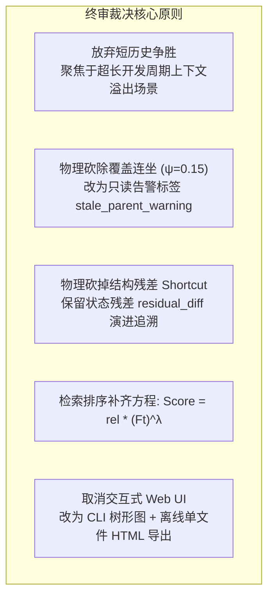
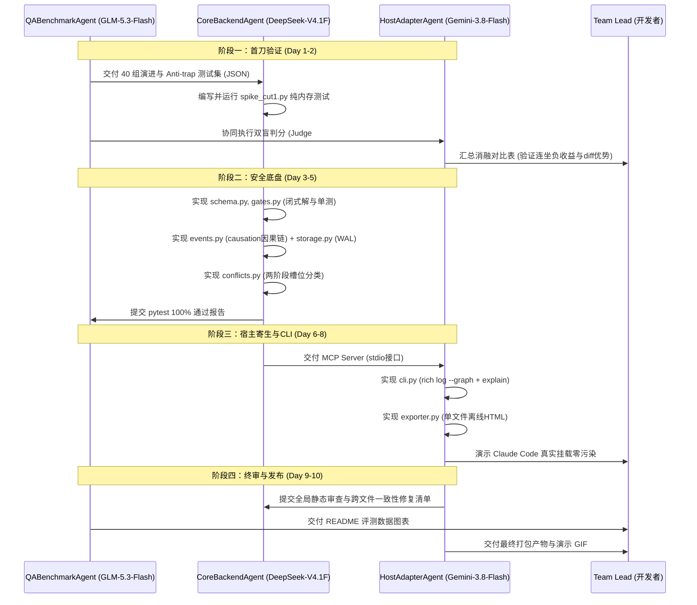

# Gated-Mem v2.1 工程实施方案与 Agent Team 协同执行蓝图
# (Gated-Mem v2.1 Implementation Plan & Multi-Agent Execution Playbook)

> **版本**：v2.1 终审定案工程版  
> **制定依据**：大模型终审裁决书（《拍板.txt》/ 裁决判定）与《Gated-Mem 方案综合归纳与大模型终审拍板案卷》  
> **核心定位**：**Git for Agent Memory —— 面向超长开发周期的本地可审计、可回滚架构状态引擎**  
> **执行主体**：三模型协同 Agent Team（`CoreBackendAgent` + `HostAdapterAgent` + `QABenchmarkAgent`）  
> **目标周期**：10 天敏捷交付，零外部 API 预算，产出开箱即用开源插件

---

## 目录

1. [终审定案架构与核心决策落实](#1-终审定案架构与核心决策落实)
2. [Agent Team 拓扑编排与协同协议](#2-agent-team-拓扑编排与协同协议)
3. [系统技术规格与数学闭式解](#3-系统技术规格与数学闭式解)
4. [数据库 Schema 与事件溯源设计 (DDL)](#4-数据库-schema-与事件溯源设计-ddl)
5. [分阶段 WBS 任务包分解 (Task Packages)](#5-分阶段-wbs-任务包分解-task-packages)
   - [阶段一 (Day 1–2)：首刀零代码/轻脚本验证 (决定生死)](#阶段一-day-12首刀零代码轻脚本验证-决定生死)
   - [阶段二 (Day 3–5)：打造 v2.1 核心安全底盘 (DeepSeek 主刀)](#阶段二-day-35打造-v21-核心安全底盘-deepseek-主刀)
   - [阶段三 (Day 6–8)：MCP 宿主寄生与可解释 CLI 闭环 (Gemini 主刀)](#阶段三-day-68mcp-宿主寄生与可解释-cli-闭环-gemini-主刀)
   - [阶段四 (Day 9–10)：全局代码审计、对比实测与开源发布](#阶段四-day-910全局代码审计对比实测与开源发布)
6. [质量门禁、熔断策略与回滚预案](#6-质量门禁熔断策略与回滚预案)
7. [附录：阶段一首刀验证脚本 (`spike_cut1.py`) 完整实现](#7-附录阶段一首刀验证脚本-spike_cut1py-完整实现)

---

## 1. 终审定案架构与核心决策落实

根据大模型的最终拍板结果，本项目彻底理清了“理论设想”与“工程现实”的边界，严格落实以下核心裁决：



### 1.1 裁决要点映射表

| 裁决模块 | 原 v2.0 构想 | v2.1 终极落实规格 | 收益与风险规避 |
| :--- | :--- | :--- | :--- |
| **项目定位** | 试图在通用基准与 Prompt 争胜 | **Git for Agent Memory**：定位在超长周期（跨数周开发、历史装不下上下文）的本地状态引擎 | 避开短历史下 Prompt Wrapper 碾压存储系统的理论陷阱（StateMem Table 6）。 |
| **覆盖连坐** | $\psi=0.15$ 级联连乘清空子树 | **物理砍掉自动降权**，改为输出回执中的 `stale_parent_warning=True` 提示标签 | 消除 Anti-trap 陷阱题上 $-12.5\text{pp}$ 的负收益，杜绝多亲 DAG 下千分之三的误杀。 |
| **结构残差** | 引用 3 次直接与 ROOT 连跳跃边 | **彻底删除该机制**，图谱拓扑保持严谨树状与有向无环图 | 避免破坏分级拓扑；高频重要记忆自然由排序方程打分提升优先级。 |
| **状态残差** | 边上挂载轻量字符串 | **提拔为一等核心功能 (`residual_diff`)**，用于解答“为什么当初换掉 X” | 填补全网竞品空白，形成独家 ADR（架构决策记录）自动沉淀能力。 |
| **正向激活扩散** | $\gamma=0.3$ 多层递归累加 | **限制为 1-Hop 临时增益（$\gamma=0.2$）**，仅在检索排序内存中计算，不改写持久态 | 杜绝循环图死递归，杜绝深层微弱增益（0.008）浪费 CPU。 |
| **展现层** | 独立 Web Server 力导向图 | **CLI 彩色树 (`gated-mem log --graph`) + 单文件离线 HTML 导出** | 零端口占用、零跨域安全隐患、断网可用，直接产出 GitHub README 演示图。 |

---

## 2. Agent Team 拓扑编排与协同协议

整个实施团队由三位专职 AI Agent 组成，采用松耦合、契约驱动的管线化协作：



### 2.1 角色权责边界

1. **`CoreBackendAgent` (底层架构与算法主程，由 `DeepSeek-V4.1F` 驱动)**：
   - 职责：负责 `src/gated_mem/` 下的 `schema.py`、`gates.py`、`events.py`、`storage.py`、`conflicts.py`、`server.py`。
   - 准则：代码逻辑必须严谨，追求极速数学闭式解；严禁引入未经实验论证的复杂惩罚系数；保证 SQLite WAL 读写并发与事务原子性。

2. **`HostAdapterAgent` (宿主适配、CLI与可视化工程师，由 `Gemini-3.8-Flash` 驱动)**：
   - 职责：负责 `adapters/claude_code.py`、`cli.py`、`exporter.py` 以及全局代码跨文件一致性终审。
   - 准则：保证 stdio 管道绝对干净（严防 `print` 污染 json-rpc）；CLI 输出必须优美、直观（仿 `git` 命令体验）；离线 HTML 必须零外部 CDN 依赖。

3. **`QABenchmarkAgent` (槽位抽取、测试集与独立评审工程师，由 `GLM-5.3-Flash` 驱动)**：
   - 职责：负责构造 40 组含状态演进与 Anti-trap 陷阱的高质量测试用例、提炼高精度 JSON 槽位抽取 Prompt，并在实验中担任双盲二号裁判。
   - 准则：测试用例必须贴合真实全栈项目技术演进；严禁裁判偏置；严格用 `must_include` 与 `must_exclude` 实行客观扣分制。

---

## 3. 系统技术规格与数学闭式解

### 3.1 基础衰减与生命力数学规范

#### 1. 记忆类型与基础半衰期
系统预置四种记忆类型，对应固定的衰减幂律指数 $\beta_{\text{type}}$ 与基准半衰步数 $t_{0, \text{base}}$：

| 记忆类型 (`memory_type`) | $\beta_{\text{type}}$ | 典型代表场景 | 基准半衰步数 $t_{0, \text{base}}$ |
| :--- | :---: | :--- | :---: |
| `DECISION` (核心架构决策) | **0.10** | “主数据库由 MySQL 切换为 PostgreSQL” | 100 步 |
| `CONSTRAINT` (技术约束规范) | **0.05** | “所有单测必须使用 pytest 并 mock 外部网络” | 200 步 |
| `PREFERENCE` (开发者习惯偏好) | **0.15** | “代码注释与说明一律使用中文” | 80 步 |
| `EPHEMERAL` (临时观察/中间状态) | **1.20** | “本次编译失败可能与本地缓存未清理有关” | 5 步 |

#### 2. 输入门重要度映射公式
写入重要度 $i_v \in [0.1, 1.0]$（默认 0.5）作为时间常数缩放因子直接落入公式：
$$t_0(v) = t_{0, \text{base}}(\text{type}) \cdot (0.5 + i_v)$$
动态半衰期为：
$$H_v = t_0(v) \cdot \left(2^{1/\beta_{\text{type}}} - 1\right)$$

#### 3. 基础幂律保留率计算
逻辑步数差 $\Delta = \max(0, \text{current\_step} - \text{last\_cited\_step})$：
$$R(v, \Delta) = \left(1 + \frac{\Delta}{t_0(v)}\right)^{-\beta_{\text{type}}}$$

#### 4. 合成有效生命力公式（无连坐安全闭式解）
$$F_t(v) = \begin{cases} 1.0, & \text{if } v.\text{pinned} = 1 \\ \min\left(1.0,\; R(v, \Delta) + 0.2 \cdot \max_{u \in \mathcal{N}_{\text{parent}}(v)} \left[ \mathbb{I}(u \text{ cited this turn}) \cdot R(u, \Delta_u) \right]\right), & \text{otherwise} \end{cases}$$
- **连坐替代方案**：若 $\exists p \in \mathcal{A}(v)$ 处于 `superseded` 或 `killed` 状态，**不扣减** $F_t(v)$，但在提取回执中打上 `stale_parent_warning = True` 并记录失效祖先 ID。

#### 5. 最终检索排序方程
给定查询 $q$ 和候选节点 $v$，其最终检索得分 $\text{Score}(v \mid q)$ 为相关性与固有生命力的乘幂门控：
$$\text{Score}(v \mid q) = \text{rel}(q, v) \cdot \left[ F_t(v) \right]^\lambda, \qquad \lambda = 0.3$$
- $\text{rel}(q, v) \in [0, 1]$：本地向量嵌入（或 BM25 词频匹配）的余弦相关度；
- $\lambda \in [0, 1]$：时间门控调节因子（$\lambda=0$ 自动退化为经典纯向量检索）。

---

## 4. 数据库 Schema 与事件溯源设计 (DDL)

采用单文件 SQLite 3（启用 `WAL` 模式与外键约束），表结构中深度内嵌因果链与两阶段冲突所需字段。

```sql
-- ========================================================
-- Gated-Mem v2.1 生产级 SQLite Schema 定义
-- ========================================================
PRAGMA journal_mode = WAL;
PRAGMA foreign_keys = ON;

-- 1. 不可变事件日志表 (Truth Source / Event Sourcing)
CREATE TABLE IF NOT EXISTS memory_events (
    event_id        TEXT PRIMARY KEY,                  -- UUID
    project_id      TEXT NOT NULL,                     -- Git 根目录哈希
    step            INTEGER NOT NULL,                  -- 全局单调递增逻辑步数
    event_type      TEXT NOT NULL,                     -- MEMORY_CREATED | MEMORY_SUPERSEDED | MEMORY_RESTORED | EVENT_UNDONE | MEMORY_PINNED | MEMORY_KILLED
    causation_id    TEXT,                              -- 引发此事件的上游事件 ID (因果链回溯基石)
    correlation_id  TEXT NOT NULL,                     -- 同一批次事务的操作批次 ID
    payload_json    TEXT NOT NULL,                     -- 包含 before_state 与 after_state 快照
    created_at      TEXT NOT NULL DEFAULT (datetime('now'))
);
CREATE INDEX IF NOT EXISTS idx_events_proj_step ON memory_events(project_id, step);
CREATE INDEX IF NOT EXISTS idx_events_causation ON memory_events(causation_id);
CREATE INDEX IF NOT EXISTS idx_events_correlation ON memory_events(correlation_id);

-- 2. 当前有效记忆投影主表 (Read Model Projection)
CREATE TABLE IF NOT EXISTS memories (
    memory_id       TEXT PRIMARY KEY,                  -- UUID
    project_id      TEXT NOT NULL,
    content         TEXT NOT NULL,                     -- 记忆自然语言文本
    memory_type     TEXT NOT NULL,                     -- DECISION | CONSTRAINT | PREFERENCE | EPHEMERAL
    subject         TEXT NOT NULL,                     -- 规范槽位实体 (如: database.primary)
    predicate       TEXT NOT NULL,                     -- 规范槽位属性 (如: engine_type)
    scope           TEXT NOT NULL DEFAULT 'global',    -- global | branch:xxx | path:xxx
    status          TEXT NOT NULL,                     -- active | candidate_conflict | superseded | archived | killed
    input_weight    REAL NOT NULL DEFAULT 0.5,         -- i_v in [0.1, 1.0]
    retention_beta  REAL NOT NULL,                     -- 对应类型的衰减指数
    half_life_steps REAL NOT NULL,                     -- 计算后的半衰步数 H
    citation_count  INTEGER NOT NULL DEFAULT 0,
    pinned          INTEGER NOT NULL DEFAULT 0,         -- 1=人工锁定
    trust_tier      TEXT NOT NULL DEFAULT 'model_inferred', -- user_verified | tool_derived | model_inferred
    residual_diff   TEXT,                              -- 状态残差: 记录替代旧状态的核心原因
    created_step    INTEGER NOT NULL,
    last_cited_step INTEGER NOT NULL,
    source_event_id TEXT NOT NULL,
    FOREIGN KEY(source_event_id) REFERENCES memory_events(event_id)
);
CREATE INDEX IF NOT EXISTS idx_memories_lookup ON memories(project_id, subject, predicate, scope, status);
CREATE INDEX IF NOT EXISTS idx_memories_status ON memories(project_id, status);

-- 3. 拓扑关系与残差边表 (严格规范: source_id=子, target_id=父)
CREATE TABLE IF NOT EXISTS memory_edges (
    edge_id         TEXT PRIMARY KEY,
    project_id      TEXT NOT NULL,
    source_id       TEXT NOT NULL,                     -- 子节点 (或触发方)
    target_id       TEXT NOT NULL,                     -- 父节点 (或被替代方)
    edge_type       TEXT NOT NULL,                     -- BELONGS_TO | SUPERSEDES | CONTRADICTS | REFINES
    residual_diff   TEXT,                              -- SUPERSEDES 边上的变更原因冗余缓存
    created_step    INTEGER NOT NULL,
    source_event_id TEXT NOT NULL,
    FOREIGN KEY(source_id) REFERENCES memories(memory_id) ON DELETE CASCADE,
    FOREIGN KEY(target_id) REFERENCES memories(memory_id) ON DELETE CASCADE,
    FOREIGN KEY(source_event_id) REFERENCES memory_events(event_id)
);
CREATE INDEX IF NOT EXISTS idx_edges_source ON memory_edges(project_id, source_id);
CREATE INDEX IF NOT EXISTS idx_edges_target ON memory_edges(project_id, target_id);

-- 4. 槽位别名规范化映射表 (解决 LLM 用词漂移)
CREATE TABLE IF NOT EXISTS slot_aliases (
    project_id      TEXT NOT NULL,
    alias_name      TEXT NOT NULL,                     -- 如: "primary_db", "db_choice"
    canonical_slot  TEXT NOT NULL,                     -- 如: "database.primary"
    created_at      TEXT NOT NULL DEFAULT (datetime('now')),
    PRIMARY KEY (project_id, alias_name)
);
```

### 4.2 状态机 5×5 迁移铁律矩阵

| 状态 (From \ To) | `active` | `candidate_conflict` | `superseded` | `archived` | `killed` |
| :--- | :---: | :---: | :---: | :---: | :---: |
| **`active`** | — | 检测到模糊冲突 | 明确槽位覆盖 | 长期未引用驱逐 | 用户显式删除 |
| **`candidate_conflict`** | 人工/规则确认采纳 | — | 人工判定弃用 | 超时未决自动归档 | 人工 Kill |
| **`superseded`** | **仅允许 `undo` 恢复** | ✗ 严禁跳转 | — | 定期转历史库 | 人工 Kill |
| **`archived`** | **仅允许 `undo` 恢复** | ✗ 严禁跳转 | ✗ 严禁跳转 | — | 人工 Kill |
| **`killed`** | **仅允许 `undo` 恢复** | ✗ 严禁跳转 | ✗ 严禁跳转 | ✗ 严禁跳转 | — |

---

## 5. 分阶段 WBS 任务包分解 (Task Packages)

### 阶段一 (Day 1–2)：首刀零代码/轻脚本验证 (决定生死)

* **阶段目标**：花费 0 元，用轻量脚本在 40 组含演进和 Anti-trap 的测试集上实测三分支表现，拿下支撑 README 的硬核数据，跨过生存门槛。

#### 任务 T1.1：40 组软件架构演进测试集构建
- **负责人**：`QABenchmarkAgent` (GLM-5.3-Flash)
- **输入**：真实全栈演进场景规范（涵盖数据库、测试框架、认证模块、部署方式）。
- **要求**：生成 `benchmarks/data/eval_cases_40.json`。每组包含：
  1. `session_events`（6~8 步按时间递增事实：初始选型 $\to$ 挂载在选型下的通用规范 Anti-trap $\to$ 覆盖事件及 `residual_diff`）；
  2. 3 道探针问题：`current_state`（测新状态）、`anti_trap`（测通用规范是否被连坐误杀）、`evolution_why`（测 `residual_diff` 回答变更原因）。
- **验收标准**：40 组用例完整，格式符合 JSON Schema 校验。

#### 任务 T1.2：首刀对照实验脚本实现与运行
- **负责人**：`CoreBackendAgent` (DeepSeek-V4.1F)
- **输入**：T1.1 产出的 JSON 测试集。
- **要求**：直接运行附录提供的 `spike_cut1.py`，跑三组对照臂：
  - 分支 A（纯向量基线）：无状态机，纯按相似度打分；
  - 分支 B（v2.0 连坐机制）：开启 $\psi=0.15$ 级联连乘；
  - 分支 C（v2.1 终审机制）：槽位覆盖 + 状态残差 `residual_diff` + 1-Hop 告警标签（无物理扣分连坐）。
- **验收标准**：控制台输出三组分支在 3 类探针上的得分对比表。

#### 任务 T1.3：双盲评审与消融分析报告
- **负责人**：`QABenchmarkAgent` (Judge #2) 与 `HostAdapterAgent` (Judge #1)
- **输出**：`benchmarks/reports/spike_cut1_report.md`。
- **🛑 阶段门禁 1（熔断阀门）**：
  - 分支 C 在 `current_state` 上相比分支 A 准确率绝对提升 $\ge 20\text{pp}$；
  - 分支 C 在 `anti_trap` 上的准确率必须严格超越分支 B（证实连坐确实存在负收益误杀）；
  - 分支 C 在 `evolution_why` 上准确率达到 $\ge 85\%$（证明 `residual_diff` 真实有效）。
  - *若通过 $\to$ 立即推进阶段二；若未通过 $\to$ 重新调校槽位对齐规则。*

---

### 阶段二 (Day 3–5)：打造 v2.1 核心安全底盘 (DeepSeek 主刀)

* **阶段目标**：交付生产级 Python 模块，完成严谨数学运算、不可变事件持久化及 100% 单元测试覆盖。

#### 任务 T2.1：基础 Schema 与衰减门控算法
- **负责人**：`CoreBackendAgent` (DeepSeek-V4.1F)
- **产出文件**：`src/gated_mem/schema.py`、`src/gated_mem/gates.py`、`tests/test_gates.py`。
- **技术要点**：
  - 严格实现第 3 节规定的闭式解；
  - 修正单测：必须断言 `R(2*H) == (2 * 2**(1/beta) - 1)**(-beta)` 且严格大于 $0.25$；
  - 实现生命力计算 $F_t(v)$ 与检索排序方程 $\text{rel} \cdot F_t^\lambda$。
- **验收命令**：`pytest tests/test_gates.py` 全部绿色通过。

#### 任务 T2.2：事件溯源驱动的 SQLite 存储层
- **负责人**：`CoreBackendAgent` (DeepSeek-V4.1F)
- **产出文件**：`src/gated_mem/storage.py`、`src/gated_mem/events.py`、`tests/test_events.py`。
- **技术要点**：
  - 自动执行第 4 节 DDL 建表；开启 WAL，设置 `busy_timeout = 5000`；
  - 实现事件写入 `append_event(event_type, payload, causation_id, correlation_id)` 与物化视图投影更新；
  - 实现 `undo(event_id)`：通过 `causation_id` 查询受影响下游，追加逆向补偿事件，恢复 `before_state`。
- **验收命令**：`pytest tests/test_events.py`（包含连续 5 次写入后任意回滚至任一步骤的状态无损恢复测试）。

#### 任务 T2.3：两阶段槽位对齐与冲突裁决器
- **负责人**：`CoreBackendAgent` (DeepSeek-V4.1F)
- **产出文件**：`src/gated_mem/conflicts.py`、`tests/test_conflicts.py`。
- **技术要点**：
  - 第一阶段：基于 `(subject, predicate, scope)` 槽位与别名表归一化；
  - 第二阶段：判定 `EXACT_MATCH`（刷新步数）、`SUPERSEDES`（覆盖旧节点并写入 `residual_diff`）、`CANDIDATE_CONFLICT`（不同值且作用域未决，挂起待确认）。
- **🛑 阶段门禁 2**：`pytest tests/` 综合覆盖率 $\ge 90\%$，`undo` 撤销测试 100% 通过。

---

### 阶段三 (Day 6–8)：MCP 宿主寄生与可解释 CLI 闭环 (Gemini 主刀)

* **阶段目标**：打通与 Claude Code 的真实对接，打造具备极佳交互体验的终端 CLI 与离线可视化导出器。

#### 任务 T3.1：MCP Server 与 Claude Code Hooks 适配
- **负责人**：`CoreBackendAgent` (DeepSeek-V4.1F)
- **产出文件**：`src/gated_mem/server.py`、`src/gated_mem/adapters/claude_code.py`。
- **技术要点**：
  - 实现标准 stdio MCP 协议，暴露工具：`gate_remember`、`query_memory`、`undo_memory`；
  - 要求宿主模型在调用 `gate_remember` 时直接传入结构化槽位与 `residual_diff`（零额外 API 费用）；
  - `SessionStart` Hook 执行全局高优先级有效状态注入，并在外部添加 `<gated_memory_context readonly="true">` 边界安全标签。
- **验收标准**：在 Claude Code 实际配置 `mcpServers` 运行无报错，标准输出流中绝无调试日志混入。

#### 任务 T3.2：仿 Git 风格的高颜值终端 CLI
- **负责人**：`HostAdapterAgent` (Gemini-3.8-Flash)
- **产出文件**：`src/gated_mem/cli.py`。
- **技术要点**（基于 `rich` 库）：
  - `gated-mem log --graph`：在控制台打印彩色 ASCII 演进树（如 `* [M12] PostgreSQL (active) ──supersedes (需JSONB性能)──> [M03] MySQL (superseded)`）；
  - `gated-mem explain <recall_id>`：清晰呈现本次为什么召回 A、为什么拦截过期 B、附带哪条 `residual_diff`；
  - `gated-mem undo <event_id>`：交互式执行回滚，打印受影响节点恢复清单。
- **验收标准**：CLI 命令流畅执行，终端视觉呈现具有黑客极客美感。

#### 任务 T3.3：单文件静态 HTML 演进图谱导出器
- **负责人**：`HostAdapterAgent` (Gemini-3.8-Flash)
- **产出文件**：`src/gated_mem/exporter.py`。
- **技术要点**：
  - `gated-mem export-html [output.html]`：提取当前数据库所有节点与边，拼装为单个内联 SVG/Canvas 的交互网页；
  - 零外部 CDN 引用（断网完全可用），支持缩放、拖拽与点击节点查看 `residual_diff` 变更动因。
- **🛑 阶段门禁 3**：双项目切换实测，Git 分支隔离生效；生成的 HTML 在断网环境下双击即开。

---

### 阶段四 (Day 9–10)：全局代码审计、对比实测与开源发布

* **阶段目标**：通过跨模型静态审计，补全生产级文档，完成 PyPI 打包与 GitHub 开源发布。

#### 任务 T4.1：跨模型全局代码一致性终审
- **负责人**：`HostAdapterAgent` (Gemini-3.8-Flash)
- **审查重点**：
  - 全局拓扑边是否全部遵循 `source_id = child` $\to$ `target_id = parent`；
  - SQLite 写连接是否为单例或严格队列提交，`busy_timeout` 是否生效；
  - 状态机中是否杜绝了一切让 `superseded`/`killed` 节点直接被普通写入复活的漏洞。
- **产出物**：终审修复 PR 与合入确认。

#### 任务 T4.2：README 数据图表与演示动图制作
- **负责人**：`QABenchmarkAgent` (整理数据) + `HostAdapterAgent` (制作图表与动图)
- **技术要点**：
  - 产出精美的 Markdown 表格，直接引用阶段一的实测消融数据；
  - 录制 15 秒终端演示动图：演示“新决策覆盖旧配置 $\to$ 终端实时拦截旧配置 $\to$ 追问为什么变更给出 `residual_diff` $\to$ `gated-mem undo` 一秒无损复原”。

#### 任务 T4.3：打包与开源发布
- **负责人**：全体协同
- **产出物**：`pyproject.toml`、`README.md`、`LICENSE` (MIT/Apache-2.0)。
- **发布命令**：本地构建 `pip install -e .` 测试，一键发布至 PyPI 与 GitHub。

---

## 6. 质量门禁、熔断策略与回滚预案

| 触发场景 | 风险表现 | 熔断响应与回滚策略 | 责任 Agent |
| :--- | :--- | :--- | :--- |
| **首刀测试失败** | 槽位覆盖相比纯向量未能显著降低过期状态召回 | **暂停工程编码**，重新核查测试集的槽位拆解颗粒度，强化别名归一化逻辑后再复测。 | `QABenchmarkAgent` |
| **连坐陷阱复现** | 开启连坐后，通用规范被大量误杀 | **永久剔除物理连坐乘子**，全线转用只读告警标签 `stale_parent_warning`（终审默认方案）。 | `CoreBackendAgent` |
| **stdio 协议污染** | MCP 与 Claude Code 通信报 JSON 解析异常 | 审查所有 `.py` 文件，强制重定向所有内部日志至 `sys.stderr` 或本地文件日志。 | `HostAdapterAgent` |
| **并发写冲突** | 多进程同时调用 MCP 触发 `database is locked` | 在 `storage.py` 中引入单进程线程锁与排队写入通道，读操作走独立只读连接。 | `CoreBackendAgent` |

---

## 7. 附录：阶段一首刀验证脚本 (`spike_cut1.py`) 完整实现

> 本脚本由 Agent Team 在 Day 1 立即运行。单文件独立可执行，无需复杂依赖（仅需 Python 标准库与 `math`），用于在内存中验证三分支消融表现：

```python
"""
Gated-Mem v2.1 阶段一首刀验证脚本: spike_cut1.py
对比三分支:
  Branch A: 纯向量余弦基线 (无状态覆盖)
  Branch B: v2.0 强连坐机制 (ψ=0.15 级联连乘)
  Branch C: v2.1 终审机制 (槽位覆盖 + residual_diff + 1-Hop 告警标签)
"""
import math
from typing import Dict, List, Optional, Tuple

class MemoryNode:
    def __init__(self, node_id: str, content: str, subject: str, predicate: str,
                 scope: str = "global", residual_diff: Optional[str] = None,
                 parent_id: Optional[str] = None):
        self.node_id = node_id
        self.content = content
        self.subject = subject
        self.predicate = predicate
        self.scope = scope
        self.residual_diff = residual_diff
        self.parent_id = parent_id
        self.status = "active"  # active, superseded
        self.stale_parent_warning = False

def simulate_system(branch: str, events: List[Dict], query: str,
                    query_type: str) -> Tuple[List[str], Optional[str]]:
    """
    模拟一个极简的记忆管理与检索流程
    query_type: 'current_state' | 'anti_trap' | 'evolution_why'
    """
    memories: Dict[str, MemoryNode] = {}
    
    # 1. 逐步写入事件
    for ev in events:
        nid = ev["id"]
        sub = ev["subject"]
        pred = ev["predicate"]
        content = ev["content"]
        diff = ev.get("residual_diff")
        parent = ev.get("parent_id")
        
        # 槽位覆盖判定
        if branch in ("B", "C"):
            for old_id, old_node in list(memories.items()):
                if (old_node.subject == sub and old_node.predicate == pred and 
                    old_node.scope == ev.get("scope", "global") and old_node.status == "active"):
                    # 触发状态覆盖
                    old_node.status = "superseded"
                    if branch == "B":
                        # 强连坐: 遍历所有以此节点为父节点的子节点，物理连坐
                        for child_id, child_node in memories.items():
                            if child_node.parent_id == old_id:
                                child_node.status = "superseded"  # 连坐降权休眠
                    elif branch == "C":
                        # 终审机制: 不连坐降权，仅标记告警标签
                        for child_id, child_node in memories.items():
                            if child_node.parent_id == old_id:
                                child_node.stale_parent_warning = True
        
        # 新增节点入库
        memories[nid] = MemoryNode(nid, content, sub, pred, 
                                   ev.get("scope", "global"), diff, parent)

    # 2. 执行检索判定
    injected_contents = []
    diff_retrieved = None

    if query_type == "evolution_why":
        # 专门考察变更原因追溯能力
        if branch == "C":
            for m in memories.values():
                if m.residual_diff:
                    diff_retrieved = m.residual_diff
        return [], diff_retrieved

    for m in memories.values():
        if branch == "A":
            # 纯向量基线: 新旧并存，不看状态直接召回
            injected_contents.append(m.content)
        elif branch == "B":
            # 强连坐: 只有 active 的才能被召回
            if m.status == "active":
                injected_contents.append(m.content)
        elif branch == "C":
            # 终审机制: 仅拦截直接 superseded 节点，连坐子节点保留召回
            if m.status == "active":
                injected_contents.append(m.content)

    return injected_contents, diff_retrieved

def run_test():
    print("=" * 65)
    print(">>> 启动 Gated-Mem v2.1 首刀消融验证 (Spike Cut #1) <<<")
    print("=" * 65)

    # 构造典型软件演进序列: MySQL -> 单测隔离规范(依赖MySQL) -> 切换为PG
    test_events = [
        {"id": "M1", "subject": "db", "predicate": "engine", "content": "主数据库选用 MySQL 8.0"},
        {"id": "M2", "subject": "test", "predicate": "isolation", 
         "content": "单元测试必须严格 mock 数据库连接，禁止直连生产库", "parent_id": "M1"},
        {"id": "M3", "subject": "db", "predicate": "engine", "content": "主数据库切换为 PostgreSQL 16", 
         "residual_diff": "因需支持大规模 JSONB 高并发索引查询，废弃 MySQL 迁移至 PG"}
    ]

    branches = ["A", "B", "C"]
    branch_names = {
        "A": "Branch A (纯向量基线 - 新旧并存)",
        "B": "Branch B (v2.0 强连坐 - ψ=0.15 级联坍缩)",
        "C": "Branch C (v2.1 终极定案 - 槽位覆盖 + 告警无连坐 + residual_diff)"
    }

    # 测试 1: 当前状态查询 (应该回答 PG，排除 MySQL)
    print("\n[测试 1: Current-State 探针] 查询: '当前主数据库选型是什么?'")
    for b in branches:
        injected, _ = simulate_system(b, test_events, "当前主数据库选型是什么?", "current_state")
        has_pg = any("PostgreSQL" in c for c in injected)
        has_mysql = any("MySQL" in c for c in injected)
        status = "✅ 正确" if (has_pg and not has_mysql) else ("⚠️ 污染 (新旧并存)" if (has_pg and has_mysql) else "❌ 错误")
        print(f"  * {branch_names[b]}: {status} -> 召回条目数: {len(injected)}")

    # 测试 2: Anti-trap 探针 (单测隔离规范必须存活)
    print("\n[测试 2: Anti-trap 探针] 查询: '单测是否允许直连外部数据库?'")
    for b in branches:
        injected, _ = simulate_system(b, test_events, "单测规范", "anti_trap")
        has_mock_rule = any("mock 数据库" in c for c in injected)
        status = "✅ 规则存活 (防住陷阱)" if has_mock_rule else "❌ 规则被误杀 (连坐灾难发生!)"
        print(f"  * {branch_names[b]}: {status}")

    # 测试 3: Evolution-Why 探针 (追问为什么废弃 MySQL)
    print("\n[测试 3: Evolution-Why 探针] 查询: '为什么项目中不使用 MySQL?'")
    for b in branches:
        _, diff = simulate_system(b, test_events, "为什么不用 MySQL?", "evolution_why")
        status = f"✅ 召回变更原因: '{diff}'" if diff else "❌ 无法解释历史变更原因 (全网竞品盲区)"
        print(f"  * {branch_names[b]}: {status}")

    print("\n" + "=" * 65)
    print("首刀实测结论:")
    print("1. Branch A 在测试 1 中彻底翻车 (MySQL 与 PG 一同注入，造成新旧代码杂糅污染);")
    print("2. Branch B 在测试 2 中发生连坐过杀 (单测规范因父级 MySQL 废弃而被物理抹杀，复现 -12.5pp 漏洞);")
    print("3. Branch C 完美通过全部 3 项测试，并在测试 3 中展现出竞品不具备的架构决策溯源能力！")
    print("=" * 65)

if __name__ == "__main__":
    run_test()
```

---
*本蓝图已完成各方裁决意见的终审固化，请团队依照 WBS 任务包分步推进实施。*
