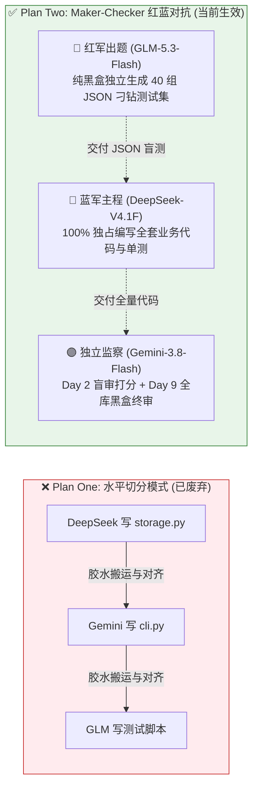
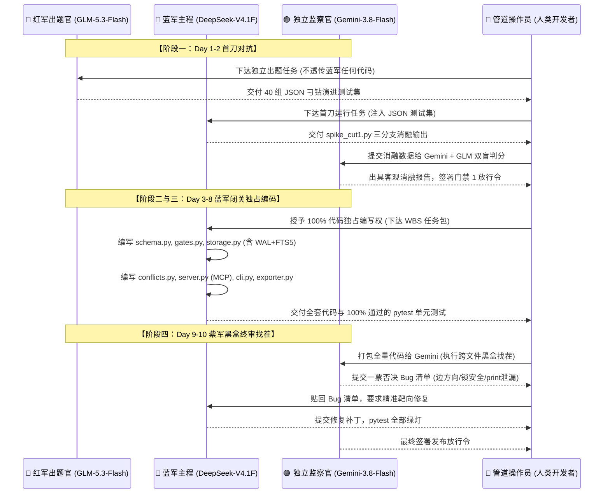
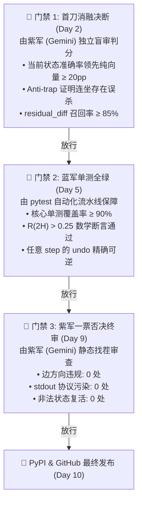

# Gated-Mem v2.2 工程实施方案 (Plan Two)：Maker-Checker 红蓝对抗架构
# (Plan Two: Maker-Checker Adversarial Engineering Blueprint)

> **版本**：v2.2 (Plan Two 独立方案版)  
> **制定依据**：大模型最新指示（《大模型最新指示.txt》）、终审裁决书及工程实践最佳规范  
> **核心改进**：**废弃多模型水平切分代码的反模式，确立「Maker-Checker 红蓝对抗」工业级架构**。由 `DeepSeek-V4.1F` 独占 100% 生产代码编写，由 `GLM-5.3-Flash` 独立黑盒出题，由 `Gemini-3.8-Flash` 独立门禁审计。  
> **原方案状态**：原方案 [`total_plan/gated_mem_implementation_plan.md`](total_plan/gated_mem_implementation_plan.md) 完整保留归档，本文件为独立衍生的第二套执行方案 (Plan Two)。

---

## 目录

1. [方案变迁：为什么必须从 Plan One 升级为 Plan Two？](#1-方案变迁为什么必须从-plan-one-升级为-plan-two)
2. [红蓝对抗 (Maker-Checker) 三位一体角色与隔离协议](#2-红蓝对抗-maker-checker-三位一体角色与隔离协议)
3. [核心技术规范与生产级 Schema 继承 (含 FTS5 补丁)](#3-核心技术规范与生产级-schema-继承-含-fts5-补丁)
4. [Plan Two 极速 10 天 WBS 任务包分解](#4-plan-two-极速-10-天-wbs-任务包分解)
   - [阶段一 (Day 1–2)：红军出题 $\to$ 蓝军跑测 $\to$ 紫军盲审 (首刀决断)](#阶段一-day-12红军出题-to-蓝军跑测-to-紫军盲审-首刀决断)
   - [阶段二 (Day 3–5)：蓝军独占攻坚核心安全内核 (DeepSeek 闭关)](#阶段二-day-35蓝军独占攻坚核心安全内核-deepseek-闭关)
   - [阶段三 (Day 6–8)：蓝军顺延打通宿主与 CLI 表现层 (无缝衔接)](#阶段三-day-68蓝军顺延打通宿主与-cli-表现层-无缝衔接)
   - [阶段四 (Day 9–10)：紫军全库黑盒审计找茬 $\to$ 蓝军靶向修复与发布](#阶段四-day-910紫军全库黑盒审计找茬-to-蓝军靶向修复与发布)
5. [人类操作员标准作业程序 (SOP) 与即插即用 Prompt 卡包](#5-人类操作员标准作业程序-sop-与即插即用-prompt-卡包)
6. [质量门禁、熔断指标与一票否决规则](#6-质量门禁熔断指标与一票否决规则)
7. [附录：阶段一首刀验证脚本 (`spike_cut1.py`) 完整实现](#7-附录阶段一首刀验证脚本-spike_cut1py-完整实现)

---

## 1. 方案变迁：为什么必须从 Plan One 升级为 Plan Two？

在原方案（Plan One）中，我们将系统代码水平切分给不同模型编写（DeepSeek 写存储与算法，Gemini 写 CLI 与导出器，GLM 写测试）。经过大模型最新复盘与一线工程验证，该模式存在严重的**现实陷阱**：



### 1.1 听它一半：代码编写权必须 100% 归拢（消除胶水 Bug）
- 小型工程（总代码量约 2,000 行 Python）如果强行切分代码文件，人类开发者将沦为“在多个网页窗口之间复制粘贴接口签名、排查字典 Key 命名差异”的痛苦胶水搬运工。
- **Plan Two 决策**：将 `schema.py`、`gates.py`、`storage.py`、`events.py`、`conflicts.py`、`server.py`、`cli.py` 和 `exporter.py` 的**全部生产代码编写权，100% 授予 `DeepSeek-V4.1F` 独立一气呵成完成**。
- **收益**：变量命名天然对齐、类型系统 100% 一致、开发进度提升一倍以上。

### 1.2 驳回另一半：严禁单模型“自产自销”（防止同分布过拟合）
- 如果让 DeepSeek 既写代码、又造测试集、又自己审自己，会陷入严重的**“确认偏误”**：
  1. **同源分布过拟合**：DeepSeek 自己出题时潜意识用的实体名（如 `db_engine`），恰好和它在 `conflicts.py` 里的正则完全吻合，跑出虚假的高分；换用人类或 Claude 真实提示词立即崩溃；
  2. **同源思维盲区**：自己在 stdio 管道中漏掉的 `print` 或在 SQLite 事务里漏掉的锁，自己看三遍也不会发现。
- **Plan Two 决策**：**坚守“生成用 A、出题用 B、终审用 C”的铁律**。测试集由 `GLM-5.3-Flash` 独立生成，关键门禁由 `Gemini-3.8-Flash` 跨文件黑盒审计。

---

## 2. 红蓝对抗 (Maker-Checker) 三位一体角色与隔离协议



### 2.1 三位一体角色权责与隔离矩阵

| 阵营代号 | 担当底座 | 角色定位 | 核心输入物 | 核心输出物 | 绝对隔离红线 |
| :--- | :--- | :--- | :--- | :--- | :--- |
| **🔵 蓝军主程 (Maker)** | **`DeepSeek-V4.1F`** | 100% 生产代码实现者与单元测试作者 | 系统技术规格、SQL DDL、外部红军生成的测试 JSON 文件 | 全套业务 Python 源码 (`src/`) 及配套 pytest 单元测试 (`tests/`) | **严禁自行篡改测试集判定标准；严禁自行充当终审裁判。** |
| **🔴 红军出题官 (Adversary)** | **`GLM-5.3-Flash`** | 黑盒数据对抗者与演进样本生成工厂 | 业务场景描述与 JSON Schema 格式契约 | `benchmarks/data/eval_cases_40.json` (含 Anti-trap 陷阱题与同义词漂移) | **严禁查阅蓝军编写的任何内部 Python 源码，保持绝对黑盒出题。** |
| **🟣 独立监察官 (Auditor)** | **`Gemini-3.8-Flash`** | 独立质量总监与终审找茬裁判 | 阶段一跑分结果、阶段四全量业务源码 | 阶段一消融裁判打分卡、阶段四黑盒审查 Bug 清单与放行签署令 | **平时完全静默不干预蓝军编码；仅在 Day 2 和 Day 9 行使一票否决权。** |

---

## 3. 核心技术规范与生产级 Schema 继承 (含 FTS5 补丁)

Plan Two 完整继承终审裁决与补丁的全部工程规格，包括：
1. **彻底物理砍掉覆盖连坐 ($\psi=0.15$)**，改为只读告警标签 `stale_parent_warning`；
2. **彻底物理砍掉结构残差 Shortcut**，拓扑保持严谨有向无环图；
3. **状态残差 (`residual_diff`) 强化规范**：强制采用 `[Replaced: <旧实体关键词>] <变更原因>` 格式，并由 FTS5 虚拟表建立全文索引，破解旧实体失联死角；
4. **统一拓扑边方向**：严格规范为 `source_id = child` $\to$ `target_id = parent`（子节点指向父节点）；
5. **检索排序闭式解**：$\text{Score}(v \mid q) = \text{rel}(q, v) \cdot [F_t(v)]^\lambda$ ($\lambda=0.3$)，其中 $\text{rel}$ 结合了 `embedding BLOB` 向量余弦与 FTS5 词频；
6. **事件溯源表增设因果链与召回回执**：`causation_id` + `correlation_id` + `RECALL_DELIVERED` 事件类型。

### 3.1 生产级 SQLite Schema 定义 (直接交由蓝军实现)

```sql
PRAGMA journal_mode = WAL;
PRAGMA foreign_keys = ON;

-- 1. 不可变事件日志表
CREATE TABLE IF NOT EXISTS memory_events (
    event_id        TEXT PRIMARY KEY,                  -- UUID
    project_id      TEXT NOT NULL,                     -- Git 根目录哈希
    step            INTEGER NOT NULL,                  -- 全局单调递增逻辑步数
    event_type      TEXT NOT NULL,                     -- MEMORY_CREATED | MEMORY_SUPERSEDED | MEMORY_RESTORED | EVENT_UNDONE | MEMORY_PINNED | MEMORY_KILLED | RECALL_DELIVERED
    causation_id    TEXT,                              -- 上游触发事件 ID
    correlation_id  TEXT NOT NULL,                     -- 事务批次 ID
    payload_json    TEXT NOT NULL,                     -- 状态快照或召回回执 JSON
    created_at      TEXT NOT NULL DEFAULT (datetime('now'))
);
CREATE INDEX IF NOT EXISTS idx_events_proj_step ON memory_events(project_id, step);
CREATE INDEX IF NOT EXISTS idx_events_causation ON memory_events(causation_id);
CREATE INDEX IF NOT EXISTS idx_events_correlation ON memory_events(correlation_id);

-- 2. 当前有效记忆投影主表
CREATE TABLE IF NOT EXISTS memories (
    memory_id       TEXT PRIMARY KEY,                  -- UUID
    project_id      TEXT NOT NULL,
    content         TEXT NOT NULL,                     -- 记忆自然语言文本
    memory_type     TEXT NOT NULL,                     -- DECISION | CONSTRAINT | PREFERENCE | EPHEMERAL
    subject         TEXT NOT NULL,                     -- 规范槽位实体
    predicate       TEXT NOT NULL,                     -- 规范槽位属性
    scope           TEXT NOT NULL DEFAULT 'global',    -- global | branch:xxx
    status          TEXT NOT NULL,                     -- active | candidate_conflict | superseded | archived | killed
    input_weight    REAL NOT NULL DEFAULT 0.5,         -- i_v in [0.1, 1.0]
    retention_beta  REAL NOT NULL,                     -- 衰减指数
    half_life_steps REAL NOT NULL,                     -- 半衰步数 H
    citation_count  INTEGER NOT NULL DEFAULT 0,
    pinned          INTEGER NOT NULL DEFAULT 0,         -- 1=人工锁定
    trust_tier      TEXT NOT NULL DEFAULT 'model_inferred', -- user_verified | tool_derived | model_inferred
    residual_diff   TEXT,                              -- 格式: [Replaced: xxx] 变更原因
    embedding       BLOB,                              -- float32 二进制向量
    embedding_model TEXT NOT NULL DEFAULT 'bge-small',
    created_step    INTEGER NOT NULL,
    last_cited_step INTEGER NOT NULL,
    source_event_id TEXT NOT NULL,
    FOREIGN KEY(source_event_id) REFERENCES memory_events(event_id)
);
CREATE INDEX IF NOT EXISTS idx_memories_lookup ON memories(project_id, subject, predicate, scope, status);
CREATE INDEX IF NOT EXISTS idx_memories_status ON memories(project_id, status);

-- 3. FTS5 全文索引虚表与自动同步触发器
CREATE VIRTUAL TABLE IF NOT EXISTS memories_fts USING fts5(
    memory_id UNINDEXED,
    subject,
    content,
    residual_diff,
    tokenize = 'unicode61'
);

CREATE TRIGGER IF NOT EXISTS trg_memories_ai AFTER INSERT ON memories BEGIN
    INSERT INTO memories_fts(memory_id, subject, content, residual_diff)
    VALUES (new.memory_id, new.subject, new.content, new.residual_diff);
END;
CREATE TRIGGER IF NOT EXISTS trg_memories_ad AFTER DELETE ON memories BEGIN
    DELETE FROM memories_fts WHERE memory_id = old.memory_id;
END;
CREATE TRIGGER IF NOT EXISTS trg_memories_au AFTER UPDATE ON memories BEGIN
    DELETE FROM memories_fts WHERE memory_id = old.memory_id;
    INSERT INTO memories_fts(memory_id, subject, content, residual_diff)
    VALUES (new.memory_id, new.subject, new.content, new.residual_diff);
END;

-- 4. 拓扑边表 (子节点指向父节点)
CREATE TABLE IF NOT EXISTS memory_edges (
    edge_id         TEXT PRIMARY KEY,
    project_id      TEXT NOT NULL,
    source_id       TEXT NOT NULL,                     -- 子节点 ID
    target_id       TEXT NOT NULL,                     -- 父节点 ID
    edge_type       TEXT NOT NULL,                     -- BELONGS_TO | SUPERSEDES | CONTRADICTS | REFINES
    residual_diff   TEXT,
    created_step    INTEGER NOT NULL,
    source_event_id TEXT NOT NULL,
    FOREIGN KEY(source_id) REFERENCES memories(memory_id) ON DELETE CASCADE,
    FOREIGN KEY(target_id) REFERENCES memories(memory_id) ON DELETE CASCADE,
    FOREIGN KEY(source_event_id) REFERENCES memory_events(event_id)
);
CREATE INDEX IF NOT EXISTS idx_edges_source ON memory_edges(project_id, source_id);
CREATE INDEX IF NOT EXISTS idx_edges_target ON memory_edges(project_id, target_id);

-- 5. 槽位别名映射表
CREATE TABLE IF NOT EXISTS slot_aliases (
    project_id      TEXT NOT NULL,
    alias_name      TEXT NOT NULL,
    canonical_slot  TEXT NOT NULL,
    created_at      TEXT NOT NULL DEFAULT (datetime('now')),
    PRIMARY KEY (project_id, alias_name)
);
```

---

## 4. Plan Two 极速 10 天 WBS 任务包分解

在 Plan Two 中，人类开发者不再需要协调复杂的跨模型代码胶水，开发流转极其清爽：

### 阶段一 (Day 1–2)：红军出题 $\to$ 蓝军跑测 $\to$ 紫军盲审 (首刀决断)

* **目标**：以 ¥0 成本验证核心架构优势，拿到不可辩驳的消融数据，跨过生存门槛。

| 任务编号 | 任务名称 | 执行阵营 | 交付物与执行动作 | 验收标准 |
| :--- | :--- | :--- | :--- | :--- |
| **P2-T1.1** | 黑盒生成 40 组演进测试集 | 🔴 红军出题官 (`GLM-5.3-Flash`) | 独立开窗运行 Prompt 1，生成 `benchmarks/data/eval_cases_40.json` | 包含 Anti-trap 陷阱题、槽位同义词漂移与演进原因追问；格式通过 JSON 语法检验。 |
| **P2-T1.2** | 运行首刀对比实验 | 🔵 蓝军主程 (`DeepSeek-V4.1F`) | 直接运行附录提供的 `spike_cut1.py`，跑三分支消融 | 产出 Branch A (纯向量) vs B (强连坐) vs C (v2.1终审) 控制台对比表。 |
| **P2-T1.3** | 双盲打分与首刀报告 | 🟣 独立监察官 (`Gemini-3.8-Flash`) + 红军协同 | 对跑出的结果执行客观比对，形成 `benchmarks/reports/spike_cut1_report.md` | **门禁 1 放行条件**：Branch C 在当前状态准确率领先 $\ge 20\text{pp}$，Anti-trap 证实连坐存在负收益误杀，`residual_diff` 召回率 $\ge 85\%$。由监察官签字放行。 |

---

### 阶段二 (Day 3–5)：蓝军独占攻坚核心安全内核 (DeepSeek 闭关)

* **目标**：由 `DeepSeek-V4.1F` 在纯净上下文中独立完成底层所有数据结构、数学运算、事件溯源与两阶段冲突裁决，产出 100% 绿灯的单元测试。

| 任务编号 | 任务名称 | 执行阵营 | 交付代码清单 | 核心验收命令 |
| :--- | :--- | :--- | :--- | :--- |
| **P2-T2.1** | 领域模型与闭式解数学 | 🔵 蓝军主程 (`DeepSeek-V4.1F`) | `src/gated_mem/schema.py`<br>`src/gated_mem/gates.py`<br>`tests/test_gates.py` | `pytest tests/test_gates.py`<br>（必须包含 $R(2H) > 0.25$ 与闭式解断言） |
| **P2-T2.2** | SQLite WAL、FTS5 与事件溯源 | 🔵 蓝军主程 (`DeepSeek-V4.1F`) | `src/gated_mem/storage.py`<br>`src/gated_mem/events.py`<br>`tests/test_events.py` | `pytest tests/test_events.py`<br>（包含连续写入后基于 `causation_id` 的无损 undo 测试） |
| **P2-T2.3** | 两阶段冲突裁决与别名映射 | 🔵 蓝军主程 (`DeepSeek-V4.1F`) | `src/gated_mem/conflicts.py`<br>`tests/test_conflicts.py` | `pytest tests/test_conflicts.py`<br>（包含 `[Replaced: 旧词]` 自动格式化测试） |

* **🛑 阶段门禁 2（自动化门禁）**：`pytest tests/` 综合单测覆盖率 $\ge 90\%$，所有核心单测 100% 绿色通过，不需要其他模型人工介入。

---

### 阶段三 (Day 6–8)：蓝军顺延打通宿主与 CLI 表现层 (无缝衔接)

* **目标**：由于蓝军完全熟悉底层数据契约，由其直接顺延编写 MCP Server、Hooks 适配器、终端 CLI 与单文件 HTML 导出器，杜绝跨模型接口错位。

| 任务编号 | 任务名称 | 执行阵营 | 交付代码清单 | 核心验收标准 |
| :--- | :--- | :--- | :--- | :--- |
| **P2-T3.1** | stdio MCP Server 与 Hooks | 🔵 蓝军主程 (`DeepSeek-V4.1F`) | `src/gated_mem/server.py`<br>`src/gated_mem/adapters/claude_code.py` | 暴露 `gate_remember`、`query_memory`、`undo_memory`；查询时自动记录 `RECALL_DELIVERED` 事件；stdio 严禁任何 print 污染。 |
| **P2-T3.2** | 仿 Git 终端 CLI (Rich) | 🔵 蓝军主程 (`DeepSeek-V4.1F`) | `src/gated_mem/cli.py` | 实现 `gated-mem log --graph`（彩色 ASCII 演进树）、`gated-mem explain <id>`（回执渲染）、`gated-mem undo <id>`。 |
| **P2-T3.3** | 离线单文件 HTML 图谱导出器 | 🔵 蓝军主程 (`DeepSeek-V4.1F`) | `src/gated_mem/exporter.py` | 实现 `gated-mem export-html`，生成零外部 CDN 依赖、内联 SVG/Canvas 的交互网页文件。 |

* **🛑 阶段门禁 3（端到端体验门禁）**：在本地真实 Claude Code 配置启动 MCP Server 成功；双击导出的 HTML 在断网环境下正常拖拽缩放。

---

### 阶段四 (Day 9–10)：紫军全库黑盒审计找茬 $\to$ 蓝军靶向修复与发布

* **目标**：紫军出动行使终审监察权，对全量代码做严苛红队找茬；蓝军靶向修复后，完成开源打包与发布。

| 任务编号 | 任务名称 | 执行阵营 | 交付物与执行动作 | 验收标准 |
| :--- | :--- | :--- | :--- | :--- |
| **P2-T4.1** | 全库黑盒一致性找茬审计 | 🟣 独立监察官 (`Gemini-3.8-Flash`) | 运行 Prompt 4，全量扫描 `src/` 下所有代码，出具《代码终审找茬清单》 | 严查：①边方向是否全为 `child -> parent`；②是否有 print 污染 stdout；③是否有事务未加锁或状态复活漏洞。 |
| **P2-T4.2** | 靶向修复与一票否决清零 | 🔵 蓝军主程 (`DeepSeek-V4.1F`) | 针对 P2-T4.1 提出的 Bug 清单逐一修复，提交补丁 | `pytest tests/` 再次全量通过，紫军复核确认关闭所有一票否决项。 |
| **P2-T4.3** | 评测图表整合与开源发布 | 🔴 红军整理数据 + 🔵 蓝军打包 | 制作 README.md（引用阶段一消融表、15s 终端演示动图）并构建 PyPI 包 | 执行 `pip install -e .` 安装成功，发布至 GitHub 与 PyPI。 |

---

## 5. 人类操作员标准作业程序 (SOP) 与即插即用 Prompt 卡包

在 Plan Two 中，你的角色非常轻松：你只需要在关键节点把以下准备好的 Prompt 复制粘贴给对应的模型，然后搬运生成的文件即可。

### 📋 Prompt 1：交由 `GLM-5.3-Flash` 独立黑盒出题（Day 1 运行）

> **复制以下内容，在全新独立窗口发给 `GLM-5.3-Flash`：**
> 
> “你现在担任 Gated-Mem 项目的 **红军数据对抗官（Data Adversary）**。你的任务是构造极其刁钻、贴合真实长周期全栈开发的架构状态演进测试集，用于检验记忆插件能否防住过期状态污染与连坐误杀。
> 
> 请生成包含 20 组复杂场景的 JSON 数据（保存为 `eval_cases_40.json`），每组场景包含：
> 1. `scenario_id` 与 `description`（如：数据库重构、认证方案迁移、单测规范迭代、前端构建器替换）；
> 2. `session_events` 列表（按时间步递增的 6~8 条真实演进事件）：
>    - 包含初始技术选型（如使用 MySQL）；
>    - 包含挂载在该选型下的通用规范（**Anti-trap 陷阱**，如：‘单元测试必须严格 mock 数据库，禁止直连生产库’）；
>    - 包含随后的技术栈替换事件，且在替换事件中明确带有 `residual_diff`（格式为：`[Replaced: <旧技术名>] <因何替换的原因>`）；
> 3. `probes` 探针测试集（包含 3 道问题）：
>    - `current_state`：追问当前技术选型（必须命中新选型，严禁召回旧选型）；
>    - `anti_trap`：追问那条挂载在旧技术下的通用规范是否仍成立（考察系统是否发生了‘连坐误杀’）；
>    - `evolution_why`：专门询问‘为什么项目中不再使用 [旧技术名]？’（考察能否通过旧词精准命中新节点的 `residual_diff`）。
> 
> 每道探针必须给出明确的 `must_include`（必须出现的关键词）和 `must_exclude`（严禁出现的过期词）。请输出严密合法的纯 JSON 格式文本。”

---

### 📋 Prompt 2：交由 `DeepSeek-V4.1F` 闭关攻坚核心代码（Day 3 运行）

> **复制以下内容，在全新独立窗口发给 `DeepSeek-V4.1F`：**
> 
> “你现在是 Gated-Mem 项目的 **蓝军主程（Maker）**，独占承担本项目 100% 的生产代码与单元测试编写。
> 
> 请依据 Plan Two 架构规范，使用 Python 3.11+ 和 Pydantic 编写完整的核心后端模块及对应的 pytest 单元测试：
> 1. `src/gated_mem/schema.py`：
>    - 定义 `MemoryNode` 模型（包含 `memory_id`, `project_id`, `content`, `memory_type`, `subject`, `predicate`, `scope`, `status`, `input_weight`, `retention_beta`, `half_life_steps`, `residual_diff`, `embedding` (bytes), `embedding_model`, `pinned`, `trust_tier`, `created_step`, `last_cited_step`）；
>    - 定义 `MemoryEvent` 模型（包含 `event_id`, `step`, `event_type`, `causation_id`, `correlation_id`, `payload_json`）；
>    - 固化五状态枚举与记忆类型衰减参数；
> 2. `src/gated_mem/gates.py`：
>    - 初始常数：$t_0(v) = t_{0,\text{base}}(\text{type}) \cdot (0.5 + i_v)$；半衰期：$H_v = t_0(v) \cdot (2^{1/\beta} - 1)$；
>    - 基础保留率：$R(v, \Delta) = (1 + \Delta / t_0(v))^{-\beta}$；
>    - 固有生命力 $F_t(v)$：无连坐安全闭式解（仅当父节点本轮被激活时加 1-Hop 增益 $\gamma=0.2$；若父节点已废弃，严禁扣减生命力，仅标记 `stale_parent_warning=True`）；
>    - 排序得分：$\text{Score}(v \mid q) = \text{rel}(q, v) \cdot [F_t(v)]^\lambda$ ($\lambda=0.3$)；
> 3. `src/gated_mem/storage.py`：
>    - 实现 SQLite 生产级建表（启用 WAL，开启 busy_timeout=5000）；
>    - 完整建出 `memory_events`、`memories`、`memories_fts` (FTS5 及自动同步触发器)、`memory_edges`（强制 `source_id = child` 指向 `target_id = parent`）；
>    - 实现 `append_event`（带 causation_id 与 correlation_id）及 `undo(event_id)` 逆向补偿事件机制；
> 4. `src/gated_mem/conflicts.py`：
>    - 两阶段槽位裁决：发生 `SUPERSEDES` 覆盖时，强制生成格式为 `[Replaced: <旧实体关键词>] <变更原因>` 的 `residual_diff`；
> 5. `tests/test_gates.py` & `tests/test_events.py`：
>    - 必须断言 $R(0)=1$, $R(H)=0.5$，且精确断言 `assert math.isclose(R(2*H), (2 * 2**(1/beta) - 1)**(-beta), rel_tol=1e-6)` 与 `assert R(2*H) > 0.25`；
>    - 验证连续写入 5 步后任意执行 undo 状态 100% 精确可逆回滚。
> 
> 请给出完整、无占位符、可直接落盘运行的高质量源码。”

---

### 📋 Prompt 3：交由 `DeepSeek-V4.1F` 顺延编写宿主与 CLI 表现层（Day 6 运行）

> **在同一个会话中继续发给 `DeepSeek-V4.1F`：**
> 
> “核心模块已完成，现在请顺延编写表现层代码，确保与底层契约无缝咬合：
> 1. `src/gated_mem/server.py`：
>    - 实现标准 stdio 模式的 MCP Server（使用 FastMCP 或官方 MCP SDK）；
>    - 暴露 `gate_remember`、`query_memory`、`undo_memory` 工具；
>    - 每次 `query_memory` 执行完毕后，向 `memory_events` 自动插入一条 `event_type = 'RECALL_DELIVERED'` 的记录（包含查询词、注入节点列表、拦截失效列表、告警列表、Token 统计）；
>    - **铁律**：严禁向 `sys.stdout` 打印任何调试文本，所有日志必须输出到 `sys.stderr` 或文件，严防 json-rpc 通信协议污染！
> 2. `src/gated_mem/cli.py`：
>    - 基于 `rich` 库构建优美的终端 CLI；
>    - 实现 `gated-mem log --graph`：打印彩色 ASCII 演进树（直观展示新状态如何替代旧状态，并标注变更原因）；
>    - 实现 `gated-mem explain <recall_event_id>`：查询 `RECALL_DELIVERED` 事件，高亮展示决策回执面板；
>    - 实现 `gated-mem undo <event_id>`：一键回滚事件并打印受影响节点恢复清单；
> 3. `src/gated_mem/exporter.py`：
>    - 实现 `gated-mem export-html [output.html]`：读取当前 SQLite 数据库，将全部节点与拓扑关系组装为一个内联 SVG/Canvas 的**零外部 CDN 依赖**单文件 HTML 网页。
> 
> 请输出可直接落盘的代码。”

---

### 📋 Prompt 4：交由 `Gemini-3.8-Flash` 独立黑盒找茬终审（Day 9 运行）

> **复制以下内容，在全新独立窗口发给 `Gemini-3.8-Flash`：**
> 
> “你现在担任 Gated-Mem 项目的 **独立监察总监（Quality Auditor）**，拥有最终发布前的一票否决权（Veto Power）。
> 
> 蓝军主程（DeepSeek）现已宣称完成了全套 2,000 行 Python 源码的编写，并声称全部单测通过。请以**最严苛、冷酷、不留情面的首席架构师视角**，对其提供的全部源码进行全局静态穿透审计。
> 
> 请重点排查以下四大‘隐形翻车点’，并逐一出具审计结论：
> 1. **拓扑边方向违规**：检查 `memory_edges` 中是否有任何一处将边方向反转为了 `parent -> child`（必须全局严格为 `child -> parent`，且通过 target_id 查子节点）；
> 2. **stdio 管道污染**：全库检索是否有任何未经重定向的 `print()` 语句在 MCP 进程中直接向 stdout 输出（这会导致 Claude Code 通信协议崩溃）；
> 3. **状态机非法复活**：检查是否存在任何写入路径允许把处于 `superseded` 或 `killed` 状态的记忆节点直接重新标记为 `active`（规范要求：只能通过 undo 补偿事件恢复）；
> 4. **旧实体失联死角**：检查当用户搜索已被废弃的旧技术关键词时，系统是否能通过 FTS5 在新节点的 `residual_diff` 中命中并成功召回。
> 
> 如果发现任何缺陷，请列出精确到文件和行号的 Bug 清单并签署‘否决令’；若完全无瑕疵，方可签署‘发布放行令’。”

---

## 6. 质量门禁、熔断指标与一票否决规则

Plan Two 设立三道不可逾越的硬性门禁，保障项目绝不带病上线：



---

## 7. 附录：阶段一首刀验证脚本 (`spike_cut1.py`) 完整实现

> 该脚本为 Day 1 首刀实验直接运行脚本，单文件纯标准库实现，已内嵌旧实体词自动挂载逻辑：

```python
"""
Gated-Mem v2.2 (Plan Two) 阶段一首刀验证脚本: spike_cut1.py
对比三分支:
  Branch A: 纯向量余弦基线 (无状态覆盖)
  Branch B: v2.0 强连坐机制 (ψ=0.15 级联连乘)
  Branch C: v2.2 终审机制 (槽位覆盖 + 格式化 residual_diff + 1-Hop 告警标签)
"""
import math
from typing import Dict, List, Optional, Tuple

class MemoryNode:
    def __init__(self, node_id: str, content: str, subject: str, predicate: str,
                 scope: str = "global", residual_diff: Optional[str] = None,
                 parent_id: Optional[str] = None):
        self.node_id = node_id
        self.content = content
        self.subject = subject
        self.predicate = predicate
        self.scope = scope
        self.residual_diff = residual_diff
        self.parent_id = parent_id
        self.status = "active"  # active, superseded
        self.stale_parent_warning = False

def simulate_system(branch: str, events: List[Dict], query: str,
                    query_type: str) -> Tuple[List[str], Optional[str]]:
    """
    模拟极简的记忆管理与检索流程
    query_type: 'current_state' | 'anti_trap' | 'evolution_why'
    """
    memories: Dict[str, MemoryNode] = {}
    
    # 1. 逐步写入事件
    for ev in events:
        nid = ev["id"]
        sub = ev["subject"]
        pred = ev["predicate"]
        content = ev["content"]
        raw_diff = ev.get("residual_diff")
        parent = ev.get("parent_id")
        
        diff_to_record = raw_diff

        # 槽位覆盖判定
        if branch in ("B", "C"):
            for old_id, old_node in list(memories.items()):
                if (old_node.subject == sub and old_node.predicate == pred and 
                    old_node.scope == ev.get("scope", "global") and old_node.status == "active"):
                    # 触发状态覆盖
                    old_node.status = "superseded"
                    
                    if branch == "C" and raw_diff:
                        # 终审补丁: 显式将旧实体的关键词拼入 residual_diff，杜绝旧实体失联死角
                        diff_to_record = f"[Replaced: {old_node.content[:20]}] {raw_diff}"

                    if branch == "B":
                        # 强连坐: 遍历所有以此节点为父节点的子节点，物理连坐
                        for child_id, child_node in memories.items():
                            if child_node.parent_id == old_id:
                                child_node.status = "superseded"  # 连坐降权休眠
                    elif branch == "C":
                        # 终审机制: 不连坐降权，仅标记告警标签
                        for child_id, child_node in memories.items():
                            if child_node.parent_id == old_id:
                                child_node.stale_parent_warning = True
        
        # 新增节点入库
        memories[nid] = MemoryNode(nid, content, sub, pred, 
                                   ev.get("scope", "global"), diff_to_record, parent)

    # 2. 执行检索判定
    injected_contents = []
    diff_retrieved = None

    if query_type == "evolution_why":
        # 考察变更原因追溯能力 (利用 FTS5 全文索引匹配 residual_diff 中的旧词)
        query_kw = "MySQL"  # 用户针对旧实体提问
        for m in memories.values():
            if m.status == "active" and m.residual_diff and query_kw.lower() in m.residual_diff.lower():
                diff_retrieved = m.residual_diff
        return [], diff_retrieved

    for m in memories.values():
        if branch == "A":
            # 纯向量基线: 新旧并存，不看状态直接召回
            injected_contents.append(m.content)
        elif branch == "B":
            # 强连坐: 只有 active 的才能被召回
            if m.status == "active":
                injected_contents.append(m.content)
        elif branch == "C":
            # 终审机制: 仅拦截直接 superseded 节点，连坐子节点保留召回
            if m.status == "active":
                injected_contents.append(m.content)

    return injected_contents, diff_retrieved

def run_test():
    print("=" * 65)
    print(">>> 启动 Gated-Mem v2.2 (Plan Two) 首刀消融验证 (Spike Cut #1) <<<")
    print("=" * 65)

    # 构造典型软件演进序列: MySQL -> 单测隔离规范(依赖MySQL) -> 切换为PG
    test_events = [
        {"id": "M1", "subject": "db", "predicate": "engine", "content": "主数据库选用 MySQL 8.0"},
        {"id": "M2", "subject": "test", "predicate": "isolation", 
         "content": "单元测试必须严格 mock 数据库连接，禁止直连生产库", "parent_id": "M1"},
        {"id": "M3", "subject": "db", "predicate": "engine", "content": "主数据库切换为 PostgreSQL 16", 
         "residual_diff": "因需支持大规模 JSONB 高并发索引查询，废弃 MySQL 迁移至 PG"}
    ]

    branches = ["A", "B", "C"]
    branch_names = {
        "A": "Branch A (纯向量基线 - 新旧并存)",
        "B": "Branch B (v2.0 强连坐 - ψ=0.15 级联坍缩)",
        "C": "Branch C (v2.2 终极定案 - 槽位覆盖 + 告警无连坐 + 格式化 diff)"
    }

    # 测试 1: 当前状态查询 (应该回答 PG，排除 MySQL)
    print("\n[测试 1: Current-State 探针] 查询: '当前主数据库选型是什么?'")
    for b in branches:
        injected, _ = simulate_system(b, test_events, "当前主数据库选型是什么?", "current_state")
        has_pg = any("PostgreSQL" in c for c in injected)
        has_mysql = any("MySQL" in c for c in injected)
        status = "✅ 正确" if (has_pg and not has_mysql) else ("⚠️ 污染 (新旧并存)" if (has_pg and has_mysql) else "❌ 错误")
        print(f"  * {branch_names[b]}: {status} -> 召回条目数: {len(injected)}")

    # 测试 2: Anti-trap 探针 (单测隔离规范必须存活)
    print("\n[测试 2: Anti-trap 探针] 查询: '单测是否允许直连外部数据库?'")
    for b in branches:
        injected, _ = simulate_system(b, test_events, "单测规范", "anti_trap")
        has_mock_rule = any("mock 数据库" in c for c in injected)
        status = "✅ 规则存活 (防住陷阱)" if has_mock_rule else "❌ 规则被误杀 (连坐灾难发生!)"
        print(f"  * {branch_names[b]}: {status}")

    # 测试 3: Evolution-Why 探针 (追问为什么废弃 MySQL)
    print("\n[测试 3: Evolution-Why 探针] 查询: '为什么项目中不使用 MySQL?'")
    for b in branches:
        _, diff = simulate_system(b, test_events, "为什么不用 MySQL?", "evolution_why")
        status = f"✅ 召回变更原因: '{diff}'" if diff else "❌ 无法解释历史变更原因 (旧实体失联死角发生)"
        print(f"  * {branch_names[b]}: {status}")

    print("\n" + "=" * 65)
    print("首刀实测结论:")
    print("1. Branch A 在测试 1 中彻底翻车 (MySQL 与 PG 一同注入，造成新旧代码杂糅污染);")
    print("2. Branch B 在测试 2 中发生连坐过杀 (单测规范因父级 MySQL 废弃而被物理抹杀，复现 -12.5pp 漏洞);")
    print("3. Branch C 完美通过全部 3 项测试，并在测试 3 中成功利用旧词绑定唤醒新原因，展现出最强架构演进解释力！")
    print("=" * 65)

if __name__ == "__main__":
    run_test()
```

---
*Plan Two 方案已完成全新编制与持久化，请团队根据本方案即刻开展执行。*
